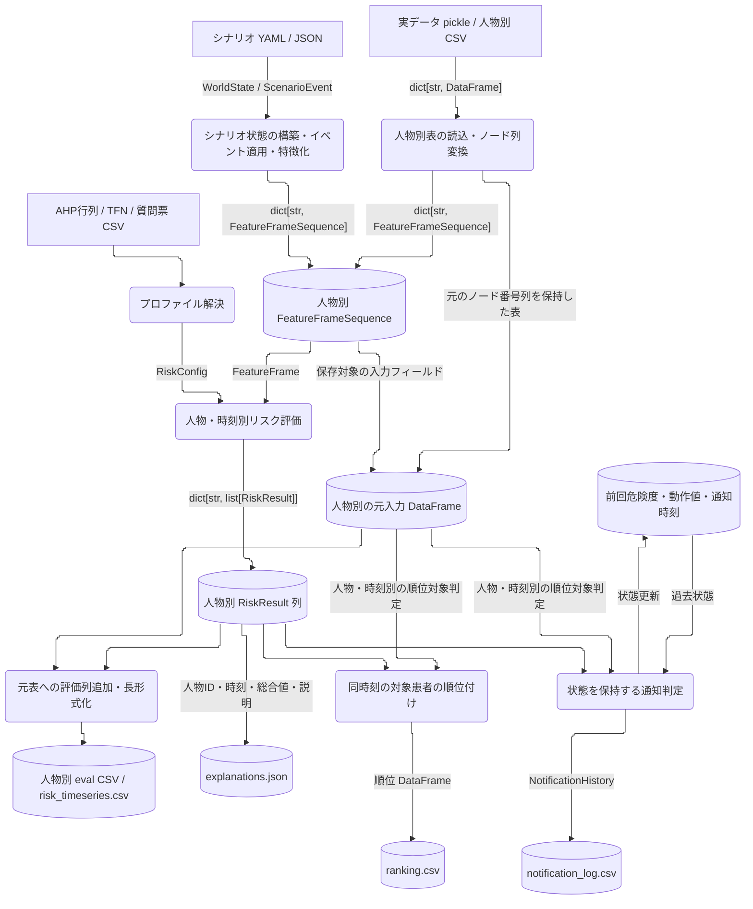
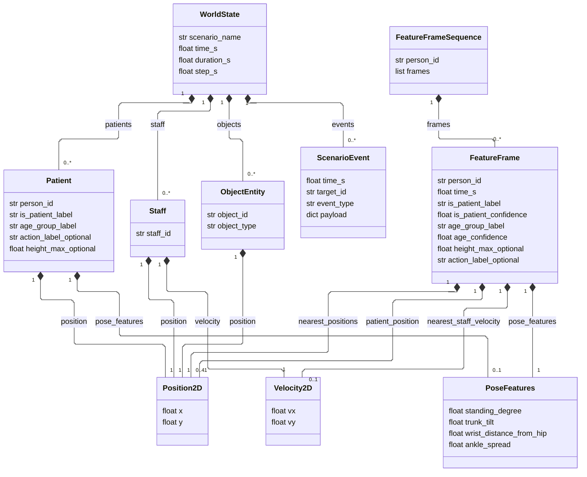
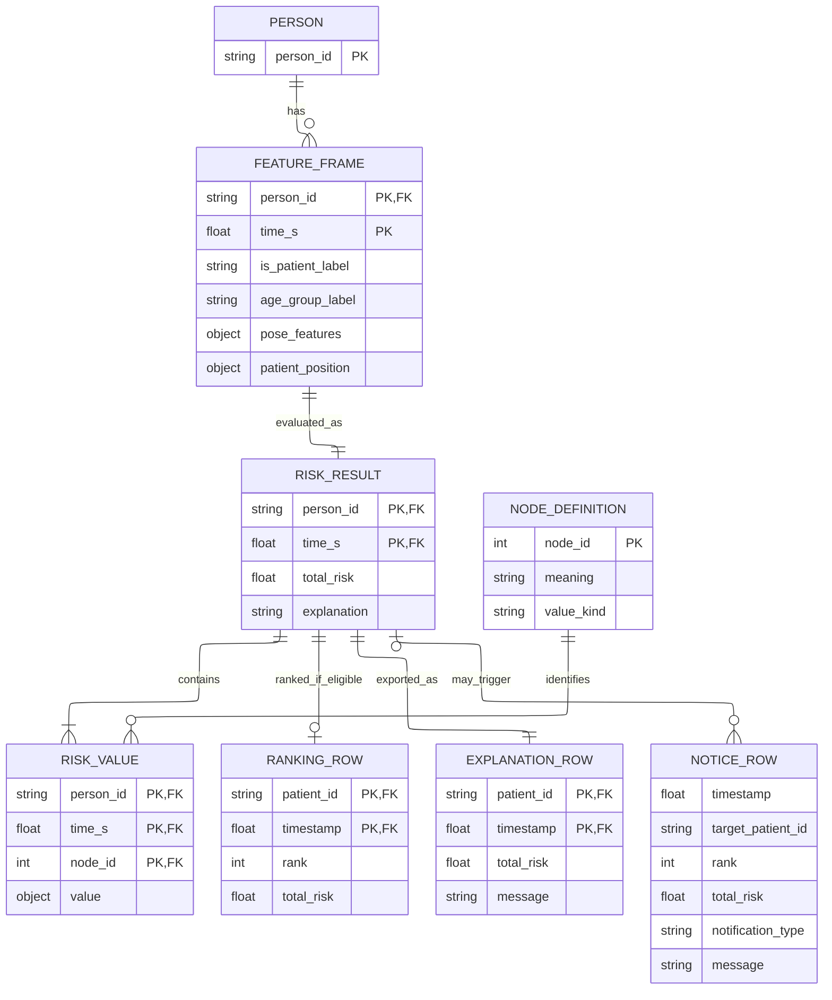
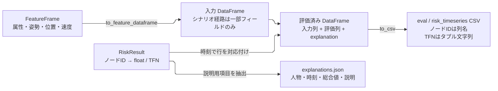

# データ型仕様書

更新日：2026-10-12

## 1. 対象と表記

[現行システムのアーキテクチャ](system_architecture.md) に登場する入力、内部データ契約、設定、評価結果、保存データを対象に、現行コードの型・既定値・変換規則を整理する。新構成 `risk_core / scenario_sim / real_data` を中心とし、旧ノード番号DataFrameとの接続を含む。センサ生データや旧リアルタイム処理固有の全形式を定義する文書ではない。

型はPythonの表記を用いる。`T | None` は値なしを許容し、`tuple[T, ...]` は可変長のタプルを表す。CSV/JSONにはPythonの型情報が保存されないため、内部型と保存表現を区別する。以下の値域・入力条件は、明示した例外を除き入力側で守る条件であり、dataclassが自動検証する条件ではない。

### 1.1 データフロー図（DFD）

以下はデータ契約に着目したDFDである。四角は外部入力、角丸は変換処理、円筒はファイルまたはメモリ上のデータ集合を表す。矢印のラベルは受け渡すデータ型で、処理の実行順や別プロセスへの通信を表すものではない。



主な境界は `FeatureFrame`（第4節）と `RiskResult`（第7節）。元入力表も出力処理へ渡すため、評価結果だけでは保存表の入力列や順位対象を決められない。通知にはこの図のデータに加えてrunnerからスタッフ人数が渡る。メモリ上の通知状態は通常の保存成果物に含まれない。

### 1.2 内部データ型の構成関係

以下のクラス図は、型がどの値を内包するかを示す。`1` は必須1個、`0..1` は任意1個、`0..*` は0個以上。`frozen=True` のdataclassでも内包するlist/dictは変更可能であり、この図の構成関係が完全な不変性を保証するわけではない。



図中の `_optional` は任意項目を示すための表記で、実際のフィールド名には付かない。`nearest_positions` も図用の総称であり、実際は点滴・車椅子・手すり・スタッフの4個の独立した任意フィールド（第4.1節）である。`WorldState.events` の注釈は `tuple[object, ...]` だが、通常loaderが作る実体は `ScenarioEvent`。イベントの `target_id` は種別に応じた人物・スタッフ・物体IDを参照する。

特徴化で選ばれた最近傍物体・スタッフについて、`FeatureFrame` は位置・速度を持つが、その物体ID・スタッフIDは保持しない。そのため、この型だけで最近傍対象のIDを追跡することはできない。

### 1.3 評価結果と出力の論理ER図

以下は実際のDBテーブル定義ではなく、dataclass・辞書・CSV/JSON間の論理的な対応をER図で表したもの。`PERSON` と `RISK_VALUE` は説明用のエンティティである。`PK` / `FK` は対応付けに使う論理キーを示し、コードで一意制約・外部キー制約が実装されているという意味ではない。



この図は、人物・時刻が重複しない通常入力を前提とする。対応は `person_id ↔ patient_id ↔ target_patient_id`、`time_s ↔ timestamp`。評価は入力1フレームに対して結果1個を返し、その結果にノードID別の値を格納する。`RISK_VALUE.value` は動作・物体・スタッフ・上位ノードでは `float`、属性2ノードではTFNとなる（第7節）。実際の保存CSVではノード別の行ではなく、ノード番号を列名にした横持ち表になる。

順位行は対象患者の結果のみから作る。説明JSONは順位対象外も含め各結果から作る。`NOTICE_ROW` は通知CSVの1行を表し、通常通知では人物・時刻で結果と対応する。一方、応援要請 `help` は複数患者を対象とし、IDは空文字列・順位は0のため、特定の `RiskResult` 1個を参照する関係にはならない。

### 1.4 内部型から保存表現への変換



この変換では情報量が変わる。特にシナリオ入力表には最近傍位置・スタッフ速度等が残らず、TFNはCSV内で型付きタプルとして保持されない。各ファイルの正確な列定義は第9節を参照する。図の矢印はデータ変換を表し、逆変換による完全復元を保証しない。

## 2. 共通の基本型

| 型・値 | 構造／意味 | 単位・条件 |
|---|---|---|
| 人物・スタッフ・物体ID | `str` | 人物別辞書のキーも文字列。先頭ゼロ等を意味のある文字列として扱う |
| 時刻 | `float`：`time_s`、保存時は `timestamp` | 秒。実データの時間原点は入力に依存し、日時型ではない |
| `Position2D` | `x: float`, `y: float` | 同一平面座標系の位置。距離正規化がmを使うためmに揃える。座標原点・軸方向は型に保持しない |
| `Velocity2D` | `vx: float`, `vy: float` | 移動ベクトル。シナリオでは速度として扱う。実データでは前処理由来の変位の場合があり、型でm/sを保証しない。方向評価は向きを使う |
| `PoseFeatures` | 下表の4個の `float` | 動作テンプレートと比較する特徴量。角度の度数等への自動換算はない |
| 三角型数（TFN） | `tuple[float, float, float]` | `(l, c, r)`：左端・中心・右端。通常 `0 ≤ l ≤ c ≤ r ≤ 1`。未知属性にはNaNを含む |
| スカラーリスク | `float` | 通常 `[0, 1]`。物理量や確率としての単位はない |
| 信頼度 | `float` | 通常 `[0, 1]`。現行の総合リスク式では属性信頼度を使わない |

| `PoseFeatures` フィールド | 意味 | 備考 |
|---|---|---|
| `standing_degree` | 立位度 | `as_tuple()` の第1成分 |
| `trunk_tilt` | 体幹傾斜の特徴 | 第2成分 |
| `wrist_distance_from_hip` | 腰から手首までの距離の特徴 | 第3成分。世界座標の距離とは別の姿勢特徴 |
| `ankle_spread` | 足首間の開きの特徴 | 第4成分 |

4成分の厳密な値域は型定義で制限されない。有限値を基本とし、実データとpresetで同じ特徴量定義を使う。位置・速度・姿勢型は `frozen=True` のdataclassである。

実装：[基本型](../master_thesis_modules/risk_core/features/position.py)、[姿勢型](../master_thesis_modules/risk_core/features/pose_features.py)。

## 3. シナリオ入力と状態型

### 3.1 YAML/JSONのトップレベル

`ScenarioLoader.load(path: str | Path) -> WorldState` は `.json` をJSON、それ以外をYAMLとして読む。

| キー | 入力型 | 既定値／変換 |
|---|---|---|
| `scenario_name` | `str` | 未指定時はファイル名のstem |
| `time_s` | 数値 | `float` に変換。既定 `0.0` |
| `patients` | 患者オブジェクトの配列 | 既定 `[]` |
| `staff` | スタッフオブジェクトの配列 | 既定 `[]` |
| `objects` | 物体オブジェクトの配列 | 既定 `[]` |
| `events` | イベントオブジェクトの配列 | 既定 `[]` |
| `time_range.duration_s` | 数値 | `float`。同名のトップレベル値、`0.0` の順に代替 |
| `time_range.step_s` | 数値 | `float`。同名のトップレベル値、`1.0` の順に代替 |

時間列を生成する場合は `duration_s > 0`、`step_s > 0` とする。生成時刻は0から期間末尾までで、初期 `time_s` を加算しない。`duration_s <= 0` の場合は初期 `time_s` の1フレームを特徴化し、イベント適用ループは実行しない。

### 3.2 ドメイン型

全型は `frozen=True` のdataclass。内部のフィールド名とYAMLのキーが異なる箇所を併記する。

| 型 | フィールドと内部型 | 入力規則／既定値 |
|---|---|---|
| `Patient` | `person_id: str` | YAMLの `id` が必須。`str()` で変換 |
| | `is_patient_label: str` | 既定 `"yes"`。YAMLの真偽値は `"yes"` / `"no"` に変換 |
| | `age_group_label: str` | 既定 `"middle"` |
| | `position: Position2D` | `position: {x, y}` が必須、各値を `float` に変換 |
| | `action_label: str | None` | 既定 `None`。空値も `None` |
| | `height_max: float | None` | 既定 `None`。高さ[m] |
| | `pose_features: PoseFeatures | None` | 既定 `None`。指定時は4成分すべて必要 |
| `Staff` | `staff_id: str`, `position: Position2D`, `velocity: Velocity2D` | `id`, `position` 必須。`velocity` は既定 `{vx: 0.0, vy: 0.0}` |
| `ObjectEntity` | `object_id: str`, `object_type: str`, `position: Position2D` | YAMLの `id`, `type`, `position` が必須 |
| `Action` | `label: str`, `description: str = ""` | 動作ラベル用の補助型。`Patient.action_label` は文字列を直接保持 |
| `WorldState` | `scenario_name: str`, `time_s: float` | シナリオ名と現在時刻 |
| | `patients: tuple[Patient, ...]` | 患者状態の集合 |
| | `staff: tuple[Staff, ...]` | スタッフ状態の集合 |
| | `objects: tuple[ObjectEntity, ...]` | 物体状態の集合 |
| | `events: tuple[object, ...] = ()` | 注釈は `object` だがloaderの実体は `ScenarioEvent` |
| | `duration_s: float = 0.0`, `step_s: float = 1.0` | 期間と時間刻み |

最近傍物体として選択される `object_type` は `iv_pole`、`wheelchair`、`handrail`。別の文字列も読み込めるが、この3種の選択対象にならない。患者・スタッフ・物体の各集合内でIDを一意にする。重複IDを明示検証する処理はなく、イベント適用時の辞書化等で上書きされ得る。

姿勢の明示指定があればpresetより優先する。preset動作名は `neutral_sitting`、`reach_floor`、`reach_table`、`reach_iv_pole`、`standing_up`、`release_brake`、`move_wheelchair`、`lose_balance`、`raise_hands`、`cough_up`、`touch_face`。`None` は `neutral_sitting`。preset参照時の未対応ラベルは `ValueError`。

### 3.3 イベント型

`ScenarioEvent` は `time_s: float`、`target_id: str`、`event_type: str`、`payload: dict[str, object]` を持つ。YAMLでは前3項目が必須で、`payload` の既定は `{}`。

| `event_type` | 対象 | `payload` の内容 |
|---|---|---|
| `set_action` | 患者 | `action_label: str`。明示姿勢を `None` に戻す |
| `move_patient` | 患者 | `position: {x: float, y: float}` |
| `move_staff` | スタッフ | `position` と任意の `velocity: {vx, vy}`。速度未指定時は0 |
| `set_pose_features` | 患者 | 姿勢4成分の数値 |
| `set_object_position` | 物体 | `position: {x: float, y: float}` |

位置更新はpayload直下の `x`, `y` でも受け付ける。loaderはイベント直下の `action_label`, `position`, `velocity`, 姿勢4成分をpayloadへ移し、同名のpayload値を上書きする。イベントは時刻順に適用され、生成刻み間にあるイベントは次の生成時刻で反映される。対象ID不一致は `KeyError`、未対応種別は `ValueError`。

実装：[ドメイン型](../master_thesis_modules/scenario_sim/domain/world_state.py)、[loader](../master_thesis_modules/scenario_sim/encoder/scenario_loader.py)、[イベント適用](../master_thesis_modules/scenario_sim/events/event_engine.py)、[時系列生成](../master_thesis_modules/scenario_sim/encoder/dataframe_builder.py)。

## 4. 評価入力の共通契約

### 4.1 `FeatureFrame`

1人・1時刻の評価入力。必須欄の項目にはコンストラクタの既定値がない。

| フィールド | 型 | 必須／既定値 | 意味 |
|---|---|---|---|
| `person_id` | `str` | 必須 | 人物ID |
| `time_s` | `float` | 必須 | 評価時刻[s] |
| `is_patient_label` | `str` | 必須 | 属性計算の対応値は `yes`, `no` |
| `is_patient_confidence` | `float` | 必須 | 患者属性の信頼度 |
| `age_group_label` | `str` | 必須 | 属性計算の対応値は `young`, `middle`, `old` |
| `age_confidence` | `float` | 必須 | 年齢群の信頼度 |
| `pose_features` | `PoseFeatures` | 必須 | 姿勢4成分 |
| `patient_position` | `Position2D` | 必須 | 本人の位置 |
| `nearest_iv_position` | `Position2D | None` | `None` | 最近傍点滴位置 |
| `nearest_wheelchair_position` | `Position2D | None` | `None` | 最近傍車椅子位置 |
| `nearest_handrail_position` | `Position2D | None` | `None` | 最近傍手すり位置 |
| `nearest_staff_position` | `Position2D | None` | `None` | 最近傍スタッフ位置 |
| `nearest_staff_velocity` | `Velocity2D | None` | `None` | 最近傍スタッフの移動ベクトル |
| `height_max` | `float | None` | `None` | 最大高さ[m]。有効時は立ち上がり評価に使用 |
| `action_label` | `str | None` | `None` | 動作名。通常評価の直接入力には使わない |

シナリオ側は本人からのユークリッド距離で最近傍を選び、属性信頼度をどちらも `1.0` とする。候補なしは `None`。

補助型 `SpatialFeatures` は本人位置と上記5個の任意位置・速度を束ねる。`SemanticFeatures` は `is_patient_label="unknown"`, `is_patient_confidence=1.0`, `age_group_label="unknown"`, `age_confidence=1.0`, `action_label=None` を保持する。`FeatureFrame` 自体はこれらをネストせず、個別フィールドとして持つ。

### 4.2 `FeatureFrameSequence` とバッチ入出力

| データ | 型 | 条件 |
|---|---|---|
| 1人の時系列 | `FeatureFrameSequence(person_id: str, frames: list[FeatureFrame])` | フレームの人物IDと外側IDを揃える |
| 人物別入力 | `dict[str, FeatureFrameSequence]` | 辞書キーも人物ID |
| 人物別評価結果 | `dict[str, list[RiskResult]]` | 各入力フレームに対応する結果列 |

時刻順・重複時刻・ID一致の自動検証は型自体にない。順位処理は同一float時刻をまとめるため、比較する人物の時間軸を入力側で揃える。

### 4.3 欠損値の意味

| 状態 | 現行の処理 |
|---|---|
| 物体位置なし | 対応する距離リスクは `0.0` |
| スタッフ位置なし | スタッフ距離・方向リスクはともに `1.0` |
| スタッフ速度なし、停止、本人との距離0 | 位置が存在すれば方向リスクは `0.5` |
| 未知の患者／年齢ラベル | 属性TFNは `(NaN, NaN, NaN)`、内的静的の代表値は `0.0` |
| 高さなし | 姿勢特徴に基づく立ち上がり評価 |

ラベルの属性計算は文字列の完全一致である。例えば `"YES"` を `"yes"` として自動解釈しない。一方、順位対象判定は文字列をtrim・小文字化し、`no`, `false`, `0`, `staff` を除外する。未知ラベルも順位対象になり得る。

実装：[FeatureFrame](../master_thesis_modules/risk_core/features/feature_frame.py)、[時系列型](../master_thesis_modules/risk_core/features/feature_sequence.py)、[特徴化](../master_thesis_modules/scenario_sim/encoder/feature_encoder.py)。

## 5. 実データと旧DataFrameの型

### 5.1 ファイル形式と読込結果

読込結果は `dict[str, pandas.DataFrame]`。pickleは人物IDをキーとするDataFrame辞書、CSVは `data_<person_id>_raw.csv` または `data_<person_id>_eval.csv` の人物別ファイルである。

`load_trial_input()` は `.pickle` ファイル、またはCSVディレクトリを受け付ける。ディレクトリ内にraw CSVが1つでもあればraw群を使い、なければeval群を使う。単独CSVファイルを直接指定する入口ではない。

列名が整数化できる場合は内部で `int` に変換する。`timestamp` がなければ行番号 `0, 1, ...` を補い、行indexを振り直す。時刻のない入力から実時間を復元する処理ではない。

### 5.2 入力ノード列と `FeatureFrame` の対応

| 内部列名 | フィールド | 読込後の型／欠損時の値 |
|---|---|---|
| `timestamp` | `time_s` | `float()`。値自体の欠損・非有限値を補完する専用処理はない |
| `50000000` | `is_patient_label` | `str`。列なし `yes`、真偽値はyes/no、数値NaNはunknown |
| `50000001` | `is_patient_confidence` | `float`、欠損・非有限値は `1.0` |
| `50000010` | `age_group_label` | `str`。列なし `middle`、数値NaNはunknown |
| `50000011` | `age_confidence` | `float`、欠損・非有限値は `1.0` |
| `50000100` | `standing_degree` | `float`、欠損・非有限値は `0.0` |
| `50000101` | `trunk_tilt` | 同上 |
| `50000102` | `wrist_distance_from_hip` | 同上 |
| `50000103` | `ankle_spread` | 同上 |
| `60010000`, `60010001` | 本人 `x`, `y` | 各 `float`、欠損・非有限値は各 `0.0` |
| `60010002` | `height_max` | 有限 `float` または `None` |
| `50001000`, `50001001` | 点滴 `x`, `y` | 片方でも欠損・非有限値なら位置全体を `None` |
| `50001010`, `50001011` | 車椅子 `x`, `y` | 同上 |
| `50001020`, `50001021` | 手すり `x`, `y` | 同上 |
| `50001100`, `50001101` | スタッフ `x`, `y` | 同上 |
| `50001110`, `50001111` | スタッフ `vx`, `vy` | 片方でも欠損・非有限値なら速度全体を `None` |

数値の欠損処理は `float()` 変換失敗または非有限値を対象とする。`action_label` はこのadapterでは読み込まず、`None` となる。`70000000` は背景差分として定義されているが、通常の `FeatureFrame` 入力に変換されない。

意味名のみのCSVをこのadapterへ渡しても姿勢・位置は復元されない。例えば `standing_degree` 列ではなく `50000100` 列を参照する。シナリオから保存した意味名の入力表を再読込して同じ評価になるとは限らない。

実装：[DataFrame adapter](../master_thesis_modules/risk_core/features/dataframe_adapter.py)、[入力判別](../master_thesis_modules/real_data/loader/trial_loader.py)。

## 6. 評価設定

### 6.1 `RiskConfig`

| フィールド | 型 | 既定値 |
|---|---|---|
| `model_type` | `str` | `spatial_context` |
| `room_diagonal_m` | `float` | `sqrt(2) * 6` [m] |
| `height_sigmoid_gain` | `float` | `5.0` |
| `height_sigmoid_center` | `float` | `1.0` [m] |
| `use_legacy_like_fuzzy` | `bool` | `True` |
| `action_aggregation` | `str` | `weighted_sum` |
| `ahp_profile_name`, `fuzzy_profile_name` | `str | None` | 各 `None` |
| `fuzzy_rule_results` | `dict[int, tuple[str | float, ...]]` | `{}` |
| `internal_static_weight`, `internal_dynamic_weight` | `float` | `0.1`, `0.9` |
| `internal_weight`, `external_weight` | `float` | `0.45`, `0.55` |
| `action_weights` | `dict[int, float]` | 動作7ノードに順に `1.1, 0.8, 0.8, 1.2, 0.9, 0.4, 0.3` |
| `object_weights` | `dict[int, float]` | 点滴・車椅子・手すりに `1.0, 0.7, 0.8` |
| `staff_weights` | `dict[int, float]` | 距離・方向に `0.9, 1.1` |
| `total_factor_weights` | `dict[int, float]` | 動作7ノードに `0.35, 0.15, 0.15, 0.35, 0.35, 0.1, 0.1`、物体3ノードに `0.55, 0.25, 0.4`、スタッフ2ノードに `0.55, 0.65` |

辞書のキーは次節のノードID。動作・物体・スタッフの順序も次節の表に従う。重みは比重であり、既定値の合計が1とは限らない。

`model_type` は `action_only`, `patient_context`, `action_attribute`, `spatial_context` のみで、構築時に検証する。`action_aggregation` は `weighted_sum`, `weighted_max` で、動作集約時に検証する。距離尺度は正の有限値、重みは有限の非負値を基本とするが、型定義では検証しない。

Fuzzy後件は通常4要素で、文字列 `low`, `middle`, `high` または数値を使う。文字列はそれぞれ `0.0`, `0.5`, `1.0` に対応する。現行実装は短い後件列の残りを既定ルールで補い、4個を超える要素は通常ルールで参照しない。`30000011` はスタッフ条件 `(high,high), (low,high), (high,low), (low,low)`、`20000001` と `10000000` は下位2要因の条件 `(high,high), (high,low), (low,high), (low,low)` の順。

### 6.2 AHP / TFN CSV

| ファイル | 保存データ型 | 使用方法 |
|---|---|---|
| `comparison_mtx_30000001_<profile>.csv` | ヘッダなし数値行列、動作7×7 | ノード順は `40000010` ～ `40000016` |
| `comparison_mtx_30000010_<profile>.csv` | ヘッダなし数値行列、物体3×3 | ノード順は `40000100` ～ `40000102` |
| `TFN_<profile>.csv` | ヘッダなし3列 `l,c,r`、少なくとも12行 | 現行設定読込は中心 `c` を使う |
| 質問票CSV | `1b` をindexとし、プロファイル名を列に持つ表 | 少なくとも12回答。回答1～5を `0, 0.25, 0.5, 0.75, 1` に変換 |

AHPは対角を1、下三角を上三角の逆数で補い、最大実固有値に対応する固有ベクトルを正規化する。上三角には正の比較値を与える。

TFNの行番号は0始まりで、外的リスク後件は `c[5], c[4], c[7], c[6]`、総合後件は `c[8], c[9], c[10], c[11]`。CSV不足時には旧共通ディレクトリ、質問票、一部プロファイルの固定代替値、既定設定へ代替する経路がある。プロファイル名には実際の読込元を記録する型情報がない。

実装：[RiskConfig](../master_thesis_modules/risk_core/engine/risk_config.py)、[プロファイル解決](../master_thesis_modules/risk_core/engine/profile_config.py)、[AHP読込](../master_thesis_modules/risk_core/aggregators/legacy_ahp_adapter.py)。

## 7. 評価結果とノード型

### 7.1 `RiskResult`

| フィールド | 型注釈 | 実際の内容 |
|---|---|---|
| `person_id` | `str` | 入力人物ID |
| `time_s` | `float` | 入力時刻[s] |
| `factor_risks` | `dict[int, float]` | 動作7・物体3・スタッフ2ノードのスカラー値 |
| `upper_risks` | `dict[int, float]` | 上位7ノードのスカラー値に加え、属性2ノードのTFN |
| `total_risk` | `float` | `upper_risks[10000000]` と同じ総合値 |
| `explanation` | `str` | 既定 `""`。高い第4層要因から生成する説明 |

**型注釈と実体の差異**：`upper_risks` の実際の値型は `float | tuple[float, float, float]`。属性TFNも `upper_risks` に入る。既存コードの型注釈を修正したという意味ではない。

### 7.2 評価ノード一覧

| ノードID | 意味 | 実際の値型 |
|---|---|---|
| `10000000` | 総合危険度 | `float` |
| `20000000` | 内的リスク | `float` |
| `20000001` | 外的リスク | `float` |
| `30000000` | 内的静的リスク | `float` |
| `30000001` | 内的動的リスク | `float` |
| `30000010` | 外的静的リスク | `float` |
| `30000011` | 外的動的リスク | `float` |
| `40000000` | 患者属性 | TFN |
| `40000001` | 年齢属性 | TFN |
| `40000010` | 立ち上がり | `float` |
| `40000011` | 車椅子ブレーキ解除 | `float` |
| `40000012` | 車椅子移動 | `float` |
| `40000013` | バランス喪失 | `float` |
| `40000014` | 手の動作 | `float` |
| `40000015` | 咳 | `float` |
| `40000016` | 顔への接触 | `float` |
| `40000100` | 点滴への近接 | `float` |
| `40000101` | 車椅子への近接 | `float` |
| `40000102` | 手すりからの離隔 | `float` |
| `40000110` | スタッフからの距離 | `float` |
| `40000111` | スタッフの非注視方向 | `float` |

患者属性のTFNは `yes: (0.4, 0.7, 1.0)`, `no: (0.0, 0.3, 0.6)`。年齢属性は `young: (0.0, 0.25, 0.5)`, `middle: (0.25, 0.5, 0.75)`, `old: (0.5, 0.75, 1.0)`。`action_only` は属性TFNをすべて0にする。比較モデルでは外的要因値等も0になるため、値0は必ずしも観測された安全状態を意味しない。

実装：[結果型](../master_thesis_modules/risk_core/engine/risk_result.py)、[評価処理](../master_thesis_modules/risk_core/engine/risk_engine.py)、[ノード定義](../master_thesis_modules/risk_core/schema/node_ids.py)。

## 8. 順位・通知データ

順位対象の補助辞書は `dict[tuple[str, float], bool]` で、キーは `(person_id, timestamp)`。同時刻の対象患者を総合値降順に並べ、順位は1始まり。同点時は安定ソートの入力順で連番となり、同順位にはしない。時刻はfloatの完全一致でまとめる。

### 8.1 通知設定と状態

| `NotificationConfig` フィールド | 型 | 既定値 |
|---|---|---|
| `threshold` | `float` | `0.30` |
| `rising_delta` | `float` | `0.08` |
| `cooldown_s` | `float` | `2.0` [s] |
| `support_threshold` | `float` | `0.45` |
| `support_patient_count` | `int` | `2` |
| `max_targets` | `int` | `3` |
| `action_threshold` | `float` | `0.8` |
| `staff_context_threshold` | `float` | `0.5` |
| `strong_rising_delta` | `float` | `0.15` |
| `staff_context_rising_delta` | `float` | `0.01` |
| `active_action_nodes` | `tuple[int, ...]` | 動作7ノード |

`NotificationPolicy` は最終通知時刻・最終応援要請時刻を数値、前回最上位人物を `str | None`、前回危険度を `dict[str, float]`、前回動作値を `dict[tuple[str, int], float]` として保持する。通常の時刻別評価は状態を更新するため、時間順に呼び出す。これらの内部状態は通常のCSV/JSONには保存されない。

### 8.2 `NotificationResult` と履歴

| フィールド | 型 | 既定値／意味 |
|---|---|---|
| `person_id` | `str` | 必須。応援要請では空文字列 |
| `total_risk` | `float` | 必須。応援要請では該当患者の最大値 |
| `should_notify` | `bool` | 必須。履歴にはTrueのものだけ追加 |
| `rank` | `int` | 必須。患者順位は1始まり、応援要請は0 |
| `explanation` | `str` | 必須 |
| `timestamp` | `float` | `0.0` [s] |
| `notification_type` | `str` | `notice`。通常通知 `notice`、応援要請 `help` |
| `message` | `str` | `""` |

`NotificationHistory.records` は `list[NotificationResult]`、既定は空リスト。保存時の `message` が空なら `explanation` を使う。

実装：[通知型](../master_thesis_modules/risk_core/notification/notification_result.py)、[通知設定・状態](../master_thesis_modules/risk_core/notification/notification_policy.py)、[履歴](../master_thesis_modules/risk_core/notification/notification_history.py)。

## 9. 保存形式

CSVは `index=False` で保存し、列名は文字列になる。以下の型は論理型であり、`pandas.read_csv()` が常に同じdtypeへ復元する保証ではない。

### 9.1 `data_<person>_eval.csv`

元入力表に評価ノード列と `explanation: str` を追加する。元入力が旧形式ならノード番号の入力列を保持する。シナリオの `to_feature_dataframe()` 由来なら次の入力列を持つ。

| 列 | 論理型 |
|---|---|
| `timestamp` | `float` |
| `person_id`, `is_patient_label`, `age_group_label` | `str` |
| `standing_degree`, `trunk_tilt`, `wrist_distance_from_hip`, `ankle_spread` | `float` |
| `x`, `y` | `float` |
| `height_max` | `float` または空欄 |
| 評価ノード番号列 | スカラーは数値、TFNは文字列表現 |
| `explanation` | `str` |

シナリオ由来の表は属性信頼度・動作名・最近傍物体位置・スタッフ位置と速度を保存しない。TFNは内部でobject列に入り、CSVには `"(0.4, 0.7, 1.0)"` のようなタプルの文字列表現として保存される。未知属性では `nan` を含むことがある。現行loaderにTFN文字列をタプルへ戻す専用処理はない。

結果の行への対応付けはtimestamp完全一致の最初の行、なければ最も近い時刻の行を使う。重複時刻やずれた時刻による上書きを避けるため、元表と結果の時刻を一致させる。

### 9.2 `risk_timeseries.csv`

| 列 | 論理型 | 備考 |
|---|---|---|
| `patient_id` | `str` | 人物別辞書キー。スタッフ等を含む場合もある |
| `timestamp` | `float` | 時刻[s] |
| `is_patient_label` | `str` | 元表で属性ラベルを取得できる場合に出力 |
| `is_rankable_patient` | `bool` | 上記ラベルを取得できる場合に出力 |
| 第7.2節の評価ノード番号列 | 数値またはTFN文字列 | 元表に存在する評価列を出力 |
| `explanation` | `str` | 元表に存在する場合に出力 |

### 9.3 `ranking.csv`

列順は `timestamp: float`, `patient_id: str`, `rank: int`, `10000000: float`。対象患者のみを出力する。

### 9.4 `notification_log.csv`

列順は `timestamp: float`, `target_patient_id: str`, `total_risk: float`, `rank: int`, `reason: str`, `message: str`, `notification_type: str`。`should_notify` は保存列に含めない。応援要請の空IDは通常のCSV読込でNaNに変換され得る。

通知履歴は0件でもヘッダを持つ。一方、順位表・長形式評価表は空データ時に固定列定義がなく、空ファイルとなる場合がある。

### 9.5 `explanations.json`

UTF-8、トップレベルは配列。各要素は以下の形式で、日本語をUnicodeエスケープせず保存する。

```json
[
  {
    "timestamp": 0.0,
    "patient_id": "patient_1",
    "total_risk": 0.42,
    "message": "説明文"
  }
]
```

型は `timestamp: number`, `patient_id: string`, `total_risk: number`, `message: string`。ここにTFNや個別要因値は保存しない。人物別結果の反復順で出力し、全人物をまたぐ時刻順へのソートは行わない。

### 9.6 ファイルパス・派生成果物

`save_evaluation_outputs()` の返却型は `dict[str, Path]`。キーは `risk_timeseries`, `ranking`, `notification_log`, `explanations`。人物別eval CSVは保存するが、この返却辞書には含めない。

PNGは図の画像であり、共通の表形式スキーマは持たない。要約CSVやプロファイル比較CSVはrunner・可視化処理ごとに生成内容が異なり、本書の共通CSV列仕様とは別である。

実装：[出力処理](../master_thesis_modules/scenario_sim/runner/_outputs.py)、[表への変換](../master_thesis_modules/risk_core/features/dataframe_adapter.py)。

## 10. 最小シナリオ例

```yaml
scenario_name: data_type_example
time_range:
  duration_s: 2.0
  step_s: 1.0
patients:
  - id: patient_1
    is_patient_label: "yes"
    age_group_label: old
    position: {x: 1.0, y: 2.0}
    action_label: neutral_sitting
staff:
  - id: staff_1
    position: {x: 2.0, y: 2.0}
    velocity: {vx: -0.2, vy: 0.0}
objects:
  - id: iv_1
    type: iv_pole
    position: {x: 1.5, y: 2.0}
events:
  - time_s: 1.0
    target_id: patient_1
    event_type: set_action
    payload:
      action_label: standing_up
```

この例は時刻 `0.0, 1.0, 2.0` の `FeatureFrame` を生成する。点滴とスタッフは最近傍値として格納され、車椅子・手すり位置は `None`。`1.0` 以降は立ち上がりpresetを使う。高さを指定していないため、立ち上がりリスクは姿勢特徴から求める。

## 11. 現行実装の制約

- `frozen=True` はフィールドの再代入を禁止するが、内部のlist/dictまで不変にはしない。
- 型注釈だけでは値域やID・時刻の整合性は保証されない。シナリオloaderと旧DataFrame adapterでも欠損・非有限値の処理が異なる。
- 属性の未知値、観測対象なし、比較モデルによる無効化は、それぞれ異なる理由でTFNやスカラーへ変換される。値のみから元の理由は復元できない。
- 保存CSVは完全な `FeatureFrame` のシリアライズではない。保存結果から同じ評価入力を復元できるという契約はない。
- 順位・通知はfloat時刻の完全一致を使用し、非同期入力の同期や補間は行わない。

設計上の背景や旧実装との差異は [アーキテクチャ](system_architecture.md) と [現行実装レビュー](current_implementation_review_20261012.md) を参照する。
