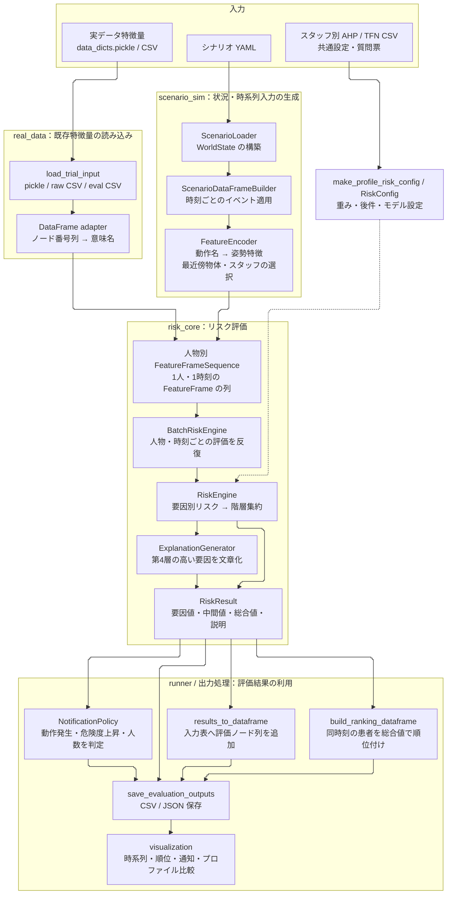
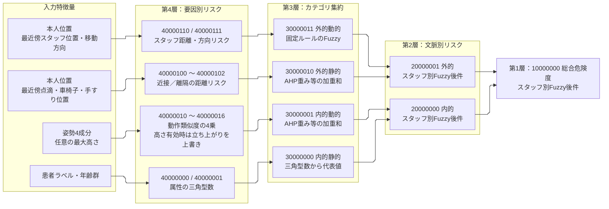
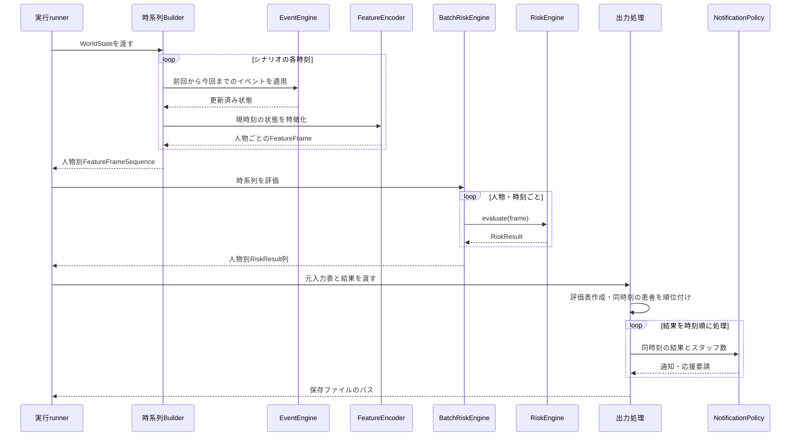
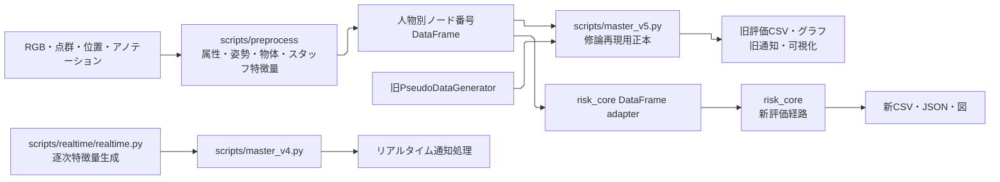

# 現行システムのアーキテクチャ

更新日：2026-10-12。現行コードに基づき、データの流れとコンポーネントの責務を整理した。図はMarkdown内のMermaidで記述しており、Mermaid対応ビューアで表示できる。

本リポジトリには、修論再現用の `scripts/master_v5.py` と、評価・シミュレーション・実データ入出力を分離した新構成 `risk_core / scenario_sim / real_data` が併存する。また、旧リアルタイム処理は `master_v4.py` を利用する。以下では新構成を中心に描き、旧経路との関係も示す。これは現行実装の説明であり、改修後の設計案ではない。

## 1. 全体構成とデータの流れ

実線は入力・評価結果の流れ、破線は設定の注入を表す。各箱は論理コンポーネントであり、別サーバーや別プロセスとして配備されていることを意味しない。runnerがPython内で各モジュールを呼び出す構成である。

入力生成とリスク計算の境界は `FeatureFrame`、リスク計算と順位・通知・保存の境界は `RiskResult` である。評価コアは患者間の順位を決めず、各人物のスコアを返す。順位と通知はその後段で計算する。

通常シミュレーションのrunnerは既定 `RiskConfig` を使う。プロファイル総当たりと実データ評価のrunnerは `make_profile_risk_config()` でスタッフ別CSVを解決する。図の設定入力は、すべての入口で必ずスタッフCSVが読み込まれるという意味ではない。

## 2. コンポーネントの切り方

以下のパスは `master_thesis_modules/` からの相対パス。

| コンポーネント | 責務 | 入力 → 出力 | 主な実装 |
|---|---|---|---|
| シナリオドメイン | 患者・スタッフ・物体・イベント・時間条件の保持 | YAML設定 → `WorldState` | `scenario_sim/domain/`、`encoder/scenario_loader.py` |
| イベント適用 | 動作・位置・姿勢等の状態更新 | 前の状態＋イベント → 新しい状態 | `scenario_sim/events/event_engine.py` `EventEngine.apply()` |
| 時系列生成 | 時間刻みに従ってイベント適用と特徴化を反復 | `WorldState` → 人物別時系列 | `scenario_sim/encoder/dataframe_builder.py` `build_sequences()` |
| 特徴化 | 動作preset、最近傍物体・スタッフを選ぶ | 時刻ごとの状態 → `FeatureFrame` | `scenario_sim/encoder/feature_encoder.py`、`pose_preset_encoder.py` |
| 実データ読込 | ファイル形式の判別・人物別表の読込 | pickle／CSV → `dict[str, DataFrame]` | `real_data/loader/trial_loader.py`、`data_dicts_loader.py`、`raw_csv_loader.py` |
| データ契約変換 | 旧ノード列と意味名の橋渡し | DataFrame → `FeatureFrameSequence`、評価結果 → DataFrame | `risk_core/features/dataframe_adapter.py` |
| 設定・プロファイル | モデル種別、AHP重み、Fuzzy後件の解決 | 共通設定・CSV → `RiskConfig` | `risk_core/engine/risk_config.py`、`profile_config.py` |
| 要因別計算 | 動作・物体・スタッフの第4層リスク | `FeatureFrame` 内の特徴 → 要因別リスク | `risk_core/factors/action_risk.py`、`object_risk.py`、`staff_risk.py` |
| 集約 | 加重和・加重最大・Fuzzyによる上位評価 | 下位ノード値＋設定 → 上位値 | `risk_core/aggregators/`、`engine/risk_engine.py` |
| 単時刻評価 | 要因計算・階層集約・説明の統括 | `FeatureFrame` → `RiskResult` | `risk_core/engine/risk_engine.py` `evaluate()` |
| バッチ評価 | 人物ごと、時刻ごとの単時刻評価 | 人物別時系列 → 人物別結果列 | `risk_core/engine/batch_risk_engine.py` `evaluate()` |
| 説明 | 第4層値から高い要因を選んで文章化 | 要因値 → 説明文 | `risk_core/explanation/` |
| 順位 | 同時刻の患者を総合リスク降順に並べる | 結果列＋対象判定 → 順位表 | `scenario_sim/runner/_outputs.py` `build_ranking_dataframe()` |
| 通知 | 動作発生・上昇量・クールダウン・要支援人数を判定 | 時刻ごとの結果＋過去状態＋スタッフ数 → 通知 | `risk_core/notification/notification_policy.py` |
| 出力・可視化 | 評価表・順位・通知・説明の保存と図示 | 評価結果 → CSV／JSON／図 | `scenario_sim/runner/_outputs.py`、`scenario_sim/visualization/` |
| 実行統括 | 入力、設定、コア、出力を接続する | CLI引数 → 一連の評価成果物 | `scenario_sim/runner/`、`real_data/runner/` |

属性評価は現在 `RiskEngine` 内の `patient_attribute_tfn()`、`age_attribute_tfn()`、`legacy_fuzzy_multiply()` が担当する。`factors/attribution_risk.py` にも関数があるが、通常の `RiskEngine` からは使われていない。上位集約の一部もengine内に直接記述されており、すべてがaggregatorsへ分離されているわけではない。

## 3. 評価コア内部のデータフロー

図は通常の `spatial_context`、Fuzzy有効、動作加重和の経路を示す。AHPは重みの同定方法、加重和は同定した重みを適用する計算である。スタッフCSVを使わない入口では、動作・物体とも固定既定重みになる。

入力から総合値までを追う主な実装は [RiskEngine](../master_thesis_modules/risk_core/engine/risk_engine.py)、[動作計算](../master_thesis_modules/risk_core/factors/action_risk.py)、[物体計算](../master_thesis_modules/risk_core/factors/object_risk.py)、[スタッフ計算](../master_thesis_modules/risk_core/factors/staff_risk.py)、[Fuzzy集約](../master_thesis_modules/risk_core/aggregators/fuzzy.py) にある。

内的・外的・総合のFuzzy後件はスタッフ別TFN CSVから取得する。内的は先頭4行の中心値を、静的／動的のhigh-high、high-low、low-high、low-lowの順で使用する。TFNがない場合は既存質問票へ代替し、不正なTFNや指定スタッフの内的後件を取得できない場合はエラーとする。スタッフ未指定時の内的後件は旧既定の1、1、0.5、0であり、従来の固定加重和から評価値が変わる。Fuzzy無効時は内的の0.1 × 静的 + 0.9 × 動的を維持する。

比較モデルでは経路が変わる。`patient_context`／`action_attribute` は総合値を内的リスクに、`action_only` は動作集約値に直接置き換える。`weighted_max` は動作の加重和を加重最大へ変更する。Fuzzy無効時には別の加重平均経路が使われる。EWMは旧実装に残るが、通常の評価経路には接続されていない。

## 4. データ構造と時系列処理

| データ構造 | 内容 | 境界での役割 |
|---|---|---|
| `WorldState` | 患者・スタッフ・物体、イベント、時間刻み・期間 | シナリオの状態を特徴化処理へ渡す |
| `FeatureFrame` | 人物ID、時刻、属性、信頼度、姿勢、本人・最近傍位置、スタッフ方向、任意の高さ・動作名 | 入力元によらない、1人・1時刻の評価入力 |
| `FeatureFrameSequence` | 人物IDと `FeatureFrame` のリスト | シミュレーションと実データの共通時系列入力 |
| `RiskConfig` | モデル種別、重み、Fuzzy後件、距離尺度、高さ変換設定 | 評価エンジンへ設定を注入 |
| `RiskResult` | 人物ID、時刻、第4層・上位ノード値、総合値、説明文 | 評価コアから出力処理へ渡す |
| 評価済みDataFrame | 入力表にノード番号の評価列・説明列を追加 | 旧形式への接続とCSV保存 |

信頼度や動作名が構造に含まれることと、総合リスク式で直接使われることは異なる。通常評価では属性信頼度は使われず、動作名はシナリオ側で姿勢presetを選ぶ際に使う。

新構成の通常バッチ処理では、まず時系列入力を作り、その後評価と通知を行う。連続センサ入力を逐次処理する旧リアルタイム系とは別経路である。実データ評価は図のBuilder部分をloaderとDataFrame adapterに置き換える。

`RiskEngine.evaluate()` は通常、前時刻の評価結果に依存しない。一方、シナリオ状態はイベントを適用して保持し、`NotificationPolicy` は過去の危険度・動作値・通知時刻を保持する。実データのスタッフ変位や特徴量の履歴補完は、評価コアより前の取得・前処理で計算される。

## 5. 旧構成との関係

旧 `Master` は `Manager / GraphManager / FuzzyReasoning / EntropyWeightGenerator` を継承し、評価・グラフ・設定読込・保存を同じクラス周辺にまとめている。新構成は入力生成、特徴量契約、評価、通知、保存を分離したが、旧処理を内部で呼び出してすべて再現する構成ではない。式や入力条件に一部差分がある。

## 6. 出力と現行構造上の注意点

主な出力は次のとおり。出力先はrunnerが指定する。

| 成果物 | 内容 |
|---|---|
| `data_<person>_eval.csv` | 人物別の入力列・評価ノード列 |
| `risk_timeseries.csv` | 人物と時刻を縦に並べた評価結果 |
| `ranking.csv` | 同時刻の患者別順位と総合危険度 |
| `notification_log.csv` | 通知・応援要請の履歴 |
| `explanations.json` | 人物・時刻別の説明 |
| PNG・要約CSV | runnerや可視化オプションに応じた時系列・順位・プロファイル比較 |

現行コードを読む際は、以下の境界条件に注意する。

- **入力の特殊分岐**：`run_profile_sweep.py` は特定のシナリオ名で、YAMLから生成する入力を固定の旧互換DataFrameへ切り替える。この場合、通常のScenarioDataFrameBuilder経路を通らない。
- **プロファイルの取得元**：CSVが不足すると共通既定値や質問票等へ代替する場合がある。プロファイル名だけでは実際のパラメータ出所を確定できない。
- **順位の同期**：順位は同じfloat timestampの結果を集めて算出する。コアで非同期入力を同期・補間する機能ではない。
- **説明の意味**：説明は高い第4層値の列挙であり、階層重みやFuzzyを通した総合値への寄与分解ではない。
- **保存される入力の範囲**：シナリオの `FeatureFrameSequence.to_feature_dataframe()` は姿勢・本人位置等を表にするが、最近傍物体・スタッフ位置等のすべてを保存するわけではない。評価時に保持したFeatureFrameと保存CSVの情報量は異なる。
- **旧新の互換性**：立ち上がりの高さなし分岐、車椅子移動テンプレート、停止スタッフ・欠損の扱い、通知条件が異なる。新構成の結果が旧正本と完全一致する前提で図表を読まない。

詳細な根拠、論文仕様との相違、改善候補は [現行実装レビュー](current_implementation_review_20261012.md) を参照。

## 7. コードを読む順番

1. シナリオから追う場合は [run_thesis_simulation.py](../master_thesis_modules/scenario_sim/runner/run_thesis_simulation.py) → [dataframe_builder.py](../master_thesis_modules/scenario_sim/encoder/dataframe_builder.py) → [feature_encoder.py](../master_thesis_modules/scenario_sim/encoder/feature_encoder.py)。
2. 実データから追う場合は [run_real_data_eval.py](../master_thesis_modules/real_data/runner/run_real_data_eval.py) → [trial_loader.py](../master_thesis_modules/real_data/loader/trial_loader.py) → [dataframe_adapter.py](../master_thesis_modules/risk_core/features/dataframe_adapter.py)。
3. 共通の評価処理は [batch_risk_engine.py](../master_thesis_modules/risk_core/engine/batch_risk_engine.py) → [risk_engine.py](../master_thesis_modules/risk_core/engine/risk_engine.py) → `factors / aggregators`。
4. 順位・保存は [_outputs.py](../master_thesis_modules/scenario_sim/runner/_outputs.py)、通知判定は [notification_policy.py](../master_thesis_modules/risk_core/notification/notification_policy.py)。
5. スタッフ設定は [profile_config.py](../master_thesis_modules/risk_core/engine/profile_config.py)、旧再現用の評価順は [master_v5.py](../master_thesis_modules/scripts/master_v5.py) と [旧評価フロー](legacy_evaluation_flow.md)。
