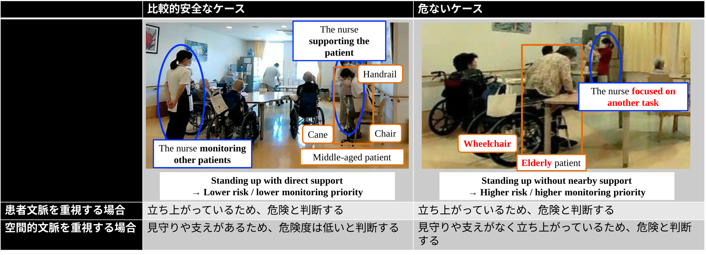
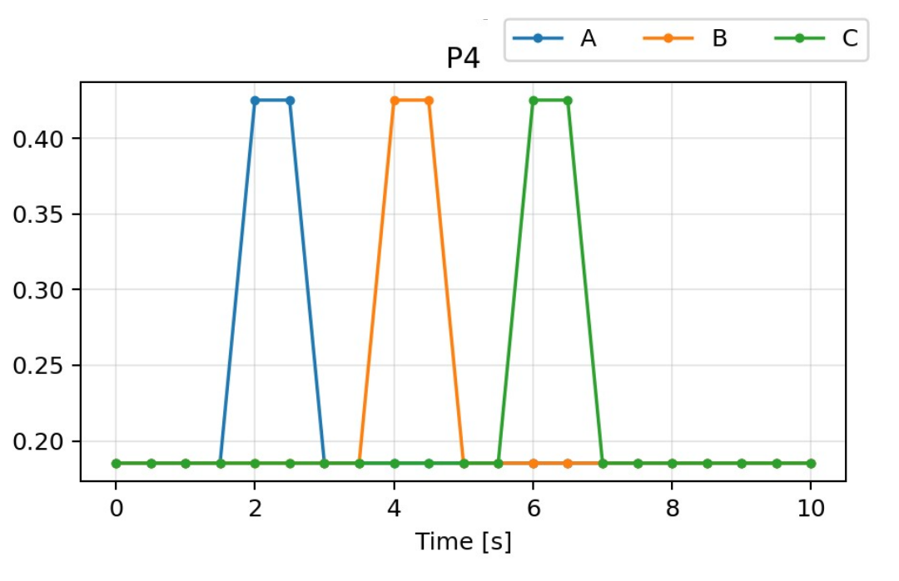
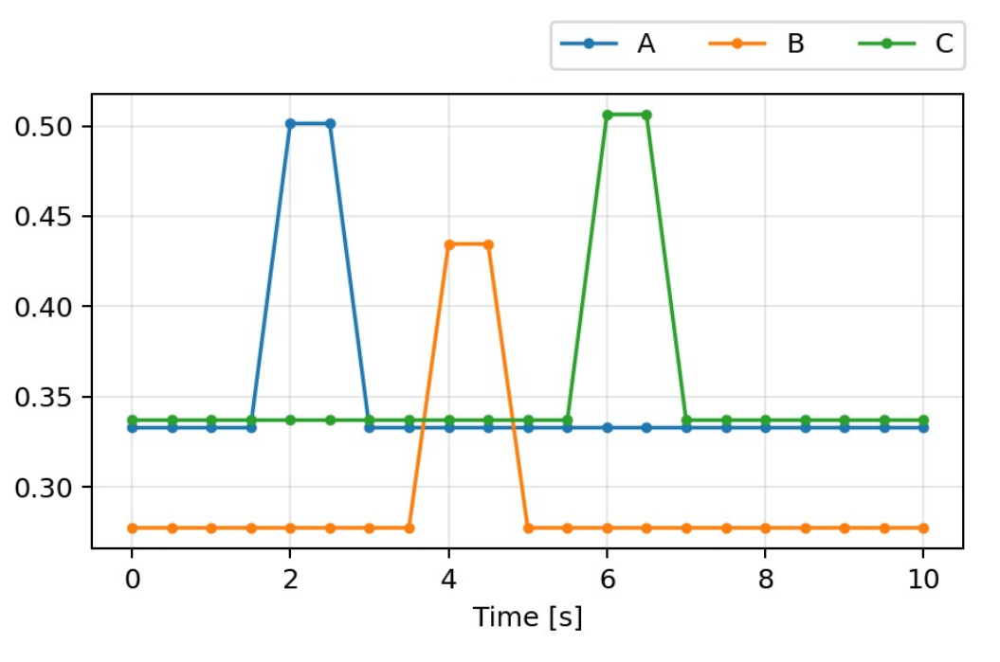
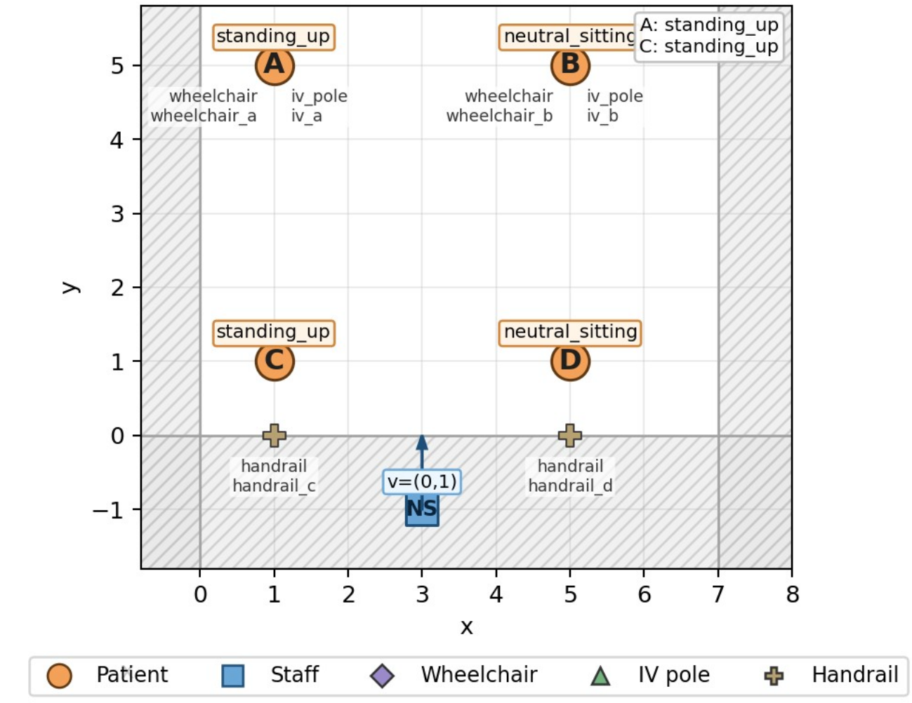
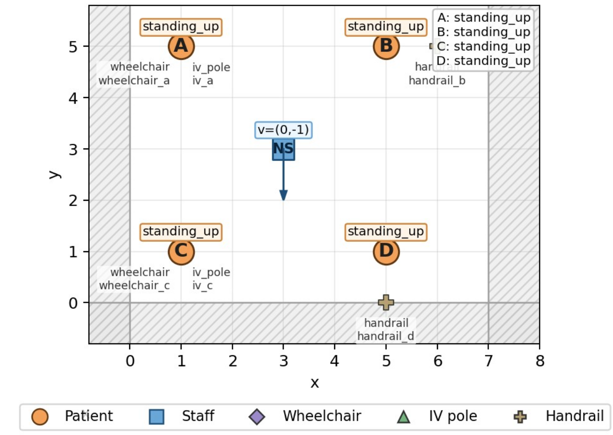
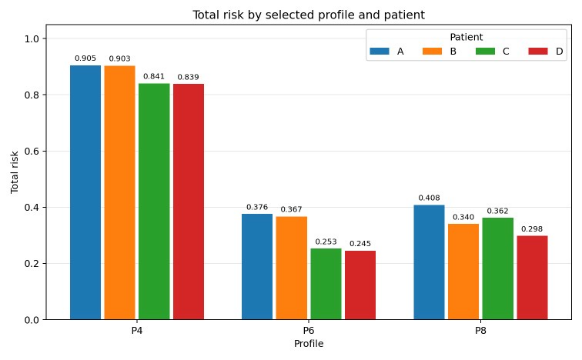
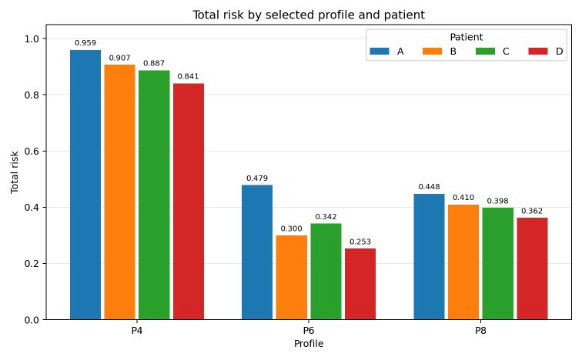

# タイトル

病棟共有空間における空間的文脈とスタッフの判断知識を統合した危険度評価・見守り優先順位付け

英語タイトル案：  
**Context-Integrated Risk Evaluation and Monitoring Prioritization Incorporating Staff-specific Judgment Knowledge in Shared Hospital Spaces**

# 投稿先

第一候補：IEEE Access  
上振れ候補：IEEE Transactions on Systems, Man, and Cybernetics

# 論文の位置づけ

本研究は、病棟共有空間における複数患者の見守りを対象とする。患者本人の属性・行動からなる**患者文脈**に加え、周囲物体・施設構造・スタッフの位置や見守り状況からなる**空間的文脈**を統合し、患者ごとの時系列危険度と見守り優先順位を算出する。

また、危険度評価で何をどの程度重視するか、条件の組み合わせをどう評価するかという**スタッフごとの判断知識**を、AHP重みとFuzzyルールとしてモデルへ反映する。

評価では、空間的文脈の有無による出力差（RQ1）と、スタッフごとの判断知識による出力差（RQ2）を分析する。通知生成は、危険度評価結果の利用例として扱う。

# Research Questions

* **RQ1：** 空間的文脈を考慮することで、患者の時系列危険度と見守り優先順位はどのように変化するか。
* **RQ2：** スタッフごとの判断知識を反映することで、同一入力に対する時系列危険度と見守り優先順位はどのように変化するか。

# 1. Introduction
患者見守り支援は、転倒・離床・姿勢・活動の検知を中心に広く研究されてきた \cite{Griffiths2024SurveillanceTechnology,Khanna2025ContinuousMonitoring,vanZeistdeJonge2025NursesExperiences}。ベッド周辺など局所的な環境を対象としたリスク評価に加え、電子カルテ・バイタル等を用いて病棟全体の患者状態を継続的に評価する方法も提案されている \cite{Gutierrez2021VisionFallReview,Escobar2020Deterioration}。

本研究では、こうした見守り支援を食堂・デイルームといった**病棟共有空間における複数患者の見守り**へ適用する。この環境には、危険度と見守り優先順位を評価するうえで重要な2つの特徴がある。

第一に、見守り優先順位は患者本人の状態・行動だけでなく、患者を取り巻く状況に依存する。Figure 1に示すように、同じ立ち上がり動作でも、スタッフが患者を直接介助している場合と、近くのスタッフが別業務に従事している場合では、見守り優先順位が異なり得る。本研究では、周囲物体、施設構造、スタッフと各患者の距離・方向、見守り状況など、患者本人以外の空間的状況を**spatial context（空間的文脈）**と定義する。なお、患者の属性や動作といった状況を、空間的文脈と対比して患者文脈と定義する。

**Figure 1.** 病棟共有空間における見守り優先順位の例。同じ立ち上がり動作でも、周囲物体・施設構造・スタッフの見守り状況によって優先順位が変化し得る。また、スタッフが直接介助している比較的安全な状況でも、患者の立ち上がり自体を重視し危険と評価するスタッフと、見守るスタッフの有無を重視して比較的安全と評価するスタッフでは評価が異なり得る。  

第二に、病棟共有空間では複数のスタッフが見守りに関与し、同じ状況でも危険度の判断基準が異なり得る。Figure 1左側の状況でも、患者の立ち上がり自体を重視して一定の優先度を保つスタッフと、スタッフが直接介助しているため優先度を下げるスタッフが考えられる。本研究では、このような特徴量の重み付けや条件の組み合わせに関する考え方を**スタッフの判断知識**と呼ぶ。

患者周囲の文脈情報を含むリスク推論や、専門家の判断をモデルへ反映する研究はそれぞれ存在する \cite{zarar2026logipar,Boulet2020ExpertWeights,TenBroeke2021BAIT}。一方、病棟共有空間において、**空間的文脈とスタッフごとの判断知識を同時に扱い、複数患者の時系列危険度と見守り優先順位を評価する研究は、確認した範囲で限定的である**。空間的文脈を導入すると扱う特徴量が増え、患者行動と周囲状況の間には条件依存的な相互作用も生じ得る。そのため、すべての特徴量の組み合わせについてスタッフの判断を直接取得することは現実的ではない。

そこで本研究では、患者文脈と空間的文脈を階層的に統合し、スタッフごとの判断知識をモデルパラメータとして反映する危険度評価フレームワークを構築する。評価では、空間的文脈の有無とスタッフごとの判断知識が、時系列危険度と見守り優先順位へ与える影響を検証する。

本研究の主な貢献は以下の2点である。

1. **Context-integrated risk evaluation:** 患者属性・行動、周囲物体・施設構造、スタッフとの相対関係を階層的に統合し、時系列危険度と見守り優先順位を算出するフレームワークを構築した。
2. **Staff-specific parameterization and evaluation:** スタッフの一対比較と状況判断をAHP重みとFuzzyルールへ変換し、同一入力に対するスタッフ別モデルの出力差を時系列危険度と見守り優先順位から分析する。

# 2. Related Work

## 2.1 Patient Monitoring and Context-aware Risk Assessment

病棟・介護施設では、RGB・赤外・深度カメラ等を用いた転倒検知、活動認識、離床検知が広く検討されてきた \cite{Gutierrez2021VisionFallReview}。また、病院内では患者の行動や状態を継続的に把握し、スタッフの確認や介入を支援する映像ベースの見守りシステムも検討されている \cite{Jones2020VideoMonitoring}。

従来の患者見守りは患者本人の状態・行動の検出を中心としてきたが、転倒リスク等は患者周囲の環境によっても変化する。本研究では、この患者本人以外の状況を空間的文脈として明示的に扱い、複数患者の時系列危険度と見守り優先順位へ反映する。

## 2.2 Risk Prioritization and Expert-informed Decision Models

病院では、電子カルテ、バイタル、検査値等から患者状態を連続的にスコア化し、高リスク患者の確認や介入を支援する研究が行われている \cite{OBrien2020OptimizedEWS,Escobar2020Deterioration}。これらは患者間の優先化という点で本研究と関連するが、本研究では生理的悪化ではなく、共有空間内の患者行動と空間的文脈に基づく短時間の見守り優先順位を扱う。

専門家の判断を意思決定モデルへ反映する方法として、医師が各臨床因子へ与える重要度を数値化する方法 \cite{Boulet2020ExpertWeights} や、仮想症例への選択から因子重みと条件間相互作用を推定する方法 \cite{TenBroeke2021BAIT} が提案されている。AHPとFuzzy推論も、多基準意思決定や医療リスク評価に用いられている \cite{Saaty1990AHP,Zadeh1965FuzzySets,Mamdani1975LinguisticControl,Uzoka2011FuzzyAHPClinical,Chang2022FuzzyAHPRisk}。

本研究では、スタッフへのアンケートから得た判断をAHP重みとFuzzyルールへ変換し、危険度評価モデルのパラメータとして用いる。

## 2.3 Multimodal Generative AI and Structured Risk Reasoning

近年、multimodal large language model（MLLM）を用いて、視覚情報から安全リスクを直接評価する研究が報告されている。Guptaらは、模擬在宅患者の動画から視覚的に観測可能な転倒リスク因子をMLLMで評価し、Doらは、住環境画像から転倒リスクを特定するとともに環境改善案を生成する手法を検討している \cite{gupta2026video,do2026leveraging}。これらは、生成型マルチモーダルモデルが患者行動だけでなく周囲環境を含む情報を解釈できる可能性を示している。

一方、安全上重要な推論を明示的な中間表現と規則によって構成する研究も進んでいる。Logi-PARは、視覚情報を \textit{RailDown}、\textit{EdgeSit}、\textit{CaregiverNear} などのatomic factsとして表現し、それらを学習可能な論理規則で組み合わせて患者状態を推論する \cite{zarar2026logipar}。学習後の規則は専門家が確認・検証し、必要に応じて修正可能な構成であり、視覚情報から判断までの経路を明示する点に特徴がある。

本研究は、リスク評価を規定する知識の取得方法に焦点を置く。Logi-PARでは規則構造や重みを主としてデータから学習するのに対し、本研究では、何をリスク要因として扱い、各要因や条件の組み合わせをどの程度重視するかというスタッフの判断知識をアンケートから明示的に取得し、調整可能なパラメータとしてモデルへ反映する。したがって、本研究の目的はリスク評価規則をデータから自動発見することではなく、スタッフごとの評価基準を外部化し、その差が時系列危険度と見守り優先順位へどのように反映されるかを評価することである。

LLMには柔軟な意味推論能力がある一方、明示された複数の制約を一貫して満たすことには課題が報告されている \cite{jiang2024followbench}。そのため、指定したリスク要因・重み・規則を確認可能な形で危険度評価へ反映することを重視する本研究では、リスク評価ロジックを生成モデルによる自由形式の推論から分離する。一方、構造化された分析結果を自然言語化する用途ではLLMを相補的に利用できる。Luoらは、XGBoostによる転倒リスク予測とSHAPによる特徴量寄与を、LLMを用いて自然言語の説明へ変換している \cite{luo2025fall}。本稿では、このうち明示的なスタッフ知識に基づくリスク評価に焦点を当てる。

## 2.4 Position of This Study

既存研究では、患者見守り、患者リスクの継続評価と優先化、専門家判断のパラメータ化、ならびに生成AI・論理規則を用いたリスク推論がそれぞれ検討されている。一方、病棟共有空間において、患者文脈・空間的文脈・スタッフごとの判断知識を同一モデルで扱い、複数患者の時系列危険度と見守り優先順位を評価する研究は、確認した範囲で限定的である。

空間的文脈とスタッフごとの判断知識を同時に扱うには二つの課題がある。第一に、患者行動、周囲物体、施設構造、スタッフの位置・見守り状況など、多数かつ異質な特徴量を扱う必要がある。第二に、これらの特徴量は独立に危険度へ寄与するとは限らず、組み合わせによって影響が変化し得る。例えば、患者の立ち上がりと手すりから離れている状態が同時に生じた場合、その危険性は各要因を個別に評価した結果の単純な加算では表現できない場合がある。すべての特徴量の組み合わせについてスタッフの判断を直接取得することは、組み合わせ数の増加により現実的ではない。

本研究では、この課題に対し、特徴量を階層化し、同一カテゴリ内の相対的重要度をAHP、異なるリスク因子間の条件依存関係をFuzzy推論で表現する。これにより、多様な特徴量とその相互作用を扱いつつ、スタッフから取得した判断知識を危険度評価へ反映する。本研究は、この統合方法と、それによって生じる時系列危険度および見守り優先順位の変化を評価する。

# 3. Proposed Method

## 3.1 Overview

提案手法は、患者文脈と空間的文脈から患者ごとの危険度を算出し、複数患者間の見守り優先順位を決定する。

スタッフの判断知識は、以下の2種類のパラメータとして反映する。

* 同一カテゴリ内の特徴量の重要度：AHP重み。
* 複数のリスク因子の組み合わせと危険度の関係：Fuzzyルール。

すべての特徴量を一つの層で扱うと、一対比較や条件の組み合わせ数が増加する。そこで、性質の近い特徴量を階層的にまとめ、同一カテゴリ内ではAHPにより相対的重要度を表現し、上位層ではFuzzy推論により異なるリスク因子間の条件依存関係を表現する。この構造により、スタッフへすべての特徴量の組み合わせを直接質問することなく、判断知識をモデルへ反映する。

Figure 2は、同一状況でも、患者文脈と空間的文脈のどちらを重視するかによって危険度評価が変わる概念例を示す。

**Figure 2.** 空間的文脈とスタッフの判断知識に応じた危険度評価の概念例。  
*Draft note: source slides pp.3-6. Final figureでは4枚をそのまま並べず、空間的文脈の2条件×スタッフの判断知識の2条件からなる2×2の模式図として再作図する。*

Figure 3に提案システムの全体構成を示す。患者属性・行動、周囲物体・施設構造、スタッフの位置・見守り状況の特徴量を取得し、階層的に危険度へ統合する。スタッフごとのAHP重みとFuzzyルールは危険度評価部へ入力する。

**Figure 3.** 提案システムの全体構成。  
*Draft note: source slide p.7. Final figureではスタッフ入力を “Questionnaire → AHP weights / Fuzzy rules” と明示し、Notification generatorは補助出力として小さくする。*

## 3.2 Feature Selection and Classification

### 3.2.1 Feature selection

特徴量候補は、対象病院の病棟デイルームで熟練看護師2名に実施した約30分の聞き取りを基に整理した。見守り時に着目する情報、危険と判断する状況、複数患者の優先順位を中心に質問し、特徴量選定に用いた。

### 3.2.2 Feature classification

危険度評価に用いる特徴量を、患者本人に由来する内的要因と患者周囲に由来する外的要因に分け、さらに静的・動的の2軸で4群に分類する。患者文脈は内的要因、空間的文脈は外的要因に対応する。特徴量の分類をTable 1に、各特徴量の詳細をAppendix Table A1に示す。

**Table 1. 特徴量の4分類。**

| 分類 | 文脈 | 主な内容 |
|---|---|---|
| 内的・静的要因 | 患者文脈 | 患者判別、年齢層などの患者属性 |
| 内的・動的要因 | 患者文脈 | 立ち上がり、車椅子操作、姿勢変化などの患者行動 |
| 外的・静的要因 | 空間的文脈 | 点滴、車椅子、手すり等との位置関係 |
| 外的・動的要因 | 空間的文脈 | スタッフとの距離、見守り方向 |

### 3.2.3 Feature extraction

内的・静的要因は、画像から取得した人物情報または既存の患者情報から取得する。内的・動的要因は、姿勢推定結果から算出した姿勢特徴と危険動作テンプレートとの類似度に基づいて評価する。外的・静的要因は周囲物体・施設構造との距離から、外的・動的要因はスタッフとの相対距離および見守り方向から算出する。実装では、RGB画像、点群、位置情報、姿勢推定、VQA、施設地図等を組み合わせて各特徴量を取得する。

姿勢特徴はAppendix Table A2に示す4種類を用いる。各特徴量は0--1に正規化し、危険動作テンプレートとの類似度算出に用いる。

*Draft note: 実装で使用したVQA／画像モデルの名称と引用を最終稿で明記する。実データについて、危険度時系列の解釈に必要な入力イベント・特徴量をどこまで本文に示すかは要確認。*

## 3.3 Questionnaire-based Parameterization

### 3.3.1 Questionnaire design

スタッフごとの判断知識を取得するため、Questionnaire 1Aと1Bを実施した。Questionnaire 1Aでは同一カテゴリ内の判断材料を比較し、Questionnaire 1Bでは複数カテゴリの条件を組み合わせた状況に対する危険度を評価させた。Table 2に設問構成とモデルへの反映方法を示す。

**Table 2. アンケートの設問構成とモデルへの反映。**

| アンケート | 設問 | 対象 | 回答形式 | モデルへの反映 |
|---|---|---|---|---|
| 1A | Qa | 患者属性に関する判断材料 | 自由記述 | 患者属性の特徴量候補の整理 |
| 1A | Qb | 患者動作（立つ、車椅子のブレーキ解除、車椅子を動かす、姿勢を崩す、手を挙げる、せき込む、顔を触る） | 判断材料2項目の一対比較。左右4段階＋同程度からなる9段階尺度 | 同一カテゴリ内の相対的重要度をAHP重みとして算出 |
| 1A | Qc | 点滴、車椅子、手すり等の周囲物体に関する判断材料 | 同上 | 同一カテゴリ内の相対的重要度をAHP重みとして算出 |
| 1A | Qd | スタッフとの距離・見守り状況に関する判断材料 | 同上 | スタッフの見守り状況に関する判断パラメータの設定 |
| 1B | No.1--4 | 患者属性と患者行動の組み合わせ | 5（高リスク）--1（低リスク）の5段階評価 | 患者文脈内部の条件関係を表すFuzzyルールの設定 |
| 1B | No.5--8 | 周囲物体とスタッフの見守り状況の組み合わせ | 同上 | 空間的文脈内部の条件関係を表すFuzzyルールの設定 |
| 1B | No.9--12 | 患者文脈と空間的文脈の組み合わせ | 同上 | 患者文脈・空間的文脈を統合するFuzzyルールの設定 |

Questionnaire 1Bで提示した12条件をTable 3に示す。高／低リスク、危険／安全等の代表的な状態を組み合わせることで、カテゴリ間の条件依存関係に対するスタッフの判断を取得する。

**Table 3. Questionnaire 1Bで提示した危険度評価条件。**

| No. | 条件1 | 条件2 | 回答 |
|---:|---|---|---|
| 1 | 患者属性が高リスク（高齢・重症など） | 危ない動作をしている | 5（高リスク）--1（低リスク） |
| 2 | 患者属性が高リスク（高齢・重症など） | 落ち着いている | 同上 |
| 3 | 患者属性が低リスク（若年・軽症など） | 危ない動作をしている | 同上 |
| 4 | 患者属性が低リスク（若年・軽症など） | 落ち着いている | 同上 |
| 5 | 危ない物体（点滴・車椅子など）の近くにいる | 近く・視野内で見守るスタッフがいる | 同上 |
| 6 | 危ない物体（点滴・車椅子など）の近くにいる | 近く・視野内で見守るスタッフがいない | 同上 |
| 7 | 危ない物体（点滴・車椅子など）から離れている | 近く・視野内で見守るスタッフがいる | 同上 |
| 8 | 危ない物体（点滴・車椅子など）から離れている | 近く・視野内で見守るスタッフがいない | 同上 |
| 9 | 患者属性・行動が危険 | 周囲に危険物がある、または見守りが不十分 | 同上 |
| 10 | 患者属性・行動が危険 | 周囲に危険物がなく、見守りも十分 | 同上 |
| 11 | 患者属性・行動が安全 | 周囲に危険物がある、または見守りが不十分 | 同上 |
| 12 | 患者属性・行動が安全 | 周囲に危険物がなく、見守りも十分 | 同上 |

### 3.3.2 AHP-based weighting

Questionnaire 1Aの一対比較回答から、同一カテゴリ内の特徴量の相対的重要度を算出する。一対比較行列を

$$
A=[a_{ij}], \quad a_{ji}=\frac{1}{a_{ij}}, \quad a_{ii}=1 \tag{1}
$$

とする。最大固有値を$\lambda_{\max}$、対応する固有ベクトルを$\mathbf{w}$とすると、

$$
A\mathbf{w}=\lambda_{\max}\mathbf{w} \tag{2}
$$

を満たす。正規化した$\mathbf{w}$を特徴量重みとして用いる \cite{Saaty1990AHP}。回答の整合性はConsistency Index（CI）またはConsistency Ratio（CR）で確認する。

$$
CI=\frac{\lambda_{\max}-n}{n-1} \tag{3}
$$

### 3.3.3 Fuzzy-rule parameterization

Questionnaire 1Bでは、Table 3の各条件に対して5段階で危険度を評価させる。これらの回答を、階層モデルでカテゴリ間のリスクを統合するFuzzyルールの後件側に対応づける。これにより、例えば「患者行動が危険でもスタッフによる見守りが十分であれば危険度を低く評価する」といった、単純な加算では表現しにくい条件依存的な判断をスタッフごとに反映する。

以下に、階層間のFuzzy推論で用いる基本的なルール構造を示す。

**Table 4. スタッフとの距離・見守り方向からスタッフ見守りリスクを算出するFuzzyルール。**

| Distance risk $r^i_{330}$ | Direction risk $r^i_{331}$ | Staff risk $r^i_{23}$ |
|---|---|---|
| Large ($A$) | Large ($B$) | Large ($C$) |
| Large ($A$) | Small ($\bar{B}$) | Moderate ($D$) |
| Small ($\bar{A}$) | Large ($B$) | Moderate ($D$) |
| Small ($\bar{A}$) | Small ($\bar{B}$) | Small ($E$) |

**Table 5. 周囲物体リスクとスタッフ見守りリスクから外的リスクを算出するFuzzyルール。**

| Object risk $r^i_{22}$ | Staff risk $r^i_{23}$ | External risk $r^i_{11}$ |
|---|---|---|
| Large ($A$) | Large ($B$) | Large ($C$) |
| Large ($A$) | Small ($\bar{B}$) | Moderate ($D$) |
| Small ($\bar{A}$) | Large ($B$) | Moderate ($D$) |
| Small ($\bar{A}$) | Small ($\bar{B}$) | Small ($E$) |

**Table 6. 内的リスクと外的リスクから総合危険度を算出するFuzzyルール。**

| Internal risk $r^i_{10}$ | External risk $r^i_{11}$ | Total risk $r^i_{00}$ |
|---|---|---|
| Large ($A$) | Large ($B$) | Large ($C$) |
| Large ($A$) | Small ($\bar{B}$) | Moderate ($D$) |
| Small ($\bar{A}$) | Large ($B$) | Moderate ($D$) |
| Small ($\bar{A}$) | Small ($\bar{B}$) | Small ($E$) |

*Draft note: Questionnaire 1Bの5段階回答をFuzzy集合・後件値へ変換する具体的な対応関係と、メンバーシップ関数の設定方法を実装に合わせて明記する。*

### 3.3.4 Staff profile representation

以降の評価では、各回答者から得たAHP重みとFuzzyルールの組を**スタッフ別プロファイル**として扱う。Table 7に、本文中でプロファイルを提示する際の共通フォーマットを示す。Questionnaire 1Aの各ブロックについてはCI/CRも併記し、プロファイルの選定根拠を確認できるようにする。

**Table 7. スタッフ別プロファイルの提示フォーマット（テンプレート）。**

| 判断ブロック | アンケート設問 | 回答・判断傾向 | モデルパラメータ | 整合性 |
|---|---|---|---|---|
| 患者行動内の重要度 | 1A-Qb | [例：立ち上がりを強く重視] | $\mathbf{w}^{ID}=[\cdots]$ | CI/CR = [ ] |
| 周囲物体内の重要度 | 1A-Qc | [例：点滴を車椅子より重視] | $\mathbf{w}^{ES}=[\cdots]$ | CI/CR = [ ] |
| スタッフの見守り判断 | 1A-Qd | [例：距離より見守り方向を重視] | [使用パラメータを記載] | CI/CR = [ ] |
| 患者属性×患者行動 | 1B No.1--4 | [5段階回答を要約] | $F_I$関連ルール | -- |
| 周囲物体×見守り状況 | 1B No.5--8 | [5段階回答を要約] | $F_E$関連ルール | -- |
| 患者文脈×空間的文脈 | 1B No.9--12 | [5段階回答を要約] | $F_T$関連ルール | -- |

*Draft note: RQ1で使用するP4、RQ2で比較するP6・P8等について、Table 7の形式で実際のアンケート回答・導出パラメータ・CI/CRを記載する。P4・P6・P8は職種・経験年数などのスタッフ属性が一つの層に偏らないよう選定した事例であり、属性の対応関係をアンケート原票で確認したうえで最終稿に明記する。*

## 3.4 Hierarchical Risk Evaluation

患者$i$の時刻$k$における総合危険度を$R_i(k)$とする。

まず、内的・静的、内的・動的、外的・静的、外的・動的の各リスクを算出する。

$$
R_i^{IS}(k)=f_{IS}(\mathbf{x}_i^{IS}(k)) \tag{4}
$$

$$
R_i^{ID}(k)=\sum_j w_j^{ID}x_{ij}^{ID}(k) \tag{5}
$$

$$
R_i^{ES}(k)=\sum_j w_j^{ES}x_{ij}^{ES}(k) \tag{6}
$$

$$
R_i^{ED}(k)=F_{ED}(\mathbf{x}_i^{ED}(k)) \tag{7}
$$

$IS$、$ID$、$ES$、$ED$は、それぞれ内的・静的、内的・動的、外的・静的、外的・動的要因を表す。

内的リスクと外的リスクを以下のように統合する。

$$
R_i^{I}(k)=\alpha R_i^{IS}(k)+(1-\alpha)R_i^{ID}(k) \tag{8}
$$

$$
R_i^{E}(k)=F_E(R_i^{ES}(k),R_i^{ED}(k)) \tag{9}
$$

最終的な危険度は、

$$
R_i(k)=F_T(R_i^{I}(k),R_i^{E}(k)) \tag{10}
$$

とする。

$F_{ED}$、$F_E$、$F_T$にはFuzzy推論を用い、異なるリスク因子間の条件依存関係を表現する \cite{Zadeh1965FuzzySets,Mamdani1975LinguisticControl}。

スタッフごとにAHP重み、$\alpha$、Fuzzyルール等を設定し、同一入力に対するスタッフ別の時系列危険度を生成する。

**Discussion point:** 一般モデルではQuestionnaire 1B No.1--4と患者文脈内の統合式の対応を最終確認する。なお、4.3.2の実データ評価では内的・静的要因を全患者で同一値に固定しているため、この設問ブロックに由来するスタッフ別パラメータは使用しない。

# 4. Evaluation

## 4.1 Evaluation Design

評価はRQ1とRQ2に沿って構成する。RQ1では、同一の患者行動を与えたシミュレーションに対し、空間的文脈を使用しない条件と使用する条件を比較する。これにより、Figure 1で示したような周囲物体・スタッフの見守り状況の違いが、時系列危険度と見守り優先順位へ反映されるかを確認する。

RQ2では、スタッフごとの判断知識の違いが出力へ反映されるかを、統制したシミュレーションと病棟共有空間で取得した実データの両方で評価する。職種・経験年数などのスタッフ属性が一つの層に偏らないよう選定した事例を用い、その中で実際に得られた判断傾向の違いとモデル出力の対応をシミュレーションおよび実データで確認する。さらに、全回答者（n=10）の傾向を分析する。

* **RQ1:** 空間的文脈の有無による時系列危険度と見守り優先順位の変化。
* **RQ2:** スタッフごとの判断知識による時系列危険度と見守り優先順位の変化。

## 4.2 Simulation-based Evaluation of Spatial Context (RQ1)

### 4.2.1 Method

Figure 4に示すシナリオに対し、(a) 空間的文脈に対応する特徴量を全患者で0に固定した条件と、(b) 空間的文脈の特徴量を入力した条件の2条件で、患者ごとの時系列危険度を比較する。両条件で患者文脈とスタッフ別プロファイルは同一に固定する。本評価では絶対的な危険度の妥当性ではなく、同一プロファイル内での患者間の相対的な危険度と見守り優先順位に着目するため、条件(a)の0は空間的文脈による患者間差を除くための共通基準値として用いる。

本評価では、空間的文脈の影響を分離するため、スタッフの判断知識をP4のプロファイルに固定する。RQ1ではスタッフ別プロファイル間の比較を目的としないため、全条件に同一のP4プロファイルを適用する。P4のアンケート回答、導出パラメータ、CI/CRは、Table 7の形式で追記する。
**Table 8. RQ1シミュレーションで患者間差を与えた主な正規化特徴量。**

| 特徴量 | 患者A | 患者B | 患者C |
|---|---:|---:|---:|
| `stand_up` | 0.09--1.00 | 0.09--1.00 | 0.09--1.00 |
| `near_iv_pole` | 0.57 | 0.75 | 0.99 |
| `near_wheelchair` | 0.99 | 0.75 | 0.99 |
| `far_handrail` | 0.24 | 0.24 | 0.24 |
| `staff_distance` | 0.30 | 0.08 | 0.19 |
| `staff_watch_loss` | 0.78 | 0.00 | 0.72 |

患者行動に関するその他の入力は患者A--Cで同一とした。動的な患者行動は所定のイベント区間のみ変化し、それ以外の特徴量はシナリオ中で固定した。

*Draft note: P4・P6・P8は、職種・経験年数などのスタッフ属性が一つの層に偏らないよう選定した事例である。若手看護師・熟練看護師・介護福祉士との対応関係は、最終稿への記載前にアンケート原票で確認する。*

**Figure 4.** RQ1で用いる立ち上がりシナリオ。  
*Draft note: Figure 4の最終版では代表時刻を絞り、患者・スタッフ・周囲物体の条件が読み取れるよう簡略化する。*

比較条件は以下とする。

* **Patient context only:** 空間的文脈の特徴量を全患者で0に固定し、患者文脈のみを患者間差として用いる。
* **Spatial context included:** 患者文脈に加え、患者ごとの空間的文脈の特徴量を入力する。

### 4.2.2 Results

Figure 5に、両条件における時系列危険度の比較を示す。

**Figure 5.** 空間的文脈の有無による時系列危険度の比較。(a) Patient context only、(b) Spatial context included。  

患者文脈のみを用いた条件では、空間的文脈の違いが出力に反映されず、各患者の立ち上がりに対して同様の危険度変化が生じた。一方、空間的文脈を含む条件では、立ち上がり動作が生じる前から、スタッフの見守り状況および車椅子・点滴の有無に応じて患者間の危険度に差が生じた。立ち上がり時の危険度は、「見守りあり・車椅子あり・点滴なし」、「見守りなし・車椅子あり・点滴なし」、「見守りなし・車椅子あり・点滴あり」の順に高くなり、上位患者間では見守り優先順位の変化も確認された。

この結果から、空間的文脈を加えることで、患者文脈のみでは区別できない周囲状況の違いが時系列危険度へ反映されることを確認した。

## 4.3 Evaluation of Staff-specific Judgment Knowledge (RQ2)

### 4.3.1 Simulation-based Evaluation

#### Method

シミュレーションシナリオに複数のスタッフ別モデルを適用し、スタッフごとの判断知識の違いが見守り優先順位へ与える影響を確認する。判断傾向の異なるモデルを比較し、(シナリオ1)患者文脈と空間的文脈の重視度、および(シナリオ2)周囲物体とスタッフの見守り状況の重視度が、出力へどのように反映されるかを評価する。

比較に用いるスタッフ別プロファイルは、Table 7の形式で追記する。ケースとして用いるP4・P6・P8は、職種・経験年数などのスタッフ属性が一つの層に偏らないよう選定した。そのうえで、各プロファイルのアンケート回答から得られた判断傾向とモデル出力の対応を確認する。

**Scenario 1:** 4名の患者を2×2に配置し、スタッフを正面から4名を見渡せる位置に配置する。奥側の2名は手前側の2名よりスタッフから遠いため、スタッフとの距離に関する空間的文脈が異なる。ここでスタッフから見て左側の2名に立ち上がり動作を与え、患者文脈と空間的文脈のどちらを重視するかが異なるスタッフ別モデル間で、見守り優先順位を比較する。

**Figure 6.** RQ2シミュレーションScenario 1の環境設定。4名の患者とスタッフの位置関係、および立ち上がり動作を与える患者を示す。

**Scenario 2:** 4名の患者を2×2に配置し、スタッフを中央付近に配置する。スタッフからはC、Dを見守れる一方、A、Bは見守られにくい状況とする。また、左側の2名は車椅子に座り、点滴ポールの近くにいる条件とする。スタッフの見守り状況と周囲物体のどちらを重視するかが異なるスタッフ別モデル間で、見守り優先順位を比較する。

**Figure 7.** RQ2シミュレーションScenario 2の環境設定。患者A--D、スタッフの見守り状況、車椅子および点滴ポールの配置を示す。

#### Results

Scenario 1では、空間的文脈を重視するスタッフ別モデルでスタッフから遠い患者の見守り優先順位が高くなった。一方、患者文脈を重視するスタッフ別モデルでは、立ち上がり動作の影響がより強く反映された。

**Figure 8.** RQ2シミュレーションScenario 1におけるスタッフ別プロファイルの危険度評価結果。

Scenario 2では、スタッフの見守り状況を周囲物体より重視するスタッフ別モデルで、見守られにくい患者の見守り優先順位が高くなった。一方、周囲物体を重視するスタッフ別モデルでは、車椅子に座り点滴ポールの近くにいる患者の見守り優先順位が高くなった。

**Figure 9.** RQ2シミュレーションScenario 2におけるスタッフ別プロファイルの危険度評価結果。

### 4.3.2 Real-world Data Evaluation

#### Method

病棟共有空間で取得した同一の実データにスタッフ別モデルを適用し、P6・P8の出力を比較する。P6・P8は、職種・経験年数などのスタッフ属性が異なる事例を含むよう選定したプロファイル群の一部であり、結果としてアンケートから得られた判断傾向も対照的であった。また、全回答者（n=10）について、アンケートから得た判断指標と危険度出力の関係を分析する。

なお、本実データでは内的・静的要因を全患者で同一値に固定したため、Questionnaire 1B No.1--4に対応する患者属性と患者行動の組み合わせに関するスタッフ別の判断知識は、本評価では使用しない。

全回答者の分析では、患者文脈と空間的文脈の相対的な重視傾向を表す指標$C_i$を用いる。

##### Profile-orientation index $C_i$

患者文脈と空間的文脈の相対的な重視傾向を定量化するため、総合危険度を算出するFuzzyルールのうち、内的危険度が高く外的危険度が低い条件（HL）と、その逆の条件（LH）の後件部中央代表値を用いて、

$$
C_i=c_i^{LH}-c_i^{HL}=\frac{s_i^{LH}-s_i^{HL}}{4} \tag{11}
$$

と定義する。ここで$s_i$はQuestionnaire 1Bの5段階回答である。$C_i>0$は空間的文脈を、$C_i<0$は患者文脈を相対的に重視する傾向を表し、$|C_i|$が大きいほどその傾向が強い。本指標は最上位Fuzzyルールの中央代表値の差を表すものであり、Fuzzy集合の幅やモデル全体の感度を直接表すものではない。

#### Results

実データに対するスタッフ別モデルの比較をFigure 10に、全回答者の判断傾向と出力の関係をFigure 11に示す。

**Figure 10.** 実データに対するスタッフ別モデルの時系列危険度と代表フレーム。(a) P6の時系列危険度、(b) P8の時系列危険度、(c)--(h) 解析区間の代表フレーム（t=73, 75, 77, 79, 81, 83）。  
*Draft note: Figure 10の最終版では平滑化せず、上記パネルを一つのマルチパネル図へ統合し、主要イベントの時刻を対応づける。横軸はUNIX時刻のオフセット表示ではなく、解析区間開始からの相対時刻に変更する。*

患者文脈を重視するP8のスタッフ別モデルでは、立ち上がった患者00021が最も高い見守り優先順位となった。一方、空間的文脈を重視するP6のスタッフ別モデルでは、スタッフから離れた位置で車椅子に座り、車椅子を動かそうとしていた患者00006が最も高い見守り優先順位となった。

**Figure 11.** スタッフごとの空間的文脈重視度と危険度出力の関係。  
*Draft note: source slide p.17. Figure 11の最終版では、x軸をスタッフごとの空間的文脈重視指標、y軸を空間的文脈変化に対する$\Delta$Risk等とした散布図へ変更する。*

患者文脈をより重視するスタッフでは患者00021の危険度が高く評価され、空間的文脈の重視度が高まるにつれて、患者00021の危険度が低下する傾向がみられた。

# 5. Discussion

## 5.1 Effect of Spatial Context (RQ1)

RQ1では、患者文脈を同一に保ったまま空間的文脈の有無を比較した。患者文脈のみを用いた条件では、周囲状況が異なる患者に同様の立ち上がりが生じると、危険度も同様に変化した。一方、空間的文脈を含む条件では、立ち上がり前からスタッフの見守り状況や周囲物体に応じて危険度に差が生じ、立ち上がり後には患者間の見守り優先順位も変化した。

この差は、患者の行動だけでなく、その行動が生じた状況を危険度評価へ取り込んだことによる。例えば、同じ立ち上がりであっても、スタッフによる見守りがある状況では危険度を抑え、見守りがなく周囲に危険要因がある状況では危険度を高めることができた。したがってRQ1に対しては、空間的文脈を特徴量として含めることで、Figure 1で示したような周囲状況の違いを時系列危険度と見守り優先順位へ反映できることを示した。

## 5.2 Reflection of Staff-specific Judgment Knowledge (RQ2)

RQ2では、同一入力に異なるスタッフ別プロファイルを適用し、アンケートから得た判断知識の違いが出力へ反映されるかを評価した。シミュレーションでは、患者文脈を重視するプロファイルと空間的文脈を重視するプロファイルで見守り優先順位が異なり、また、周囲物体を重視するプロファイルとスタッフの見守り状況を重視するプロファイルでも異なる順位が得られた。これらの差は、各プロファイルのアンケート回答で示された判断傾向と整合する方向に生じた。

実データに対しても、スタッフ属性が偏らないよう選定した事例のうち、患者文脈を重視するP8では立ち上がった患者00021が高く評価された一方、空間的文脈を重視するP6では、スタッフから離れた位置で車椅子を動かそうとしていた患者00006が高く評価された。また、全回答者（n=10）の比較では、患者文脈と空間的文脈の相対的な重視傾向に応じて患者00021の危険度が連続的に変化する傾向がみられた。以上は、スタッフ別プロファイルの違いが単一の代表例だけでなく、複数回答者の出力差にも反映され得ることを示している。

このスタッフ別の調整を可能にした要因は、判断知識を階層ごとに分解してパラメータ化した点にある。同一カテゴリ内の相対的重要度をAHPで表現し、異なるリスク因子間の条件依存関係をFuzzy推論で表現することで、すべての特徴量の組み合わせを直接質問することなく、重要度と相互作用の双方をアンケートからモデルへ反映できる。したがってRQ2に対しては、AHPとFuzzy推論を組み合わせた階層構造により、空間的文脈を考慮した危険度評価をスタッフごとの判断知識に応じて調整できることを示した。

*Draft note: 「すべての組み合わせを直接質問する場合」と比較して設問数をどの程度削減できているか、最終的な階層・設問数が確定した時点で定量化可能か確認する。*

## 5.3 Implications for Monitoring Support

提案手法は、複数患者の危険度を継続的に算出し、見守り優先順位として提示できる。この出力は、スタッフが複数患者を同時に見守る際に、どの患者を優先して確認するかを判断するための補助情報として利用できる。また、階層構造内の特徴量と中間危険度を保持するため、危険度上昇に寄与した要因を通知理由として提示する構成へ接続できる。

さらに、複数スタッフが担当する範囲で高い危険度を示す患者が同時に増加した場合、応援要請等の運用判断へ利用できる可能性がある。ただし、本研究では通知方法、応援要請の条件、業務負荷への影響を評価していないため、これらは提案手法の潜在的な応用として位置づける。

## 5.4 Limitations

本研究には以下の限界がある。第一に、算出された危険度やスタッフ別の調整結果が臨床的に正しいかは検証していない。本評価は、空間的文脈やアンケート由来の判断知識がモデル出力へ反映されることを確認したものであり、スタッフによる見守り判断を代替するものではない。

第二に、スタッフ別分析の回答者数はn=10であり、結果は探索的である。また、特徴量は限られた現場観察と熟練看護師2名への聞き取りを基に選定しているため、他病棟・他施設への一般化には追加検証が必要である。実データにはセンサ・認識ノイズも含まれる。

第三に、スタッフごとに異なる危険度や通知を提示する運用については検証していない。個別化された出力がスタッフ間の認識齟齬を生じないか、どの情報を個人別に調整し、どの情報をチームで共有すべきかを検討する必要がある。また、通知理由の理解度、通知方法、業務負荷、alarm fatigue、事故防止効果も本研究の評価対象外である。

## 5.5 Future Work

今後は、スタッフ自身が同一状況に対して付与した危険度・見守り優先順位と提案手法の出力を比較し、臨床的な妥当性を評価する必要がある。また、より多くのスタッフと患者状況を対象に、アンケートから得た判断知識と実際の見守り行動・通知への対応との関係を検証する。

運用面では、通知内容・頻度の調整がalarm fatigueの低減に寄与するか、階層構造から得られるリスク要因が通知理由として有用かをユーザー評価する必要がある。さらに、スタッフの判断知識、通知ログ、実際の行動ログを組み合わせることで、熟練者と新人の着目点の違いを分析し、教育支援へ応用できる可能性がある。これらは本研究の結果から直接実証された効果ではなく、今後検証すべき応用課題である。

# 6. Conclusion

本研究では、病棟共有空間における複数患者の見守りに向けて、患者文脈、空間的文脈、スタッフごとの判断知識を統合する危険度評価フレームワークを提案した。患者属性・行動、周囲物体・施設構造、スタッフの位置・見守り状況を階層的に統合し、患者ごとの時系列危険度と見守り優先順位を算出する。また、スタッフへのアンケートからAHP重みとFuzzyルールを設定し、同一入力に対するスタッフ別モデルの出力差を評価した。

シミュレーションでは、空間的文脈を導入することで患者文脈のみでは区別できない周囲状況の差が危険度と見守り優先順位へ反映された。また、スタッフ別プロファイルを変更すると、アンケートで示された判断傾向と整合する方向に出力が変化した。実データでも、対照的なスタッフ別プロファイル間で異なる見守り優先順位が得られ、全回答者の比較では判断傾向に応じた危険度変化がみられた。

以上より、本研究は、多様な空間的文脈とスタッフごとの判断知識を階層的なAHP・Fuzzyモデルで扱い、病棟共有空間における見守り優先順位へ反映するための基礎的枠組みを示した。今後は、臨床的な妥当性、運用上の有用性、および他施設への一般化を検証する。

# Appendix: Draft-only Figure Management Notes

以下は本文に直接入れず、最終図の再設計またはSupplementary候補として保持する。

## A. Additional RQ1 scenario

顔を触る動作を用いたシナリオと結果（source slides pp.10-11）は、立ち上がり以外の動作でも同様の傾向が得られることを示す補助実験として利用できる。

**Figure A1.** 顔を触る動作を用いた追加RQ1シナリオ。

**Figure A2.** 顔を触る動作を用いた追加RQ1シナリオの危険度評価結果。

## B. Four-patient simulation candidates

Source slides pp.12-15は、スタッフの判断知識と見守り優先順位の関係を統制条件で示す素材として利用できる。Main textへ入れる場合は、現行の折れ線グラフではなくheatmapまたは順位表へ再設計する。

## C. Implementation detail

Source slide p.20は、VQA、Pose similarity evaluator、relative position calculator等の実装詳細を示す。今回の論文ではFigure 3をMain textのシステム図とし、p.20相当の詳細図はSupplementaryまたはImplementation節の補助図とする。

**Figure A3.** VQA、姿勢類似度評価、相対位置計算を含む実装レベルのシステム構成。

## D. 特徴量 detail
**Table A1. 危険度評価に用いる特徴量の詳細。**

| ID | 文脈 | 時間特性 | 特徴量 | 定義・評価方法 |
|---|---|---|---|---|
| 1-1 | 患者文脈 | 静的 | 患者判別 | 対象人物が患者であるかを表す。yes/noのラベルを三角型Fuzzy数へ変換して評価する。 |
| 1-2 | 患者文脈 | 静的 | 年齢層 | 対象人物の年齢層をyoung/middle/oldで表し、三角型Fuzzy数へ変換して評価する。 |
| 2-1 | 患者文脈 | 動的 | 立ち上がり動作 | 姿勢特徴と立ち上がり動作テンプレートとの類似度から評価する。高さ情報がある場合は、高さに基づく立ち上がり度を用いる。 |
| 2-2 | 患者文脈 | 動的 | 車椅子のブレーキ解除 | 姿勢特徴と車椅子のブレーキを解除する動作テンプレートとの類似度から評価する。 |
| 2-3 | 患者文脈 | 動的 | 車椅子を動かす動作 | 姿勢特徴と車椅子を動かす動作テンプレートとの類似度から評価する。 |
| 2-4 | 患者文脈 | 動的 | バランスを崩す動作 | 主に体幹の傾きを含む姿勢特徴から、バランスを崩した動作との類似度を評価する。 |
| 2-5 | 患者文脈 | 動的 | 手を挙げる・動かす動作 | 主に手首と腰の位置関係を含む姿勢特徴から、手を動かす動作との類似度を評価する。 |
| 2-6 | 患者文脈 | 動的 | せき込む動作 | 体幹および手首の姿勢特徴から、せき込む動作との類似度を評価する。 |
| 2-7 | 患者文脈 | 動的 | 顔を触る動作 | 体幹および手首の姿勢特徴から、顔を触る動作との類似度を評価する。 |
| 3-1 | 空間的文脈 | 静的 | 点滴との距離 | 対象者と最も近い点滴ポールとの距離を用い、近いほど危険度を高くする。 |
| 3-2 | 空間的文脈 | 静的 | 車椅子との距離 | 対象者と最も近い車椅子との距離を用い、近いほど危険度を高くする。 |
| 3-3 | 空間的文脈 | 静的 | 手すりとの距離 | 対象者と最も近い手すりまたは壁との距離を用い、遠いほど危険度を高くする。 |
| 4-1 | 空間的文脈 | 動的 | スタッフとの距離 | 対象者と最も近いスタッフとの相対距離を用い、遠いほど危険度を高くする。 |
| 4-2 | 空間的文脈 | 動的 | スタッフの見守り方向 | スタッフの移動方向と対象者の相対位置から、スタッフが対象者を見ていない可能性を評価する。 |

**Table A2. 危険動作の評価に用いる姿勢特徴。**

| ID | 姿勢特徴 | 算出方法 | 値が小さい場合 | 値が大きい場合 |
|---|---|---|---|---|
| P-1 | 立位度 | 人物バウンディングボックスの縦横比を用いる。縦横比2.0以下を0、3.5以上を1とし、その間を線形に正規化する。 | 座位に近い | 立位に近い |
| P-2 | 体幹傾斜度 | 左右肩の中点と左右腰の中点を結ぶ体幹軸の鉛直方向からの傾斜角を求め、45度以上を1として正規化する。 | 体幹が鉛直に近い | 体幹の傾きが大きい |
| P-3 | 手首・腰間距離 | 左右それぞれの手首と腰の距離を求め、大きい方を体幹長の2倍で除して正規化する。 | 手首が腰に近い | 手首が腰から離れている |
| P-4 | 下肢伸展度 | 左右それぞれの腰と足首の距離を求め、大きい方を鼻と腰中央の距離で除して正規化する。 | 腰と足首の距離が短い | 腰と足首の距離が長い |