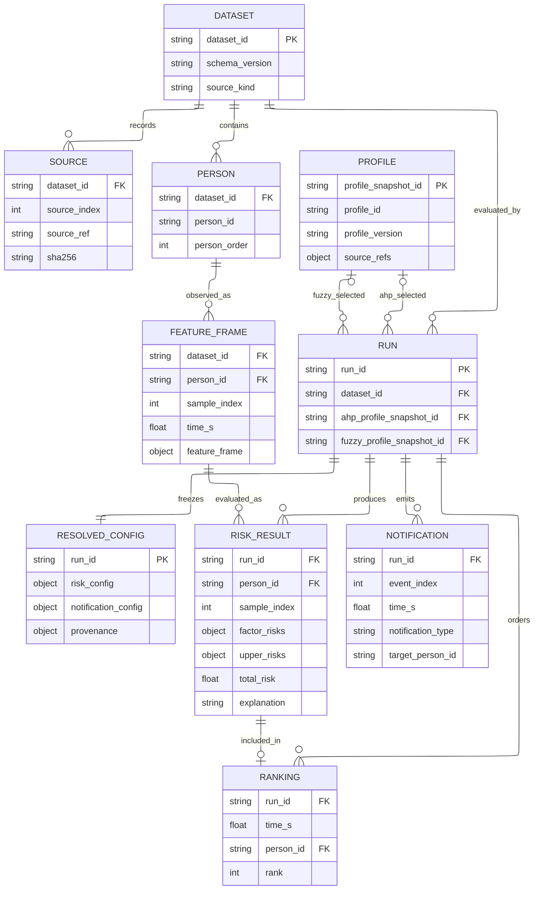

# REQ-002 データ構造の整理案

対象：REQ-002 revision 1。状態：提案、実装未承認。調査日：2026-10-13。

## 推奨する整理

原入力とアンケート回答を保持し、その後のデータを「評価入力」「評価設定」「評価結果」に分ける。評価入力には既存の `FeatureFrame` を使い、全フィールドを保存できる形式を追加する。評価設定には名前だけでなく実際に使った重み・Fuzzy後件・通知設定を保存する。評価結果から従来のCSVと図を生成する。

この順序なら、既存の危険度計算を呼び出したまま保存と運用を整理できる。新しいデータベースの導入や、すべての旧コードの書き換えは初期段階では必要ない。

## 現状のデータ経路と問題

| 区分 | 現状 | 整理が必要な理由・根拠 |
|---|---|---|
| 実データ入力 | `dict[str, pandas.DataFrame]` をpickleまたは人物別CSVからロード | 時刻とノード番号列をadapterで解釈する。[loader](../master_thesis_modules/real_data/loader/data_dicts_loader.py)、[adapter](../master_thesis_modules/risk_core/features/dataframe_adapter.py) |
| 模擬入力 | YAML → WorldState → FeatureFrameSequence | 実データと同じ評価型へ合流できる。修論デモには旧形式を生成する特別経路がある。[encoder](../master_thesis_modules/scenario_sim/encoder/feature_encoder.py)、[sweep](../master_thesis_modules/scenario_sim/runner/run_profile_sweep.py) |
| 評価入力 | 人物ID、時刻、属性、姿勢4成分、本人位置、最近傍物体・スタッフ、任意の高さ・動作名 | 共通型はすでにある。[FeatureFrame](../master_thesis_modules/risk_core/features/feature_frame.py) |
| 回答・評価設定 | AHP行列CSV、TFN CSV、アンケートCSV → RiskConfig | ファイル探索・フォールバック・行順の意味がコードに含まれる。同じ名前でも読込元を記録しないと再現条件が不明になる。[profile_config](../master_thesis_modules/risk_core/engine/profile_config.py) |
| 評価結果 | RiskResult → 元DataFrameへの列追加 → CSV、順位、通知、説明 | 入力と結果が同じ表に混在する。時刻による結果の再対応付けが必要。[result](../master_thesis_modules/risk_core/engine/risk_result.py)、[outputs](../master_thesis_modules/scenario_sim/runner/_outputs.py) |
| 再評価用保存 | シナリオ由来の保存表はFeatureFrameの一部のみ | 信頼度・最近傍座標・スタッフ速度等を保存しない。TFNはCSVではタプル文字列になる。[型仕様 §9](../docs/data_type_specification.md) |
| 実行条件 | runnerごとに複数のCLI引数 | プロファイルの人名と現場のスタッフが別概念でも `staff_names` という名称が使われる。入力、モデル、集約法、通知表現等をまとめた実行設定が必要 |

既存の [データ型仕様](../docs/data_type_specification.md) は現状の説明として残し、この文書は変更案として区別する。2026-10-12のレビューにはREQ-001以前の内的統合の記述があるため、計算の正本は調査時のコードとする。

## 論理ER図

ER図はファイル間の関係を表す。DBテーブルへの移行は提案しない。複合キーの詳細は次の表で定義する。



`SOURCE` は入力ファイルの来歴。`PROFILE` は回答者の評価プロファイルであり、観測された現場スタッフの人物レコードとは結合しない。現行の既定設定だけで実行する場合は、対応するプロファイル参照をnullとし、解決済み設定を必ず保存する。

## エンティティと保存契約

| エンティティ | キー | 内容・規則 |
|---|---|---|
| Dataset | dataset_id | schema_version、実データ／模擬の区分、入力ファイル参照とSHA-256、変換処理版、座標系・単位・時刻基準。入力を移動・上書きしない |
| Source | dataset_id + source_index | 入力の相対参照、ハッシュ、入力種別。人物への対応が分かる場合は対応も記録 |
| Person | dataset_id + person_id | 先頭ゼロを保つ文字列ID、元の人物反復順person_order。患者ラベルは時刻により変わり得るのでFeatureFrame側に保持 |
| FeatureFrame | dataset_id + person_id + sample_index | 既存FeatureFrame全フィールド。sample_indexは元行の識別用に追加する保存メタデータ。time_sは元のfloatを保持 |
| Profile | profile_snapshot_id（profile_id + profile_versionに一意対応） | 回答・AHP行列・TFNへの参照とハッシュ、行順とノード順の対応。原回答は変更しない |
| Run | run_id | dataset_id、AHP/Fuzzyの独立した参照、実行設定、成果物一覧 |
| ResolvedConfig | run_id | 実際に使ったRiskConfigの全フィールドと通知設定、現場スタッフ数、通知表現、読込元・フォールバック、コード版・未コミット差分の識別、Pythonと依存版、コマンド、seedの使用有無 |
| RiskResult | run_id + person_id + sample_index | time_s、total_risk、factor_risks、upper_risks、説明。入力列を混ぜない。比較モデルで0になるノードの意味はモデル設定と対応付ける |
| Ranking | run_id + time_s + person_id | 順位、総合値、元結果のsample_index参照。対象判定、同点処理、時刻のグループ化を現行どおりにする |
| Notification | run_id + event_index | 時刻、種別、対象、順位、値、理由、message。応援要請は対象nullとし、旧CSVへ出す際に空文字へ戻す |

RiskResultの入力参照は `(Run.dataset_id, person_id, sample_index)` とし、参照先FeatureFrameのdatasetとRunのdatasetが一致することを検証する。復元時は `person_order` 順、各人物内は元の `sample_index` 順に結果列を組み立てる。時刻ソートに置き換えない。

`sample_index` の追加で時刻の同期方法を変えない。既存の順位と通知はfloat時刻の完全一致を使うため、時刻丸め、補間、人物の並べ替えはこの改修から除外する。重複時刻は入力を黙って統合せず記録し、既存処理との対応が一意にならない場合は移行対象として合格にしない。順位キーが衝突する入力は個別設計・承認が必要になる。

座標単位とスタッフ方向の意味はデータセットごとに記録する。既存の経路には変位・方向・速度の意味差があるため、保存名を `vx/vy` にしただけでm/sへ換算しない。最近傍物体やスタッフのIDが元入力で分からない場合も、位置からIDを推定して作らない。全物体を持つ空間観測テーブルの導入は次段階の任意案とする。

## 推奨ファイル形式

初期案はUTF-8のJSONとJSON Linesを使う。JSON Linesは1行1レコードのJSONで、列の順番に依存せず、座標や姿勢をまとまりとして保存できる。既存CSVは分析・可視化・互換出力として残す。大規模データの速度・容量は未測定なので、Parquetへの変更は実測後の別判断とする。

```text
datasets/<dataset_id>/
  manifest.json           # 版、来歴、単位、人物順
  features.jsonl          # 全FeatureFrameと元行の識別情報
profiles/<profile_id>/<profile_version>/
  manifest.json           # 原回答・行列・TFNへの参照と変換対応
runs/<run_id>/
  requested.yaml          # 指定した実行条件
  resolved.json           # 実際に使った設定、環境、入力ハッシュ
  risk_results.jsonl      # 入力を含まない型付き評価結果
  ranking.csv
  notification_log.csv
  legacy/                 # 従来のeval CSV等
  figures/
```

ファイルパスは案であり、既存outputsを今回移動しない。順位・通知CSVは空でも固定ヘッダを持つ。未使用のseedは `not_used` と明記する。生データと個人情報を含むプロファイルはGitへの追加対象にしない。

### 評価入力の例

以下は説明用の架空データであり、測定結果ではない。

```json
{
  "schema_version": "1",
  "dataset_id": "demo",
  "person_id": "00001",
  "sample_index": 0,
  "feature_frame": {
    "person_id": "00001",
    "time_s": 0.0,
    "is_patient_label": "yes",
    "is_patient_confidence": 1.0,
    "age_group_label": "old",
    "age_confidence": 1.0,
    "pose_features": {
      "standing_degree": 0.8,
      "trunk_tilt": 0.2,
      "wrist_distance_from_hip": 0.1,
      "ankle_spread": 0.3
    },
    "patient_position": {"x": 1.0, "y": 2.0},
    "nearest_iv_position": {"x": 1.5, "y": 2.0},
    "nearest_wheelchair_position": null,
    "nearest_handrail_position": null,
    "nearest_staff_position": {"x": 2.0, "y": 2.0},
    "nearest_staff_velocity": {"vx": -0.2, "vy": 0.0},
    "height_max": null,
    "action_label": null
  },
  "nonfinite": {},
  "source_ref": {"source_index": 0, "row_index": 0}
}
```

JSON標準ではNaNとInfinityを直接保存できない。非有限値のフィールドはJSON上ではnullにし、同じレコードの `nonfinite` にパスと `nan`／`posinf`／`neginf` を記録して、読込時に復元する。例：`{"feature_frame.pose_features.trunk_tilt": "nan"}`。任意のNoneとはこの補助情報で区別する。値を0へ補完する変更は行わない。原入力の欠損とadapterが代入した値の区別は、原入力参照と変換来歴で残す。

### 評価ノードの型

ノード番号は計算と互換性のために保持する。読みやすい名称は既存のnode_ids／node_labelsを参照し、別の独立した番号表を増やさない。現行の名称表が全入力ノードを網羅するとは限らず、不足する名称の補完は同じschema内で扱う。JSONのキーは文字列、計算へ渡すときは整数へ戻す。

```json
{
  "upper_risks": {
    "10000000": {"kind": "scalar", "value": 0.42},
    "40000000": {"kind": "tfn", "l": 0.4, "c": 0.7, "r": 1.0}
  }
}
```

この断片も架空の形式例である。完全な結果レコードでは現行RiskResultの `factor_risks` と `upper_risks` を分けて保存し、同じノードが両辞書にあっても所属を保持する。`total_risk` と `upper_risks[10000000]` の整合を検証し、不一致を黙って修正しない。TFNは3成分を保存し、読込時に既存tupleへ復元する。非有限成分には入力と同じnonfinite規則を使う。CSVのタプル文字列を正規の再評価入力にはしない。

## 実行設定とコードの責務

将来の実行設定は、入力・プロファイル選択・計算条件・通知条件・出力先を一つのYAMLへまとめる。モデル名や集約法は省略で変わらないよう明示し、既存CLIは互換のために残す。設定とCLIを併用する場合の優先順位は「CLIで明示指定した値 > YAML > 現行既定値」とし、適用結果をresolved.jsonに保存する案とする。

現状の `staff_names` は評価者プロファイルの選択に使われるため、設定では `ahp_profiles` と `fuzzy_profiles` に分ける。現場スタッフ数・位置はdatasetまたは通知条件に置く。回答者と現場スタッフの区別を名前で示せる。

コードは入力adapter、保存codec、評価engine、出力exporter、runnerの役割に分ける。既存engineとFeatureFrameを再利用し、初期実装は保存codecと設定保存を追加する。旧版スクリプトは現行・互換・過去参照の一覧を作り、削除や一括移動は使用状況の確認後に別要求で扱う。

## 段階的な移行と確認条件

| 段階 | 実装候補 | 確認条件 |
|---|---|---|
| 1：中間データの保存 | 全FeatureFrameの保存・復元、manifest、型と来歴の検証 | 全フィールド、None、NaN、Infinity、先頭ゼロID、人物順、元時刻を往復で保持。既存入力を上書きしない |
| 2：設定・結果の保存 | 解決済み設定、型付きRiskResult、既存exporterへの受渡し | 同一入力・同一設定で保存前後の危険度とTFN、順位、通知順・文面が一致。NaN位置も比較する |
| 3：運用の整理 | 設定YAMLと薄いrunner、旧コードの分類 | 既存CLIの明示引数と同じ設定へ解決できる。フォールバック元と既定値が追跡できる |

最初に段階1と2を推奨する。検証対象は代表的な実データ、通常シナリオ、旧形式を使う修論デモ、複数プロファイルと比較モデル。既存テストとREQ-001の内的Fuzzy回帰を実行し、新旧構成全体の一致ではなく、改修直前と改修後の同じ計算経路を比較する。

値の保存・復元は同一Python floatとしての一致を基準とする。再計算の許容誤差が必要になる環境差は、理由と具体値を提示して別途合意する。順位や通知の差を数値誤差として許容しない。通知は時間順に全入力から再計算する。途中再開のための通知内部状態保存は初期範囲に含めない。

## 承認が必要な範囲

今回の依頼に基づき、調査と提案書作成を実施した。保存形式・複数ファイルのコード改修は未承認である。段階1・2、JSON/JSONLの採用、既存CSV併存を承認候補とする。段階3と旧コードの整理は保留案として扱う。

算出式、モデルの意味、重み、Fuzzyルール、最近傍選択、同点順位、欠損処理、時刻同期、研究評価・データ分割は変更対象から除外する。欠損の扱いなどに改善が必要と判明しても、この移行とは別に理由と影響を提示する。
