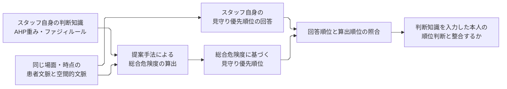

# 総括：課題・解決策を裏付ける評価の見込みは得られたか

AI予行の一致・不一致の原因、判断知識とCIの詳細は[原因考察016](2026-10-17-016-REQ-003-pilot-mechanism-discussion.md)へ追記した。本書は研究全体の到達点の総括として残す。

## 結論

**研究責任者が求めた評価を実施するための手順は成立した。ただし、現手法が課題・解決策を実際に裏付ける結果を出せるという見通しは、まだ十分には得られていない。**

今回分かったのは、空間的文脈とスタッフ自身の判断知識を入力し、本人の順位判断と同じ場面・時点で照合できることである。保存済みの14名分の判断知識の設定では、空間的文脈や判断知識の設定によって出力順位が異なることも確認できた。

一方、研究責任者のいう「適切に順位算出できるか」、すなわち本人の順位との一致については、実スタッフの回答をまだ取得していない。AI予行でも一致と不一致があり、本人間の判断差をそのまま再現できてはいない。したがって、現在の成果から「手法の有効性を示せそうだ」と結論するのは早い。評価は進められるが、手法が本人の判断を表現できる範囲を、次の検証で確かめる必要がある。

### 何を確かめれば研究の裏付けになるか

原稿v18に合わせ、患者本人の属性・行動を「患者文脈」、周囲物体とスタッフの見守り状況を「空間的文脈」と呼ぶ。スタッフの「判断知識」は、カテゴリ内のAHP重みとカテゴリ間のファジィルールに対応する。

図1　研究責任者が求める評価の対応関係。算出順位が変わることに加え、同じ判断知識を持つスタッフ自身の回答順位と整合するかを確かめる。今回、AI予行では照合まで実施したが、実スタッフの回答順位は未取得である。

## 研究責任者の問いへの回答

研究責任者は、①空間的文脈を考慮した見守りと、②スタッフによって異なる判断知識を反映した見守りのための順位算出手法の実現を課題とし、その両方を組み込めるフレームワークを提案する方針を示した。「適切に順位算出できるか」は、知識を入力したスタッフ本人の考える見守り優先順位との一致で確かめる。この基準は変更していない。[要求書の原文・合意](../requests/2026-10-17-001-REQ-003-evaluationDesign.md)

| 知りたかったこと | 今回答えられること | まだ答えられないこと |
| --- | --- | --- |
| 空間的文脈の違いを順位に反映できるか | 患者・物体・スタッフ速度を固定し、スタッフ位置だけを変えた対応場面を作れた。既存の判断知識14名分では、多くの設定で出力順位が変わった | その変化が、同じ場面を見た本人の判断と合うか |
| 判断知識の違いを順位に反映できるか | 同じ場面にスタッフごとに異なる判断知識を入力すると、異なる順位が出ることを確認した | 本人間の判断の違いを、その人の判断知識による出力差として再現できるか |
| 本人の知識から出した順位はスタッフ自身の順位判断と一致するか | 同じ本人・場面・患者・時点で比較する接続を実装し、AI予行で一致と不一致を取り出せた | 実スタッフでどの程度一致するか。不一致の主な原因は何か |
| スタッフ調査として実行できるか | 知識36判断と3場面の順位を答え、回答者の判断知識による解析へ取り込む試作は動く | 説明を含めて5分以内に回答できるか。場面が十分理解されるか |

「入力を組み込めること」と「組み込んだ結果が本人の判断に合うこと」は、確認すべき内容が異なる。今回は前者の実行可能性が具体的になった。研究責任者が最終的に知りたい後者は、これからの中心的な検証事項である。

## 結果を研究上どう読むか

### 空間的文脈は出力に影響する。ただし、本人判断との整合は未確認

C02とC03は、スタッフ位置だけを変えた対応場面である。既存14名分の知識による保存結果を今回読み取り集計すると、順位が変わった設定はweighted_sumで10名分、weighted_maxで11名分だった。これは、空間的文脈の変更が順位まで反映される実例である。残りの設定で順位が変わらなかったことだけから、不具合とは判断できない。本人の優先順位も変わらない可能性があるためである。

ただし、この14名には今回の場面の順位を尋ねていない。「スタッフ位置を変えると出力が変わる」という証拠は得たが、「本人が優先先を変える状況で、システムも同じように変わる」という証拠は未取得である。

AI予行では、AIスタッフS02はC02からC03で順位を変えたが、システムは同じ順位だった。AIスタッフS01とシステムは両方とも順位を変えたものの、C02では両者が一致していない。現時点で、空間的文脈に応じた本人判断の再現を確認できたとはいえない。なお、C01とC02は患者行動等も異なるため、その差を空間的文脈だけの効果として説明しない。

### 判断知識による出力差はある。しかし、本人間の違いに合うとは限らない

既存14名分の判断知識の設定では、同じ場面で異なる順位が出た。順位パターン数はC01/C02/C03の順に、weighted_sumで4・4・5種類、weighted_maxで5・5・5種類だった。判断知識の設定の違いが出力に現れることは確認できる。

しかし、AI予行で見えたのは、出力差とAIスタッフの判断差の食い違いである。以下の順位は患者P01、P02、P03、P04の順で示す。今回、両集約の順位は同じだった。

| 場面 | AIスタッフS01とS02の判断 | 各自の知識を使った出力 | 読み取れる問題 |
| --- | --- | --- | --- |
| C01 | どちらも1,3,2,4 | S01は1,3,2,4、S02は1,2,3,4 | AIスタッフの判断が同じなのに出力が異なる |
| C02 | S01は1,3,1,3、S02は1,2,3,4 | どちらも1,2,3,4 | AIスタッフの判断が異なるのに出力は同じ |
| C03 | どちらも1,3,2,4 | S01は1,3,2,4、S02は1,2,3,4 | AIスタッフの判断が同じなのに出力が異なる |

つまり、今回のAI予行には「本人間の判断の違いを各自の知識によって再現できた」と示せる場面がなかった。これを実スタッフにも当てはまる結論にはできないが、評価設計の壁打ちとしては重要な確認点である。

### スタッフ自身の順位判断との一致を評価する形はできたが、有効性の判定には進めていない

AI予行の2名×3場面では、順位全体が一致したのは3回答、不一致は3回答だった。この数字を「精度50％」として論文に使うことはできない。スタッフ役のAIによる少数回答であり、研究の主要指標も未確定だからである。

不一致を生む計算上の仕組みは[原因考察016](2026-10-17-016-REQ-003-pilot-mechanism-discussion.md)で分析した。一方、AIスタッフがその回答に至った理由は未特定である。場面説明の曖昧さ、判断知識に関する設問が引き出す判断と場面の順位判断の違い、モデルの表現範囲などを切り分ける必要がある。AI自身の回答の一貫性も未確認である。今回のテストと独立再計算は、保存した知識から所定の計算が再現されることを確認した。本人の判断を再現するモデルとして妥当だという証拠にはならない。[予行結果013](2026-10-17-013-REQ-003-prototype-execution.md)、[独立査読014](2026-10-17-014-REQ-003-prototype-review.md)

## PMの判断と次に優先すること

研究の課題・解決策を変える必要があるとは、現時点では判断しない。同じ場面への本人判断と出力を照合する評価は、両者が合う場合も合わない場合も明らかにできる。今回の方向で評価を具体化する意義はある。

ただし、現在の3場面をそのまま本調査の最終版にして、本人との一致が得られると期待する根拠は不足している。次はコードの追加より、次の順で評価条件を詰めることを優先する。

1. **場面の理解を揃える。** 位置・姿勢・移動方向から何が分かり、物体の使用状態や視線など何が分からないかを説明する。本人が提示されていない状況を補って答えると、システムと異なる状況を評価することになる。
2. **知識回答と順位判断の対応を確かめる。** 空間的文脈だけを変える場面と、同じ場面への本人間の判断を使い、一致・不一致の理由を確認する。人による小規模な試行が必要であり、AI予行の結果に合うよう算出式を調整する段階ではない。
3. **全回答の負担を実測する。** 5分は300秒であり、知識36判断だけでも均等配分なら1判断約8.3秒、実際は説明と順位回答にも時間が必要である。達成可能性は未確認で、重要な実施上の課題である。超過しても設問を無断削除しない。
4. **本調査の判定方法を確定する。** 同順位・判断不能を含む一致の測り方、場面数、sum/maxの採用を、具体案と影響を示して合意する。不一致を見てから都合のよい指標や方式を選ばない。

この順で準備を進めれば、「空間的文脈や判断知識に応じて順位が出る」だけで終わらず、「その順位が本人の見守り判断に合うか」を問う調査にできる。現段階で得られた見込みは、その検証を実施できるという見込みである。本人判断との整合という研究上の成果は、まだ実証できていない。

## 根拠と今回の作業範囲

今回の総括は[研究計画006](2026-10-17-006-REQ-003-research-plan.md)、[仕様012](2026-10-17-012-REQ-003-prototype-specification.md)、報告013・014、保存済み順位CSVに基づくPMの判断である。14名分の集計は次の保存結果の `system_rank` を患者ID順に並べ、同一場面内のパターン数とC02/C03間の変化数を数えた。新たなモデル計算、実スタッフ調査、主要指標の採用は行っていない。

- [既存14名・weighted_sumの保存順位](../outputs/REQ003_pilot_20261017T165939/existing-weighted_sum-final/system-ranks.csv)
- [既存14名・weighted_maxの保存順位](../outputs/REQ003_pilot_20261017T165939/existing-weighted_max-final/system-ranks.csv)

## 変更・確認履歴

| ID | 発生日時 | 記録日時 | 担当 | 対象・内容 | 根拠 |
| --- | --- | --- | --- | --- | --- |
| H01 | 2026-10-17（依頼受信時刻未記録） | 2026-10-17T22:04:11+09:00 | 研究責任者→PM | 課題・解決策を裏付ける評価の見込みを説明する総括を直接指示 | 今回の依頼 |
| H02 | 2026-10-17T22:04:11+09:00 | 2026-10-17T22:04:11+09:00 | PM | 要求・計画・予行結果を照合。既存14名分の保存順位を読取集計し、実施可能性と本人一致の未確認を分けて総括 | 本文の参照資料。独立査読の新規実施ではない |
| H03 | 2026-10-17T22:04:48+09:00 | 2026-10-17T22:04:48+09:00 | PM | yomiyasuによる日本語校正・静的検査・差分確認。数値・原文・採否を保持し、評価の実施可能性と有効性の未実証を区別 | 校正前後の照合 |

| ID | 発生日時 | 記録日時 | 担当 | 追記 |
| --- | --- | --- | --- | --- |
| H04 | 2026-10-17T22:16:08+09:00 | 2026-10-17T22:16:08+09:00 | PM | 詳細考察016への参照を追加。元の総括・結果は保持 |
| H05 | 2026-10-17（依頼受信時刻未記録） | 2026-10-17T22:26:03+09:00 | 研究責任者→PM | 原稿v18の用語に統一し、理解を助ける図を追加するよう直接指示 |
| H06 | 2026-10-17T22:26:03+09:00 | 2026-10-17T22:26:03+09:00 | PM | 本文の判断知識・空間的文脈・リスクの用語を原稿に合わせ、照合の図を追加。数値と結論を保持。計算上の機序と回答に至った理由の区別を明記 |
