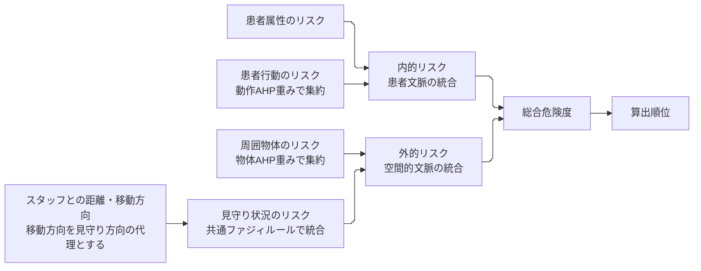
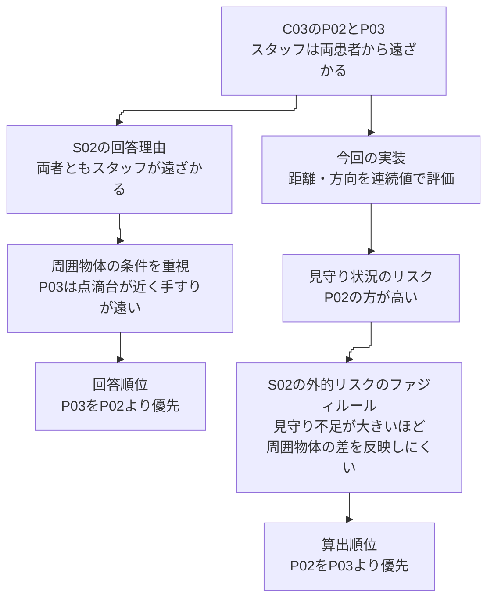

# AI予行の考察：どの知識が一致・不一致を生み、何が分かったか

## 原稿と共通の用語

本書は[原稿v18](../paper/latest/paper_full_draft_v18.pdf)の1ページおよび3〜4ページに合わせ、患者本人の属性・行動を「患者文脈」、周囲物体とスタッフの見守り状況を「空間的文脈」と呼ぶ。患者文脈を統合した値が「内的リスク」、空間的文脈を統合した値が「外的リスク」、両者を統合した値が「総合危険度」である。

S01とS02はスタッフ役を担ったAIであり、本書では「AIスタッフ」と呼ぶ。「回答順位」はAIスタッフ自身が回答した見守り優先順位、「算出順位」はそのAIスタッフの判断知識を入力して提案手法が算出した見守り優先順位を指す。原稿と同じく、スタッフの移動方向を見守り方向の代理として用いる。本書の「移動方向に基づくリスク」はこの入力から求めた値を指し、実際の視線を観測したものではない。

## 今回の問いへの回答

今回の一致・不一致は、AHPの整合性の高低だけでは説明できない。主要な論点は、**患者行動と空間的文脈から異なる優先順位が導かれるとき、どちらを優先する判断知識か、スタッフの見守り状況をどのようにリスク値へ変換・統合するか**にある。同順位を付ける判断基準の違いも、確認すべき候補として残る。

動作を優先するS01では、座位だが空間的文脈に由来するリスクが高い患者より、立ち上がり姿勢の患者を優先する判断が再現された。一方、同じS01でも、AIスタッフが差を付けなかったスタッフの移動方向をモデルが区別すると、不一致になった。空間的文脈を重視するS02では、スタッフの移動方向を判断材料にした場面で一致した。一方、見守り不足が大きいと周囲物体の違いを反映しにくくなるファジィルールは、周囲物体の条件を優先した回答順位と一致しなかった。

ここから得られる研究上の論点は、入力した知識が計算に使われたかに加え、**判断知識に関する設問で得た判断規則と、具体的な場面で使う判断規則が対応しているか**を評価する必要があるということである。今回、保存値から出力が生じる計算上の機序はかなり絞れた。ただし、なぜAIスタッフがその知識と順位を回答したかという回答に至った理由は観測していない。以下は保存回答と計算過程に基づく考察であり、実スタッフの認知過程を実証したものではない。

## 比較した判断知識とCI

### 2名のAIスタッフはどのような知識を回答していたか

AIスタッフの自由記述と数値回答には、次の特徴がある。重みはAHP各カテゴリ内の相対重みであり、患者行動と周囲物体では重みを正規化するカテゴリが異なるため、数値を直接比較して総合的な重要度とは解釈しない。

| 観点 | S01：動作を優先する知識 | S02：見守り不足を重視する知識 |
| --- | --- | --- |
| AIスタッフが述べた方針の要約 | 危険な動作があれば、空間的文脈がよくても優先度を高く保つ | 同じ動作なら、スタッフによる見守りが手薄な患者を先に確認する |
| 動作AHPの主な重み | バランスを崩す動作0.419、立ち上がり0.249、車椅子移動0.082 | バランスを崩す動作0.428、立ち上がり0.176、車椅子移動0.168 |
| 物体AHPの重み | 車椅子0.540、点滴台0.297、手すりからの距離0.163 | 手すりからの距離0.540、点滴台0.297、車椅子0.163 |
| 総合危険度のファジィルールの特徴 | 内的リスクが高い条件を優先する | 外的リスクが高い条件を優先する |

「患者行動を重視する」「空間的文脈を重視する」という説明だけでは、一致・不一致の原因を説明できない。例えば両者とも、動作AHPではバランスを崩す動作を最重視している。総合順位の違いを生むのは、その重みが場面内で実際に働くかと、上位のファジィ推論が下位の差をどう統合するかである。

### CIはいくつだったか、何を意味するか

CIはAHPの整合度指標（Consistency Index）として、相反行列の最大固有値を使う既存処理と同じ定義で再計算した。

\[
CI=\frac{\lambda_{\max}-n}{n-1}.
\]

| AIスタッフ | 動作7項目のCI | 物体3項目のCI |
| --- | ---: | ---: |
| S01 | 0.0342375052 | 0.0046013564 |
| S02 | 0.0274568260 | 0.0046013564 |

再計算した主固有ベクトルは、保存された実際の重みと丸め誤差の範囲で一致した。値が読み込まれず別の既定重みに置き換わったことが原因ではない。

CIが測るのは、一対比較の集合が一つの相対重みとしてどの程度整合するかである。CIは、ファジィ回答や具体場面の順位との整合を測っていない。S02の動作CIはS01より小さいが、回答順位との一致が多かったわけではない。また、物体CIは同じでも、車椅子と手すりの重視の仕方は逆である。**この結果をCIの大小だけで説明したり、不一致だけを理由にAHP回答を不整合として除外したりすることはできない。** 今回、CIによる採否閾値は定めていない。

ファジィルールに関する回答は一対比較行列ではないため、上記のCIは適用していない。代わりに、各入力が増えたときの出力の変化を調べた。どちらのAIスタッフのファジィルールでも、入力に対する出力は全段で非減少であり、非単調なルールが順位を不自然に逆転させたという説明は当てはまらない。

## 一致と不一致を生む計算の仕組み

図1　今回のAI予行で用いた階層構造。判断知識から設定したAHP重みとファジィルールを使う一方、距離と移動方向の統合には共通ルールを使う。内的リスクも回答由来のファジィルールで統合した点は今回の実装に従っており、原稿v18の計算式へ戻したものではない。

現実装は、Hを高リスク、Lを低リスクとし、二入力の高リスクの所属度を入力値そのもの、低リスクの所属度を1から入力値を引いた値とする。積で求めた四つの発火強度を後件値で重み付けするため、今回のファジィ統合は双線形の式として表せる。

患者属性のリスクを \(s\)、患者行動のリスクを \(a\)、周囲物体のリスクを \(o\)、見守り状況のリスクを \(z\)、内的リスクを \(i\)、外的リスクを \(e\)、総合危険度を \(T\) とする。回答の1〜5を0〜1へ変換した後の式は次のとおりである。

| 統合段階 | S01 | S02 |
| --- | --- | --- |
| 内的リスクの統合 | \(i=0.5s+a-0.5sa\) | \(i=0.5s+0.75a-0.25sa\) |
| 外的リスクの統合 | \(e=0.5o+0.5z-0.25oz\) | \(e=z+0.75o(1-z)\) |
| 総合危険度への統合 | \(T=i+0.5e(1-i)\) | \(T=e+0.75i(1-e)\) |

S02の式から、次が分かる。

\[
\frac{\partial e}{\partial o}=0.75(1-z),\qquad
\frac{\partial T}{\partial i}=0.75(1-e).
\]

見守り状況のリスクが高いほど、周囲物体のリスクの差が外的リスクに現れにくい。さらに外的リスクが高いほど、動作・属性に由来する内的リスクの差が総合危険度に現れにくい。これは不具合による消失ではなく、S02が回答したファジィルールによる相互作用である。「周囲物体に関するAHP重み」を入力していても、その効果が上位の統合で小さくなる場合がある。

S01の総合式では逆に、内的リスクが高いと空間的文脈の影響が小さくなる。したがって、スタッフの判断知識の反映をAHPの重みだけで論じるのは不十分である。**階層全体で、どの条件が他の条件の影響を弱める知識になっているか**まで説明する必要がある。

## 場面ごとの考察

### C01：患者行動と空間的文脈のどちらを優先するか

中心となる比較は、P02「座位だが空間的文脈に由来するリスクが高い」とP03「立ち上がり姿勢だがスタッフの見守りが比較的十分」である。2名のAIスタッフはともにP03を上位と答えた。

S01では、立ち上がり姿勢と座位の患者行動のリスクの差が比較的大きく、総合危険度のファジィルールも内的リスクを優先した。その結果、空間的文脈に由来するリスクが高いP02よりP03が上位となり、「動作に危険があるときは優先する」というAIスタッフの理由に沿った一致が得られた。これは、単に同じ順位になっただけでなく、**AIスタッフが述べた優先順位の判断理由と計算過程が対応する一致例**である。

S02では、患者行動のリスクの差が小さく、空間的文脈を重視する2段階のファジィ推論が働いた。P02の外的リスクがP03より高いため、座位のP02が上位になった。モデルは回答された数値知識に従っているが、AIスタッフは自由順位では「立ち上がり中なので優先」とP03を選んでいる。

この不一致は、知識回答と具体場面の判断基準の対応に問題がある可能性を示す。HH・HL・LH・LLの4条件の回答だけで、具体的な中間値での判断まで直接取得したわけではない。所属度の尺度と補間はモデルが定めているため、出力との不一致をAIスタッフの論理矛盾と断定することもできない。ただし、AIスタッフが知識回答を十分に理解しなかったのか、H/Lの設問と具体的な姿勢の対応が曖昧だったのか、場面判断が変わったのかは特定できていない。回答順位だけを正しい教師として、ファジィを変更すべきだとは結論しない。

保存値による条件置換でも、この不一致は一つの重みだけでは説明できなかった。weighted_sumでは、S01を基準に動作AHPだけ、外的リスクのファジィルールだけ、または総合危険度のファジィルールだけをS02へ交換すると、いずれもP02が上位となった。weighted_maxでは、外的リスクのファジィルールだけの交換ではP03上位を保った。元の回答条件では両集約が同じ順位でも、条件を変えたときの応答は同じではない。一方、S02の一つの設定だけをS01へ戻しても、一致は回復しなかった。複数段階の組合せがどちらの患者を上位にするかを決めている。なおS01のP03とP02の総合危険度差は約0.0149（weighted_sum）であり、この一例の一致から幅広い条件での安定性は主張できない。

### C02：同順位の不一致は、方向情報を判断材料にしたかで分かれる

C02は全員同じ姿勢・属性で、スタッフからの距離も同じである。動作AHPを交換しても順位関係は変わらず、この場面で患者行動に関する判断知識の個人差が有効だったとはいえない。

AIスタッフS02は、スタッフが離れる方向にいるP01/P02と、近づく方向にいるP03/P04を区別した。モデルも移動方向を見守りの代理として区別し、AIスタッフと一致した。これは、**スタッフの移動方向から見守り不足を判断する点が対応した一致例**である。実際の視線や注意を観測できたという意味ではない。

AIスタッフS01は、主に同じ動作・同じスタッフ距離・近傍物体を根拠に、P01/P03を同順位、P02/P04を同順位とした。とくにP02/P04は、保存された下位のリスク値のうち移動方向に基づくリスク以外はすべて同じである。この二者をモデルが別順位にした計算上の原因は、移動方向に基づくリスクにある。

距離と移動方向から見守り状況のリスクを求める共通ファジィルールは、今回の個人回答には含まれず、両者共通の既定ルールだった。S01が方向を順位差として使わなかったとしても、その選択をこの段階に入力する仕組みは今回の質問票にはない。**個人の判断知識による見守り優先順位を評価する際には、どこが個人回答で、どこが共通のモデル仮定かを明示する必要がある。** これは、ユーザーが対象外とした共通知識との比較を追加する提案ではない。

P01/P03には手すり距離の差もあるため、完全に同条件ではない。移動方向に基づくリスクを全員同じ0.5へ置く診断では、両設定でP02/P04は同点になるが、P01/P03には差が残った。この部分には、AIスタッフが小差を判断上区別しなかった可能性もある。厳密な数値順位と「差を付けにくい」という同順位回答の違いを、一括して知識の不一致と解釈するのは適切ではない。許容差の導入や同順位の評価方法は、本調査の仕様として事前に合意する必要がある。

### C03：同じ「スタッフが遠ざかる」でも、数値知識と場面判断の使い方が異なる

C03では、2名のAIスタッフともP03をP02より優先した。S01の算出順位は回答順位と一致したが、S02の算出順位ではP02が上位となった。

図2　S02のC03における回答順位と算出順位の食い違い。回答側の説明は保存された理由からの解釈であり、AIの思考過程を観測したものではない。算出側は保存値とファジィルールから確認した計算過程を示す。

AIスタッフS02の理由では、両者ともスタッフが遠ざかる状況として扱い、そのうえで点滴台・手すりの条件が悪いP03を優先したと読める。一方モデルは「両者とも遠ざかる」という同じカテゴリーにはまとめない。スタッフの距離と移動方向に基づく連続的なリスク値から、P02の見守り状況のリスクを約0.984、P03を約0.878と評価した。

S02の外的リスクのファジィルールでは、このように見守り状況のリスクが高いと、周囲物体のリスクに対する感度が小さくなる。P02の周囲物体のリスクに対する感度は約0.012、P03でも約0.092である。AIスタッフがP03を優先する理由に挙げた周囲物体の条件の差が、計算では大きく抑えられ、P02のスタッフの見守り不足が上回った。

S02の外的リスクのファジィルールだけをS01のものへ交換すると、C03の出力はAIスタッフと同じ順位になった。この操作は、**当該条件下では外的リスクの統合ルールが順位の逆転を左右する**ことを示す。ただし、S01のルールを採用すべきという修正根拠ではない。保存した回答順位に合う設定を探すことと、その人の知識を妥当に取得することは異なるからである。

S01のC03の一致は、同じ立ち上がり姿勢の患者間で、周囲物体とスタッフの見守り状況を組み合わせた結果として説明できる。全員の動作が同じなので、この一致から患者行動のAHP重みの個人差が有効だったとはいえない。

C03から得られる論点は、「空間的文脈を重視する」という言葉だけでは、空間的文脈に含まれる複数条件の優先関係は決まらないことである。今回のS02では、数値知識はスタッフの見守り不足を強く優先した一方、自由記述は「遠ざかる」という状況内で周囲物体の条件を重視したと解釈できる。この違いを、判断知識の取得と特徴量化の双方から確かめる必要がある。

## この予行から研究として得られたこと

第一に、**CIが示す一対比較内の整合と、スタッフ自身の順位判断を再現する妥当性は別の検証課題である。** CIを確認しても、ファジィの条件解釈や場面理解を通じて不一致は生じる。本調査ではCIと順位一致を併記しても、一方で他方を代用しない。

第二に、**一致した理由を場面ごとに限定して論じる必要がある。** S01のC01は患者行動と空間的文脈のどちらを優先するかという判断、S02のC02は方向情報の解釈、S01のC03は周囲物体とスタッフの見守り状況の組合せが対応した例である。これらをまとめた一致件数だけでは、どの判断知識を反映できたかが分からない。

第三に、**不一致は、判断知識の取得・特徴量化・統合・順位の表現に分けると、確認すべき点が具体化する。** 今回は、C01で知識回答と場面判断の対応、C02で移動方向に基づくリスクと共通ルール、および同順位の意味、C03で距離・方向から求める見守り状況のリスクとカテゴリー的な判断の違いが問題として残った。これらは、スタッフごとの判断知識の入力経路が正常であることとは別に検証する必要がある。

第四に、**今回の場面は知識全体を十分に試していない。** 両者が最重視したバランスを崩す動作は、立ち上がり動作の参照姿勢では対応する下位危険度が0である。C02/C03では動作と属性も全患者同じである。この結果だけでは、重要な動作に対する個人差や属性との組合せを評価できない。どの知識を確かめる場面なのかを明示し、競合条件を含む場面の十分性を次の評価仕様で検討する。

以上から、本調査前に優先するのは、不一致に合うよう重みを調整することではない。H/Lの条件と具体場面の対応、移動方向をどう読むか、同順位をどういう意味で答えるかを確認し、スタッフ自身が述べた順位の理由と各段階の計算を照合することである。必要な手法・設問・特徴量の変更は、この確認を踏まえて具体案と影響を示し、合意してから行う。

今回のAI予行は、この評価で何を区別すべきかを示す材料となった。ただし、これらの一致・不一致を実スタッフの結果として論文に掲載するものではない。論文の考察へ引き継げるのは、今後の本人回答で確かめる論点と、結果を説明する分析の枠組みである。

## 根拠、診断の再現性と限界

保存された[S01知識](../outputs/REQ003_pilot_20261017T165939/synthetic-knowledge/S01.json)、[S02知識](../outputs/REQ003_pilot_20261017T165939/synthetic-knowledge/S02.json)、[順位と理由](../outputs/REQ003_pilot_20261017T165939/responses/all.csv)、各集約のsnapshotsとconfigsを用いた。元の一致・不一致の一覧は[実行報告013](2026-10-17-013-REQ-003-prototype-execution.md)、研究全体の位置付けは[総括015](2026-10-17-015-REQ-003-research-assessment.md)に記録している。

式の根拠は[ファジィ実装](../master_thesis_modules/risk_core/aggregators/fuzzy.py)、[階層計算](../master_thesis_modules/risk_core/engine/risk_engine.py)、[移動方向に基づくリスク](../master_thesis_modules/risk_core/factors/staff_risk.py)、CIの定義は[既存AHP処理](../master_thesis_modules/scripts/AHP/get_comparison_mtx_v3.py)である。

今回の追加診断では、動作AHP・物体AHP・内的リスクのファジィルール・外的リスクのファジィルール・総合危険度のファジィルールの各設定について、2名のAIスタッフの全32組合せを調べた。3場面・2集約で192条件となる。これは事後的な計算機構の切り分けであり、合成人物が追加で回答した条件でも、採用した評価条件でもない。元条件48件のスコアを誤差1e-12以内、順位を完全一致で復元した。判断知識に関する設定だけを交換した混合設定は、実在する回答者の知識として扱わない。

[診断スクリプト](../outputs/REQ003_pilot_20261017T165939/mechanism-analysis-20261017T221057/analyze.py)、[数値詳細](../outputs/REQ003_pilot_20261017T165939/mechanism-analysis-20261017T221057/mechanism-results.json)、[入力・コードhashと実行環境](../outputs/REQ003_pilot_20261017T165939/mechanism-analysis-20261017T221057/provenance.json)を保存した。実行したコマンドは `python outputs/REQ003_pilot_20261017T165939/mechanism-analysis-20261017T221057/analyze.py`。再実行するときは同じpilot配下の新規ディレクトリにスクリプトをコピーする。既存結果があれば上書きを拒否する。最初の解析スクリプトの式確認は浮動小数点数の厳密等号で失敗し、許容誤差比較へ修正して再実行した。元回答・算出コード・既存出力は変更していない。

移動方向に基づくリスクの等置と実RiskEngineによる設定の交換はresearcherがメモリ内で別途確認した。PMの全32組合せ診断は保存factorと解析式を使った照合である。条件置換が示すのは計算内部での効果であり、AIスタッフの思考過程や、実スタッフに対する因果効果ではない。

## 変更・委譲・査読履歴

| ID | 発生日時 | 記録日時 | 担当 | 内容・結果 |
| --- | --- | --- | --- | --- |
| H01 | 2026-10-17（依頼受信時刻未記録） | 2026-10-17T22:14:03+09:00 | 研究責任者→PM | AI予行の知識・CI・一致不一致の原因を、学術的考察を中心に掘り下げるよう直接指示 |
| H02 | 2026-10-17（委譲・返却秒未記録） | 2026-10-17T22:14:03+09:00 | PM→researcher→PM | CI・実計算・条件置換を読取調査。単調性、C01の複合要因、C02の方向代理、C03のFuzzy相互作用を返却 |
| H03 | 2026-10-17T22:14:03+09:00 | 2026-10-17T22:14:03+09:00 | PM | 元条件48件を復元し、全32知識組合せ・192条件を事後診断。原因の候補と確認可能な機構を分けて文書化 |
| H04 | 2026-10-17（依頼・返却秒未記録） | 2026-10-17T22:15:01+09:00 | PM→別reviewer→PM | 独立査読。CI・式・偏微分・元48件と全192混合条件を再計算。C01の交換効果は集約法依存という中指摘、同順位原因の断定を避ける低指摘を返却 |
| H05 | 2026-10-17T22:15:01+09:00 | 2026-10-17T22:15:01+09:00 | PM | 中指摘に従いweighted_sum/maxの応答差を明記。冒頭の同順位要因を候補へ修正。知識の四隅回答と所属度・補間の違いを補足 |

### 独立確認の範囲

reviewerは入力hash、CI4件、元条件48件、192混合条件の768スコアと順位を別の行列式で再計算し、保存結果との一致を確認した。偏微分は数値差分との誤差1e-8未満で一致した。査読で確認したのは計算と解釈の根拠であり、原因候補を実スタッフで確定したものではない。

| ID | 発生日時 | 記録日時 | 担当 | 内容・結果 |
| --- | --- | --- | --- | --- |
| H06 | 2026-10-17（返却秒未記録） | 2026-10-17T22:16:08+09:00 | reviewer→PM | 中・低指摘の解消を再確認。重大指摘なし。査読対象本文hash ac4279d0756eac9c7703f243a2fb610d8af13c868b72d9638ce0d5751ab80d7c |
| H07 | 2026-10-17T22:16:08+09:00 | 2026-10-17T22:16:08+09:00 | PM | 日本語校正・yomiyasu lint/diff・根拠リンクを確認。数値・原文・採否は保持。診断と正式評価を区別する否定表現は誤解防止のため保持 |
| H08 | 2026-10-17（依頼受信時刻未記録） | 2026-10-17T22:26:03+09:00 | 研究責任者→PM | 原稿v18の用語への統一と、図による説明を直接指示 |
| H09 | 2026-10-17T22:26:03+09:00 | 2026-10-17T22:26:03+09:00 | PM | 患者文脈・空間的文脈・内的リスク・外的リスク・総合危険度へ統一。階層とC03の不一致の図を追加。旧用語を含む過去の履歴は当時の記録として保持 |
| H10 | 2026-10-17（依頼・返却秒未記録） | 2026-10-17T22:26:03+09:00 | 別reviewer→PM | 原稿との対応、数式15箇所と小数値の保持、3図の説明を確認。移動方向の定義等の軽微指摘を修正し再確認、残る指摘なし。Mermaid実描画は未実施 |
| H11 | 2026-10-17T22:26:03+09:00 | 2026-10-17T22:26:03+09:00 | PM | yomiyasuで日本語校正と静的・差分検査。数式・CI・順位結果を保持。AGENTS.mdにも原稿の用語を使う方針を追加 |
