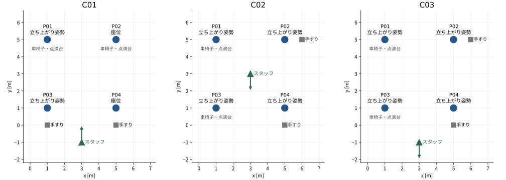
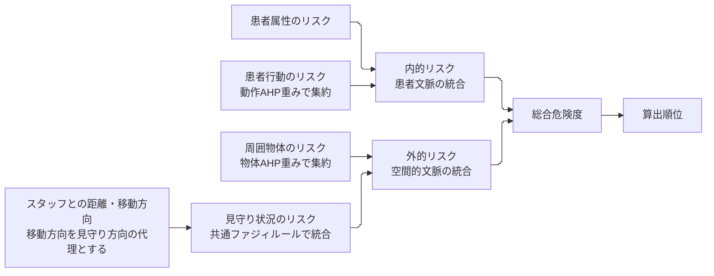

# AI予行報告：判断知識と見守り優先順位の対応をどこまで確認できたか

## 要旨

患者行動を重視するAIスタッフと、空間的文脈を重視するAIスタッフに判断知識と3場面の見守り優先順位を回答させ、各自の知識を入力したシステムの順位と照合した。2名×3場面のうち順位全体が一致したのは3回答で、残る3回答は一致しなかった。実スタッフの調査結果ではないため、この件数から手法の有効性は判断できない。

今回得られたのは、**知識を入力すれば本人の順位判断を再現できるとは限らず、知識設問と具体場面で同じ判断基準が使われているかを確かめる必要がある**という知見である。とくに、移動方向を見守り状況としてどう扱うかと、周囲物体・見守り状況を組み合わせるルールが、不一致に関わっていた。PMは、次に知識設問と場面説明の理解を確認する予行を優先し、その結果から必要な修正を決める方針を提案する。

## 1. 目的：本調査で本人の判断との整合を確かめられるか

研究責任者が設定した課題は、空間的文脈を考慮し、スタッフごとに異なる判断知識を反映して、見守り優先順位を算出する手法の実現である。解決策は、患者文脈と空間的文脈を階層的に統合し、AHP重みとファジィルールへスタッフの判断知識を反映するフレームワークである。

今回のAI予行では、本調査に先立ち「同じスタッフから得た判断知識を使うと、そのスタッフ自身が同じ場面に付けた順位を再現できるか」を試した。一致・不一致を生む条件を調べ、設問や提示資料、評価手順の不足を明らかにすることが目的である。AIの回答を論文の実スタッフ評価へ含めることはしない。

用語は[原稿v18](../paper/latest/paper_full_draft_v18.pdf)に合わせる。患者本人の属性・行動が「患者文脈」、周囲物体とスタッフの見守り状況が「空間的文脈」である。以下ではAIスタッフ自身が答えた順位を「回答順位」、そのAIスタッフの判断知識からシステムが出した順位を「算出順位」と呼ぶ。

## 2. 方法：2名のAIスタッフの知識回答を、3場面の順位判断と照合した

### 2.1 どのような場面を提示したか

高齢患者4名とスタッフ1名、車椅子・点滴台・手すりを配置した3場面を使った。すべてシナリオの0秒時点でイベントを適用した後の状態である。「立ち上がり」は参照姿勢の設定であり、実映像から特定した動作開始の瞬間ではない。



図1　今回の3場面。矢印はスタッフの移動方向を示す。図は読者のために保存座標から作成したもので、AIスタッフへの実際の提示は、患者の姿勢・位置、物体の位置、スタッフの位置・速度を記載した構造化テキストであった。車椅子・点滴台の記載は患者と同じ座標への配置を表し、使用中・接続中・ブレーキ状態までは意味しない。

| 場面 | 患者文脈 | 空間的文脈 | この場面で確かめること |
| --- | --- | --- | --- |
| C01 | P01/P03は立ち上がり姿勢、P02/P04は座位 | 上側のP01/P02に車椅子・点滴台、下側に手すり。スタッフは下側から上向きに移動 | 患者行動と空間的文脈から異なる優先順位が導かれるとき、どちらを優先するか |
| C02 | 全員が立ち上がり姿勢 | 左側のP01/P03に車椅子・点滴台、右側に手すり。スタッフは中央から下向きに移動 | 全員同じ動作・同じスタッフ距離でも、物体や移動方向の違いをどう判断するか |
| C03 | C02と同じ | 患者・物体・スタッフ速度はC02のまま、スタッフ位置だけ中央から下側へ移す | スタッフ位置の変化に対し、回答順位と算出順位がどう変わるか |

患者位置は全場面でP01=(1,5)、P02=(5,5)、P03=(1,1)、P04=(5,1)mである。C02からC03ではスタッフ位置だけを(3,3)から(3,-1)mへ変えた。C01とC02は患者行動も物体配置も異なるため、その比較を空間的文脈だけの効果とは解釈しない。

### 2.2 どのようなAIスタッフを設定したか

別スレッドのAIスタッフS01・S02を用い、各スレッドが知識と場面順位の両方に回答した。S01は患者行動を、S02は空間的文脈を重視する設定とした。この設定方針は実行時の引継ぎに基づく。保存された回答理由からも、次の方針が読み取れる。

| AIスタッフ | 設定した着眼点 | 知識回答で本人役が述べた判断方針の要約 |
| --- | --- | --- |
| S01 | 患者行動を重視 | バランスを崩す動作や立ち上がりを優先し、空間的文脈に由来するリスクが低くても、動作に危険があれば優先度を高く保つ |
| S02 | 空間的文脈、とくに見守り不足を重視 | 同じ患者行動なら、スタッフによる見守りが手薄な患者を優先し、手すりや点滴台との位置関係も判断材料とする |

ここで確認できるペルソナは着眼点の違いである。職種・経験年数などの詳細設定は確認できず、指示全文も保存を確認できていない。表の右列は保存された回答理由の要約であり、指示原文を再現したものではない。生成モデルの詳細やseedも未取得であるため、同じ回答を再生成できる条件までは揃っていない。

### 2.3 どのような知識回答と順位回答を得たか

先に、患者行動7項目と周囲物体3項目の一対比較、および3段階の統合に使うファジィルールを、構造化回答として取得した。一対比較は7×7・3×3の相反行列で受領し、上三角は動作21比較・物体3比較に相当する。対象となる患者行動は立ち上がり、車椅子ブレーキ解除、車椅子移動、バランスを崩す、手を挙げる／動かす、せき込む、顔を触るである。

回答例では、S01はバランスを崩す動作を立ち上がりの2倍、S02は3倍とした。物体については、S01は車椅子に近いことを手すりから遠いことの3倍、S02は逆に手すりから遠いことを車椅子に近いことの3倍とした。両者ともバランスを崩す動作を重視しており、違いは相対的な重みと上位の統合方法にある。

見守り状況のリスクは、値が高いほど見守り不足が大きいことを表す。ファジィルールは、二入力が高リスク（H）／低リスク（L）であるHH・HL・LH・LLの4条件について、統合後の危険度を1（低い）〜5（高い）で答える形式である。下表は受領した12回答を、各段階でHH・HL・LH・LLの順に並べた。

| 統合段階と入力の順序 | S01の回答 | S02の回答 |
| --- | --- | --- |
| 内的リスク：患者属性、患者行動 | 5, 3, 5, 1 | 5, 3, 4, 1 |
| 外的リスク：周囲物体のリスク、見守り状況のリスク | 4, 3, 3, 1 | 5, 4, 5, 1 |
| 総合危険度：患者文脈、空間的文脈 | 5, 5, 3, 1 | 5, 4, 5, 1 |

例えば総合危険度のHL条件では、患者文脈が高リスク、空間的文脈が低リスクのとき、S01は5、S02は4と回答した。LH条件ではS01は3、S02は5であり、S01は患者文脈を、S02は空間的文脈を優先する違いが表れている。

その後、同じAIスタッフに各場面の構造化テキストを渡し、「この瞬間に、追加の見守りを優先すべき患者の順を答えてください」と尋ね、順位と理由をCSVで受け取った。同順位・場面全体の判断不能も認め、システムのスコア・順位や実スタッフの知識は見せなかった。これは後から追加した全回答フォームの操作試験とは別であり、フォームで36判断と順位を通して回答する所要時間は測定していない。

### 2.4 システムは危険度と順位をどう算出したか

まず、提示した状態を下位のリスク値へ変換した。姿勢は7種類の参照動作との類似度、周囲物体は同じ種類で最も近い物体との距離から値を求めた。車椅子・点滴台は近いほど、手すりは遠いほどリスクを高くする。スタッフについては、距離が遠いほど、また移動方向が患者のいる方向から外れるほど、見守り不足に対応するリスクを高くする。これらの値に、各AIスタッフの判断知識を適用した。

回答行列の主固有ベクトルからAHP重みを求めた。ファジィ回答の1〜5は、1→0、3→0.5、5→1となるよう線形変換して後件値にした。患者文脈・空間的文脈の入力は、AIへの説明と同じシナリオ・時点から作り、各自のAHP重みとファジィルールを用いて既存RiskEngineで計算した。



図2　危険度算出の流れ。患者行動と周囲物体は各自のAHP重みで集約し、内的リスク・外的リスク・総合危険度は各自のファジィルールで統合した。一方、スタッフとの距離と移動方向から見守り状況のリスクを求めるルールは共通である。今回、内的リスクもファジィ統合しており、原稿v18の旧計算式とは区別する。

総合危険度の大きい患者から順位を付け、同じ値なら同順位とした。患者行動の集約は、7動作のリスク値をAHP重みで加重平均する方法（weighted_sum）と、重み付けした値の最大値を使う方法（weighted_max）の両方で計算した。どちらを本調査へ採用するかは未決である。数式と重み、保存値からの再現確認は付録A・Bに分けた。

### 2.5 何をもって一致としたか

AIスタッフ・場面・患者・時点を揃え、回答順位と算出順位を照合した。今回は4患者全体の順序と同順位の組が同じかを記述的に確認した。これは予行結果の読み取りであり、論文の主要指標や合否基準を採用したものではない。

## 3. 結果：6回答中3回答で一致したが、2名双方の判断を再現した場面はなかった

### 3.1 回答順位と算出順位はどこで合ったか

表中は左ほど見守りを優先し、「＝」は同順位を示す。二つの患者行動集約法で、この表の算出順位は同じだった。

| AIスタッフ・場面 | 回答順位 | 算出順位 | 照合 |
| --- | --- | --- | --- |
| S01・C01 | P01 → P03 → P02 → P04 | P01 → P03 → P02 → P04 | 一致 |
| S01・C02 | P01＝P03 → P02＝P04 | P01 → P02 → P03 → P04 | 不一致 |
| S01・C03 | P01 → P03 → P02 → P04 | P01 → P03 → P02 → P04 | 一致 |
| S02・C01 | P01 → P03 → P02 → P04 | P01 → P02 → P03 → P04 | 不一致 |
| S02・C02 | P01 → P02 → P03 → P04 | P01 → P02 → P03 → P04 | 一致 |
| S02・C03 | P01 → P03 → P02 → P04 | P01 → P02 → P03 → P04 | 不一致 |

一致した場面はあるが、スタッフ間の判断の違いの再現には至っていない。C01/C03では2名の回答順位が同じなのに算出順位が異なり、C02では回答順位が異なるのに算出順位は同じだった。

空間的文脈の変化についても、S02はC02からC03で回答順位を変えたが、算出順位は変わらなかった。S01は両方の順位が変わったものの、C02では一致していない。この予行だけから、空間的文脈に応じた本人判断の変化を再現できたとはいえない。

### 3.2 C01では同じ回答順位に対して異なる総合危険度が得られた

P02は座位だが車椅子・点滴台が近く、スタッフから遠い。P03は立ち上がり姿勢だがスタッフと手すりに近い。両AIスタッフとも、理由として立ち上がりを優先し、P03をP02より上位にした。各自の知識から得た総合危険度は次のとおりである（weighted_sum、四捨五入）。

| 患者 | S01の判断知識による総合危険度 | S02の判断知識による総合危険度 |
| --- | ---: | ---: |
| P02：座位、空間的文脈に由来するリスクが高い | 0.6053 | 0.8324 |
| P03：立ち上がり姿勢、見守り不足が比較的小さい | 0.6203 | 0.6521 |

S01ではP03が上位となり、回答順位と一致した。S02ではP02が上位となり、回答順位とは逆になった。次節では、この差がどの段階から生じたかを考察する。

### 3.3 AHPのCIが小さい回答でも不一致は生じた

一対比較回答の整合性を表すCI（整合度指標）も確認した。

| AIスタッフ | 動作7項目のCI | 物体3項目のCI |
| --- | ---: | ---: |
| S01 | 0.0342375052 | 0.0046013564 |
| S02 | 0.0274568260 | 0.0046013564 |

再計算したAHP重みは保存された計算設定と一致した。別の重みに置き換わったことが不一致の原因ではない。CIは一対比較行列内の整合度であり、ファジィ回答や具体場面の順位まで整合することを保証しない。今回はCIによる回答の採否閾値を設けていない。

## 4. 考察：不一致は、判断知識と具体場面を結び付ける段階に現れた

### 4.1 C01の違いは、患者行動と空間的文脈の優先関係から説明できる

S01の一致には、本人役が述べた方針と計算過程の対応がある。立ち上がり姿勢と座位の患者行動のリスク差がS02より大きく、総合危険度のルールも患者文脈を優先するため、P03が上位となった。

S02では患者行動のリスク差が小さく、外的リスクと総合危険度の両段階が空間的文脈を強く反映した。その結果、座位でも見守り不足や周囲物体に由来するリスクが高いP02が上位になった。これは入力された数値知識から説明できる出力だが、AIスタッフが具体場面で述べた「立ち上がり中なので優先」という判断とは対応していない。

ただし、この不一致だけではAIスタッフの論理矛盾とは断定できない。質問で得たのは高リスク／低リスクの4条件の回答であり、その間の値をどう計算するかはモデルが定めている。具体的には、入力を高・低に対応付ける所属度と、4条件から中間値を求める補間に依存する。知識設問の条件をどう理解したか、具体場面をどう解釈したかを確かめなければ、知識取得とモデル化のどちらを修正すべきかは決まらない。

### 4.2 C02の不一致は、移動方向を順位差に使うかという問題を含む

S02は、スタッフが離れる側と近づく側を区別して回答し、同じ区別をするシステムと一致した。S01は、同じ動作・同じスタッフ距離・似た物体配置を理由に同順位を回答した。

とくにP02/P04は、移動方向に基づくリスク以外の下位リスク値がすべて同じだった。したがって、システムがこの2名を別順位とした計算上の原因は移動方向である。しかも距離と移動方向の統合は共通ルールであり、今回の個人回答には含まれない。個人の判断知識を入力していても、システムに残る共通の仮定が回答順位との不一致を生む場合がある。

一方、S01が移動方向を意図的に無視したか、説明を異なる意味に読んだか、差が小さいので同順位にしたかは未特定である。P01/P03には手すり距離の差もある。方向の解釈と同順位の意味を確かめず、S01の回答を誤りと数えるべきではない。

### 4.3 C03では見守り不足を強く反映するルールが周囲物体の差を弱めた

C03のS02は、P02/P03をともに「スタッフが遠ざかる」状況としたうえで、点滴台が近く手すりが遠いP03を優先したと、保存された理由から読める。システムは距離・方向を連続値で区別し、P02の見守り状況のリスクをP03より高くした。

S02の外的リスクのルールでは、見守り状況のリスクが高くなるほど、周囲物体の差が計算結果に現れにくくなる。このため、回答で重視されたP03の物体条件より、P02の見守り不足が強く反映された。外的リスクのルールだけをS01のものへ交換する事後診断では、C03の算出順位が回答順位と一致した。これは当該条件で順位を変えた計算要因の確認であり、S01のルールを採用すべきという結論ではない。

S01のC03では、周囲物体とスタッフの見守り状況の差を組み合わせ、P03をP02より上位にした点が回答順位と対応した。ただし全員同じ動作なので、この一致から患者行動のAHP重みの個人差が有効だったとはいえない。

以上から、「空間的文脈を重視する」という設定だけでは、周囲物体と見守り状況が異なる患者をどう比較するかまで決まらない。S02の不一致は、その優先関係を質問票と具体場面で同じ意味で扱えたかを確認すべき事例である。

### 4.4 この予行で得た知見と、まだ言えないこと

CIや計算の再現性を確認しても、スタッフ自身の順位判断を再現するとは限らないことを、具体場面で確認できた。一致・不一致を件数でまとめるだけでなく、患者行動、周囲物体、見守り状況、統合ルールのどこで判断が分かれたかを追う分析が必要である。

一方、今回の3場面では、両者が最重視したバランスを崩す動作が十分に試されていない。立ち上がりの参照姿勢ではその下位リスク値が0で、C02/C03は全患者が同じ動作・属性である。この結果だけで、患者行動の判断知識全体を反映できたとも、できなかったとも判断できない。ペルソナ・知識設問の原文保存も不十分であり、実スタッフ全般へ一般化する根拠は得られていない。

## 5. 今後の方針：質問票と場面の解釈を確認してから本調査の仕様を固める

PMは、次の予行で知識回答と具体場面の判断理由の対応を確認することを優先する。C01のように患者行動と空間的文脈が異なる優先順位を導く場面、C02のように移動方向を区別する場面を用い、H/L条件をどう読んだか、なぜその患者を優先したか、同順位はどういう意味かを確認する。

その準備として、ペルソナ全文、知識設問全文、場面の提示版、回答、算出に使う版・設定を一組で保存する。今回の記録不足を補ったことにして、過去の予行条件を書き換えることはしない。回答に合うルールへ事後的に置き換える前に、場面説明・知識取得・計算のどこを修正する必要があるかを判断する。

人による試行では、知識36判断と順位回答を含む5分目標も実測する。そのうえで、同順位・判断不能の扱い、主要指標、場面数、weighted_sum/maxの採用を研究責任者と合意し、本調査前に固定する。これは次工程への提案であり、今回の改稿で調査条件を変更・採用したものではない。

今回の報告として得られた結論は、本人判断との照合を実行する方法は用意できたが、その一致を期待して本調査へ進めるだけの根拠はまだ不足している、ということである。次の予行は、この不足が質問票の解釈、場面理解、モデルの表現のどこから来るかを確認するために行う。

---

## 付録A：重みと数式の確認

一対比較の原回答は[S01](../outputs/REQ003_pilot_20261017T165939/synthetic-knowledge/S01.json)・[S02](../outputs/REQ003_pilot_20261017T165939/synthetic-knowledge/S02.json)へ保存されている。

AHPから得た主な相対重みは次のとおりである。各カテゴリ内で正規化した重みであり、患者行動と周囲物体の値を直接比較しない。

| カテゴリ・項目 | S01 | S02 |
| --- | ---: | ---: |
| 患者行動：バランスを崩す | 0.419 | 0.428 |
| 患者行動：立ち上がり | 0.249 | 0.176 |
| 患者行動：車椅子移動 | 0.082 | 0.168 |
| 周囲物体：車椅子に近い | 0.540 | 0.163 |
| 周囲物体：点滴台に近い | 0.297 | 0.297 |
| 周囲物体：手すりから遠い | 0.163 | 0.540 |

CIは既存処理と同じ定義で計算した。

\[
CI=\frac{\lambda_{\max}-n}{n-1}.
\]

現実装は、Hを高リスク、Lを低リスクとし、二入力の高リスクの所属度を入力値そのもの、低リスクの所属度を1から入力値を引いた値とする。積で求めた四つの発火強度を後件値で重み付けするため、今回のファジィ統合は双線形の式として表せる。

患者属性のリスクを \(s\)、患者行動のリスクを \(a\)、周囲物体のリスクを \(o\)、見守り状況のリスクを \(z\)、内的リスクを \(i\)、外的リスクを \(e\)、総合危険度を \(T\) とする。回答の1〜5を0〜1へ変換した後の式は次のとおりである。

| 統合段階 | S01 | S02 |
| --- | --- | --- |
| 内的リスクの統合 | \(i=0.5s+a-0.5sa\) | \(i=0.5s+0.75a-0.25sa\) |
| 外的リスクの統合 | \(e=0.5o+0.5z-0.25oz\) | \(e=z+0.75o(1-z)\) |
| 総合危険度への統合 | \(T=i+0.5e(1-i)\) | \(T=e+0.75i(1-e)\) |

S02の式から、次が分かる。

\[
\frac{\partial e}{\partial o}=0.75(1-z),\qquad
\frac{\partial T}{\partial i}=0.75(1-e).
\]

見守り状況のリスクが高いほど、周囲物体のリスクの差が外的リスクに現れにくい。さらに外的リスクが高いほど、動作・属性に由来する内的リスクの差が総合危険度に現れにくい。これは不具合による消失ではなく、S02が回答したファジィルールによる相互作用である。「周囲物体に関するAHP重み」を入力していても、その効果が上位の統合で小さくなる場合がある。

S01の総合式では逆に、内的リスクが高いと空間的文脈の影響が小さくなる。したがって、スタッフの判断知識の反映をAHPの重みだけで論じるのは不十分である。**階層全体で、どの条件が他の条件の影響を弱める知識になっているか**まで説明する必要がある。

## 付録B：事後診断と再現記録

原因の切り分けでは、動作AHP・物体AHP・内的リスクのルール・外的リスクのルール・総合危険度のルールについて、二役の設定を組み合わせた全32通りを調べた。3場面・2集約で192条件となる。追加の回答者や正式な評価条件ではなく、計算内部の変化を調べた事後診断である。

C01のweighted_sumでは、S01の動作AHPだけ、外的リスクのルールだけ、または総合危険度のルールだけをS02へ交換するとP02が上位となった。weighted_maxでは、外的リスクのルールだけの交換ではP03上位を保った。逆にS02から一つの設定だけS01へ戻してもC01の不一致は残った。複数段階の組合せが関わり、元の算出順位が同じでも集約方法によって応答は異なる。S01のP03とP02の総合危険度差は約0.0149（weighted_sum）だった。

C02では、移動方向に基づくリスクを全員0.5へ等置すると、P02/P04は同点になるが、手すり距離の異なるP01/P03は別順位のままだった。C03のS02では、見守り状況のリスクはP02が約0.984、P03が約0.878で、周囲物体のリスクに対する感度はそれぞれ約0.012、約0.092となる。両者のファジィルールは各入力について非減少であり、非単調性が原因という説明は当てはまらない。

[元の順位回答と理由](../outputs/REQ003_pilot_20261017T165939/responses/all.csv)、[場面・時点の指定](../studies/REQ-003/prototype.yaml)、[保存場面テキストの例](../outputs/REQ003_pilot_20261017T165939/bundle-v2/participant/C02-ai-prompt.txt)、[診断スクリプト](../outputs/REQ003_pilot_20261017T165939/mechanism-analysis-20261017T221057/analyze.py)、[数値詳細](../outputs/REQ003_pilot_20261017T165939/mechanism-analysis-20261017T221057/mechanism-results.json)、[入力・コードhashと実行環境](../outputs/REQ003_pilot_20261017T165939/mechanism-analysis-20261017T221057/provenance.json)を参照できる。

図1の作図元は、保存された場面JSON（[C01](../outputs/REQ003_pilot_20261017T165939/bundle-v2/participant/C01.json)・[C02](../outputs/REQ003_pilot_20261017T165939/bundle-v2/participant/C02.json)・[C03](../outputs/REQ003_pilot_20261017T165939/bundle-v2/participant/C03.json)）である。配置・姿勢・移動方向を読者向けに描画し直した。図を追加したことによって、当時のAIへの提示内容が変わったわけではない。

実行記録にある診断コマンドは次のとおりである。

```bash
python outputs/REQ003_pilot_20261017T165939/mechanism-analysis-20261017T221057/analyze.py
```

既存結果は上書きできない。再実行するときは同じpilot配下の新規ディレクトリへスクリプトをコピーする。

診断は保存した下位リスク値と解析式から元条件48件のスコアを誤差1e-12以内、順位を完全一致で復元した。別reviewerも元条件と192診断条件を独立再計算し一致を確認した。移動方向の等置とRiskEngineによる設定交換はresearcherも別途確認した。これらは計算の確認であり、AIの思考過程や実スタッフへの因果効果を示すものではない。

初回のS01回答では通常回答のstatusが不正で検証を通らず、本人役が形式のみ再回答した。元回答は保存し、順位・理由は変更していない。最初の診断スクリプトでも式の浮動小数点数の厳密等号による確認が失敗したが、許容誤差比較へ修正して再実行した。試作の実行・検証全体は[報告013](2026-10-17-013-REQ-003-prototype-execution.md)、研究全体の到達点は[総括015](2026-10-17-015-REQ-003-research-assessment.md)にまとめている。今回の改稿では、コード、原回答、シナリオ、算出結果を変更していない。

## 変更・委譲・査読履歴

| ID | 発生日時 | 記録日時 | 担当 | 内容・結果 |
| --- | --- | --- | --- | --- |
| H01 | 2026-10-17（依頼受信時刻未記録） | 2026-10-17T22:14:03+09:00 | 研究責任者→PM | AI予行の知識・CI・一致不一致の原因を、学術的考察を中心に掘り下げるよう直接指示 |
| H02 | 2026-10-17（委譲・返却秒未記録） | 2026-10-17T22:14:03+09:00 | PM→researcher→PM | CI・実計算・条件置換を読取調査。単調性、C01の複合要因、C02の方向代理、C03のFuzzy相互作用を返却 |
| H03 | 2026-10-17T22:14:03+09:00 | 2026-10-17T22:14:03+09:00 | PM | 元条件48件を復元し、全32知識組合せ・192条件を事後診断。原因の候補と確認可能な機構を分けて文書化 |
| H04 | 2026-10-17（依頼・返却秒未記録） | 2026-10-17T22:15:01+09:00 | PM→別reviewer→PM | 独立査読。CI・式・偏微分・元48件と全192混合条件を再計算。C01の交換効果は集約法依存という中指摘、同順位原因の断定を避ける低指摘を返却 |
| H05 | 2026-10-17T22:15:01+09:00 | 2026-10-17T22:15:01+09:00 | PM | 中指摘に従いweighted_sum/maxの応答差を明記。冒頭の同順位要因を候補へ修正。知識の四隅回答と所属度・補間の違いを補足 |

### 独立確認の範囲

reviewerは入力hash、CI4件、元条件48件、192混合条件の768スコアと順位を別の行列式で再計算し、保存結果との一致を確認した。偏微分は数値差分との誤差1e-8未満で一致した。査読で確認したのは計算と解釈の根拠であり、原因候補を実スタッフで確定したものではない。

| ID | 発生日時 | 記録日時 | 担当 | 内容・結果 |
| --- | --- | --- | --- | --- |
| H06 | 2026-10-17（返却秒未記録） | 2026-10-17T22:16:08+09:00 | reviewer→PM | 中・低指摘の解消を再確認。重大指摘なし。査読対象本文hash ac4279d0756eac9c7703f243a2fb610d8af13c868b72d9638ce0d5751ab80d7c |
| H07 | 2026-10-17T22:16:08+09:00 | 2026-10-17T22:16:08+09:00 | PM | 日本語校正・yomiyasu lint/diff・根拠リンクを確認。数値・原文・採否は保持。診断と正式評価を区別する否定表現は誤解防止のため保持 |
| H08 | 2026-10-17（依頼受信時刻未記録） | 2026-10-17T22:26:03+09:00 | 研究責任者→PM | 原稿v18の用語への統一と、図による説明を直接指示 |
| H09 | 2026-10-17T22:26:03+09:00 | 2026-10-17T22:26:03+09:00 | PM | 患者文脈・空間的文脈・内的リスク・外的リスク・総合危険度へ統一。階層とC03の不一致の図を追加。旧用語を含む過去の履歴は当時の記録として保持 |
| H10 | 2026-10-17（依頼・返却秒未記録） | 2026-10-17T22:26:03+09:00 | 別reviewer→PM | 原稿との対応、数式15箇所と小数値の保持、3図の説明を確認。移動方向の定義等の軽微指摘を修正し再確認、残る指摘なし。Mermaid実描画は未実施 |
| H11 | 2026-10-17T22:26:03+09:00 | 2026-10-17T22:26:03+09:00 | PM | yomiyasuで日本語校正と静的・差分検査。数式・CI・順位結果を保持。AGENTS.mdにも原稿の用語を使う方針を追加 |
| H12 | 2026-10-17（依頼受信時刻未記録） | 2026-10-17T22:53:09+09:00 | 研究責任者→PM | report016 revision2の説明順序・具体性を再指摘。目的、シナリオとペルソナ、回答、計算、照合結果、考察、今後を追える報告へ改稿するよう直接指示 |
| H13 | 2026-10-17（委譲時刻未記録） | 2026-10-17T22:53:09+09:00 | PM→独立3担当 | revision3を構成・読みやすさ・報告書型と根拠の3観点で査読依頼。natural-japaneseフル工程を適用。担当は読取のみ |
| H14 | 2026-10-17（指摘返却時刻未記録） | 2026-10-17T22:53:09+09:00 | 独立3担当→PM | 下位リスクへの変換、sum/maxの説明、見守り不足の定義、結果見出しの範囲、S01・C03の一致理由等を指摘。根拠担当は原回答、CI、6順位、具体スコア・座標を独立照合 |
| H15 | 2026-10-17（修正時刻未記録） | 2026-10-17T22:53:09+09:00 | PM | 目的→方法→結果→考察→今後へ全面再配置。場面図・回答例・12ファジィ回答・6順位対照を追加し、指摘を修正。数式・診断詳細を付録へ。旧版はoutputs内report-revisionsへ保存 |
| H16 | 2026-10-17（再確認返却時刻未記録） | 2026-10-17T22:53:09+09:00 | 独立3担当→PM | revision3の変更点を再確認し、追加修正指摘なし。根拠担当はAHP丸め値と再現コマンドも照合。今回、診断の再実行やMermaid実描画は行っていない |
| H17 | 2026-10-17T22:53:09+09:00 | 2026-10-17T22:53:09+09:00 | PM | 最終校正、lint・outline・terms、数式15箇所の保持、旧履歴の保持、根拠リンク、SVG表示を確認。反復する専門用語・S01主語は同一概念と比較対象を明確にするため保持。原回答・計算・研究条件の採否は変更しない |
