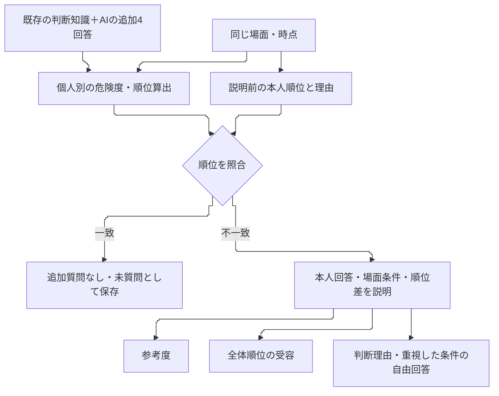

# 三軸の追加評価を実装し、参考度と順位受容の違いを確認した

## 研究責任者への回答

要求した「不一致の根拠を本人の回答へ遡る→説明する→参考度と受容を尋ねる」という評価を実装し、S01・S02、その後に既存14名の回答に基づくAIスタッフで実行できた。四段階のファジィ統合を回答者別にし、下位リスクへの変換と既存の原回答は維持した。

結果は、各集約法で48場面中16場面が順位全体で一致した。不一致32場面のうち、全体順位を受容したのは加重平均で2場面、重み付き最大で1場面だった。一方、説明の参考度を4・5としたのはそれぞれ16場面、22場面である。**説明が参考になっても、順位そのものへの同意には至らない場合が多かった。** 部分受容を成功へまとめず、元の順位一致・参考度・最終受容を分けて報告する必要がある。

今回得られたのは、この評価手順を実施できる見通しと、不一致を調べる具体的な手掛かりである。実スタッフによる有効性の裏付けはまだ得ていない。以下では、どの人物・場面を使い、何を回答させ、どの結果からこの判断に至ったかを説明する。

## 1. 目的：不一致の説明と、その説明に対する本人評価を取得する

研究課題は、空間的文脈とスタッフの判断知識の違いに応じた見守り優先順位の算出である。REQ-003では算出順位と本人順位を照合した。REQ-004では不一致の根拠を追跡し、本人が説明を参考にするか、最終的に算出順位を受け入れるかまで確認する。

[要求書revision2](../requests/2026-10-18-001-REQ-004-additional-questionaire.md)と「OK。自律的な作業に着手せよ」が実行根拠である。視野の扱いは研究責任者の補足に従い、移動方向を視線の代理とする既存の仮定を用いた。視線を実測した結果ではない。[仕様004](2026-10-18-004-REQ-004-execution-specification.md)に沿って実装した。

## 2. 方法：同じ場面について、説明前の順位と説明後の評価を分けた

### 2.1 三つの場面と、二種類の人物群

高齢患者4名とスタッフ1名を配置した、次の3場面の0秒時点を使った。物体の所有・使用中・ブレーキ状態を設定から推測させず、提示した姿勢・位置・見守り方向から答えさせた。

| 場面 | 患者文脈 | 空間的文脈 | 比較する判断 |
| --- | --- | --- | --- |
| C01 | P01/P03は立ち上がり姿勢、P02/P04は座位 | P01/P02に車椅子・点滴台が近く、P03/P04に手すりが近い。スタッフは下側から上向き | 患者行動と物体・見守り状況のどちらを優先するか |
| C02 | 全員が立ち上がり姿勢 | P01/P03に車椅子・点滴台が近い。スタッフは中央から下向き | 同じ動作・スタッフ距離でも、物体と視野の違いをどう扱うか |
| C03 | C02と同じ | 患者・物体はC02のまま、スタッフを下側へ移す。見守る方向は下向き | 視野外という共通点と、距離・物体の差をどう比較するか |

配置は[既存の3場面図](figures/2026-10-17-016-REQ-003-pilot-scenes.svg)と同じである。今回の提示では矢印を見守り方向の設定として解釈することを明記した。具体的な座標と提示文は[新規manifest](../studies/REQ-004/prototype.yaml)と[保存した場面](../outputs/REQ004_pilot_20261018T142554/inputs/scenes.json)にある。C01とC02では動作も物体配置も異なるため、単純な空間的文脈だけの比較とはしない。

先に、保存済みの判断知識・理由を持つS01・S02で試した。S01は患者行動を、S02は空間的文脈を重視するAIスタッフである。その後、既存14名の一対比較・ファジィ回答を匿名化して渡したAI-R01〜R14で実行した。14名由来AIには、確認できない職種・経験年数・経歴を付けていない。実スタッフ本人の順位や受容を再現できると確認した人物ではない。

既存1Bの12問は、内的リスク・外的リスク・総合危険度の各4問である。今回不足する「距離×視野」の4問だけを各AIへ追加し、四統合段階16問を揃えた。実回答とAI追加回答の来歴を別に保存した。1A Qdに対応する可能性がある25番目の回答も原値を保持したが、左右項目を確定できず、計算や人物設定には使っていない。

### 2.2 危険度算出と追加質問の順序



図1　今回実装した評価の流れ。算出結果を提示する前に順位と理由を保存し、説明後の回答で上書きしない。三軸を足した成功指標は設けていない。

姿勢・物体距離・スタッフ距離・視野外の程度から下位リスクを求める既存処理を維持した。その上で、内的リスク、見守り状況、外的リスク、総合危険度の四段階すべてに本人役の回答を適用した。欠損時はエラーとし、共通ルールへ黙って戻らない。動作の集約は加重平均と重み付き最大の両方で計算した。

不一致の患者対では、実際の条件・適用回答・上位リスク・総合危険度差を保存した。物体・見守り等の影響を調べるため、相手患者の実値を基準に5群を交換する32条件の計算診断も行った。これはモデルの計算内訳であり、人がその順位を答えた心理的原因の証明ではない。スタッフ向けには診断数値を並べず、「あなたの回答→各患者の状態→どちらを優先する方向に働いたか→順位差」の順で説明した。

参考度は1「全く参考にならない」〜5「とても参考になる」、判断不能は別値とした。受容は受容・部分受容・拒否・判断不能に分けた。患者対と4患者全体について別々に答えさせた。元の判断で重視した条件とアンケートで重視した条件の同じ点・違う点も、想定する理由を先に与えず尋ねた。

各人物の初回回答と、集約法別の追加回答は別スレッドへ提示した。指示上、他条件の結果や研究者用の診断値を読ませない。人物設定の指示全文・入力ハッシュは保存したが、生成モデルの詳細とseedは取得できていない。[三軸の参考文献と適用範囲](2026-10-18-003-REQ-004-implementation-readiness.md)も参照されたい。

## 3. 結果：参考度の高さと、順位全体への受容は一致しなかった

「参考度4・5」は尺度上位二カテゴリの記述的な件数である。順位一致は全場面、参考度・受容は不一致の追加質問だけを分母とする。

| 人物群 | 動作集約 | 順位一致 | 参考度4・5 | 全体受容 | 部分受容 | 拒否 |
| --- | --- | ---: | ---: | ---: | ---: | ---: |
| S01・S02 | 加重平均 | 3/6 | 2/3 | 0 | 3 | 0 |
| S01・S02 | 重み付き最大 | 3/6 | 3/3 | 0 | 3 | 0 |
| 14名由来AI | 加重平均 | 13/42 | 14/29 | 2 | 24 | 3 |
| 14名由来AI | 重み付き最大 | 13/42 | 19/29 | 1 | 25 | 3 |

両集約法は同じ人物・場面の反復条件であり、人数や場面数を二倍の独立標本として扱わない。各集約の全16名では16/48場面が一致したが、算出順位そのものはAI-R08・C02とAI-R10・C01で集約法によって異なった。追加回答の差も、人物生成の変動や説明の差を含むため、集約法による効果とは断定できない。

一致した場面の参考度・受容は未質問である。不一致の患者対45件についても、全体とは別に評価を得た。加重平均では受容2・部分受容19・拒否22・判断不能2だった。したがって、全体への「部分受容」27件を、問題となった患者対への同意27件として読むこともできない。[全場面の順位・三軸・理由](../outputs/REQ004_pilot_20261018T142554/final-summary/case-results.csv)と[集計JSON](../outputs/REQ004_pilot_20261018T142554/final-summary/results.json)を保存した。

## 4. 考察：追加質問によって、異なる種類の不一致を区別できた

### 4.1 見守りと物体の優先関係を見直して、順位を受容する例は得られた

加重平均のAI-R03・C03では、最初は遠いP02をP03より優先した。説明後は、全員が同じ立ち上がり姿勢・視野外という場面で、本人の物体に関する判断を反映してP03を優先する並びを受容した。AI-R05も同じ場面で受容し、追加回答に「視野外なら近くても遠くても5と答えていた」と、自分の知識回答を参照した。

これは、研究責任者が期待した、説明を受けて当初と異なる優先関係も受け入れる回答の例である。ただし後者の距離差が数学的に消えたわけではない。モデルでは視野外の程度を連続値で扱うため、距離の効果が弱くなり物体の差が相対的に反映された、と解釈する。AIの受容を、実スタッフにも同じ変化が起きる証拠とはしない。

一方、AI-R06は3場面すべてで当初から一致した。患者行動と空間的文脈を変えた今回の条件では、その人物役の順位と算出順位が対応した例である。三場面だけで、判断知識全体や他の場面まで適切に反映できたとはいえない。

### 4.2 「参考になるが、優先順位は変えない」という回答も捉えられた

S01・C02は、視野外のP02をP03より優先したが、計算ではP03が上位だった。説明後は物体条件を重く見た算出理由を参考度4と評価しつつ、患者対については拒否した。全体は最上位・最下位が同じなので部分受容だった。

この回答から分かるのは、説明の理解・有用性と、本人の優先関係への同意が別であることだ。「参考にする」という回答を、順位が適切だったとの賛成へ読み替えるべきではない。追加質問は肯定を得るための手続きよりも、どの条件を重視する点で意見が残るかを調べる手続きとして有用だった。

### 4.3 入力された統合ルールが、危険度の大小を逆転させる例があった

AI-R02・C01では、立ち上がりP01の内的リスクは座位P02より高いが、同じ外的リスクのもとで総合危険度はP02の方が高かった。総合危険度の元回答がHH・HL・LH・LL順で5・1・4・2であり、今回の外的リスクの範囲では、内的リスクを高めるほど総合危険度を低める式となるためである。AI-R11にも同種の逆転があった。

これは計算の取り違えではなく、保存された回答をそのまま適用した結果である。ただし、元の本人の意図に矛盾があると断定するには、設問の解釈・尺度の方向・具体場面への適用を確認しなければならない。今回、回答の補修や単調性による除外は行っていない。人に調査する際には、この種の回答を順位だけで評価する前に、条件の理解を確認する必要がある。

### 4.4 動作の下位表現に遡らなければ説明できない不一致もあった

AI-R10・C01では、加重平均による動作リスクが立ち上がり姿勢で約0.177、座位で約0.197となった。座位の設定に残る車椅子移動・ブレーキ解除・バランスを崩す動作への類似度に個人重みを掛けた増分が、立ち上がり成分の低下を上回り、合計が逆転した。

一方、重み付き最大では、両姿勢に共通する「顔を触る」参照動作の項が支配して同順位になった。この重みは約0.308だった。共通項は加重平均の差には寄与せず、平均での逆転と最大値での同点化は別の仕組みによる。

この例には、知識設問と順位回答の関係に加えて、動作の下位表現も関わっている。場面に「立ち上がり」と表示したことと、モデルが他の参照動作にもどの程度の値を計算したかは別である。追加評価では、本人の知識の聞き方に加え、提示した状態と下位リスクの表現が対応しているかも確認すべきである。[数値と計算根拠](../outputs/REQ004_pilot_20261018T142554/final-summary/mechanism-examples.json)を残した。下位変換を変更する場合は、今回の承認範囲を超えるため別途仕様を提示する。

## 5. 検証と限界：計算の再現を確認し、AI予行の条件は保存した

独立査読では384患者の総合危険度・順位、四段階1,536ノード、不一致90患者対の診断を別計算で照合した。原回答、下位リスク、未コミットコードのZIP・差分ハッシュも確認した。詳細は[査読005](2026-10-18-005-REQ-004-execution-review.md)を参照する。関連テスト356件と、その後のフォーム・文面修正を含む47件が通った。数式計算だけでなく、実ブラウザで40問と追加回答のJSON出力・取込も確認した。

予行中には二つの修正を行った。最初の提示には視野の設定と旧注記の矛盾があり、その回を除外して別runへ取り直した。次に、S01・S02の追加回答で説明の接続不足が分かり、入力・モデル・質問項目を変えず説明v2を作り、14名由来AIへ展開した。修正前の回答・結果は保持している。

最終査読では、保存済みAI提示の全体要約に語句の欠落が9場面条件で見つかった。患者対の説明と計算は正常だが、全体受容へ与えた影響は分離できない。既存packet・回答は書き換えず、今後用のフォームで修正した。尺度端点と全体要約の表示も、今後用フォームをAIの指示・説明へ合わせた。この最終フォームによる新たなAI・人の回答は取得していない。

AHPのCIは付録に示す。14名由来の動作CIは約0.074〜0.450、物体CIは約0〜0.919だった。AI-R06は動作CI約0.117でも全場面一致し、S01は約0.034でも不一致がある。CIが小さいことは具体場面の一致を保証しない。採否閾値を追加したり、結果に合わせて回答を除外したりはしていない。

## 6. 今後：実スタッフ調査の前に、原設問と場面表現の対応を確定する

評価の接続と三軸の記録は用意できた。次は、Qdの原票・左右項目、入力ルールの条件の読み方、動作表示と下位リスクの対応を確認し、実スタッフに提示する説明を確認する。特に部分受容では、既に一致している最上位・最下位への賛成と、不一致患者対への賛成を分けて読む。

今回のAI予行では、不一致の大半について全体順位への同意が得られる、という見込みまでは得られなかった。一方、不一致がどの計算段階から生じ、本人役がどの条件に異論を持つかを取得する手順は成立した。この手順を実スタッフの回答で確かめることが、研究の課題・解決策を裏付ける次の評価となる。

## 付録：人物別CIと追加回答

追加4回答はHH・HL・LH・LL順。順位一致件数は加重平均である。CIの表示0.0000には浮動小数精度の微小値を含む。

| AIスタッフ | 動作CI | 物体CI | 見守りの追加4回答 | 順位一致 |
| --- | ---: | ---: | --- | ---: |
| S01 | 0.0342 | 0.0046 | 5, 3, 4, 1 | 1/3 |
| S02 | 0.0275 | 0.0046 | 5, 4, 5, 1 | 2/3 |
| AI-R01 | 0.0738 | 0.2178 | 5, 3, 4, 1 | 1/3 |
| AI-R02 | 0.1649 | 0.0000 | 5, 3, 4, 1 | 1/3 |
| AI-R03 | 0.1761 | 0.0678 | 5, 2, 4, 1 | 1/3 |
| AI-R04 | 0.4138 | 0.9190 | 5, 3, 4, 1 | 2/3 |
| AI-R05 | 0.0753 | 0.0678 | 5, 4, 5, 3 | 0/3 |
| AI-R06 | 0.1172 | 0.0063 | 5, 2, 3, 2 | 3/3 |
| AI-R07 | 0.2770 | 0.0678 | 5, 3, 3, 1 | 0/3 |
| AI-R08 | 0.2536 | 0.0145 | 5, 3, 4, 2 | 1/3 |
| AI-R09 | 0.3752 | 0.0678 | 5, 3, 4, 1 | 2/3 |
| AI-R10 | 0.1299 | 0.0678 | 5, 3, 4, 1 | 0/3 |
| AI-R11 | 0.3996 | 0.0401 | 5, 3, 4, 1 | 0/3 |
| AI-R12 | 0.4501 | 0.0145 | 5, 3, 4, 1 | 0/3 |
| AI-R13 | 0.2313 | 0.0193 | 5, 3, 4, 2 | 1/3 |
| AI-R14 | 0.3246 | 0.1474 | 5, 3, 4, 1 | 1/3 |

## 成果物と再現方法

- [40問の初回フォーム](../outputs/REQ004_pilot_20261018T142554/presentation-final/participant/personalized-questionnaire.html)
- [追加質問フォーム例：S01・加重平均](../outputs/REQ004_pilot_20261018T142554/presentation-final/followup/weighted_sum/S01/questionnaire.html)
- [全場面の結果](../outputs/REQ004_pilot_20261018T142554/final-summary/case-results.csv)、[集計・CI・回答](../outputs/REQ004_pilot_20261018T142554/final-summary/results.json)
- [正規AI提示と今後用フォームの版の違い](../outputs/REQ004_pilot_20261018T142554/presentation-final/presentation-provenance.json)

匿名profileの`knowledge-lineage.json`に、元の設問番号・原符号・変換後の一対比較比率・追加回答の来歴を分けて保存した。実行はHEAD `a3e3ed193379b9e5959b952d9704421cf1c1b5bc`に未コミット変更を加えた版であり、各解析の`execution-code.zip`・差分・ハッシュから再現する。モデル詳細・seedは取得できず、AI文章の再生成条件は揃っていない。

各解析の`provenance.json`に記録された実行環境はPython 3.11.7、PyYAML 6.0.1、Linux 6.8.0-136-genericである。最終コード一式も[ZIP](../outputs/REQ004_pilot_20261018T142554/protocol/final-execution-code.zip)と[ハッシュ一覧](../outputs/REQ004_pilot_20261018T142554/protocol/final-execution-code.json)に保存した。各AI評価時点の版とは区別する。

同じ回答からの再計算例は次のとおり。出力先は必ず未使用のディレクトリにする。

```bash
python3 studies/REQ-004/run_pilot.py analyze \
  studies/REQ-004/prototype.yaml \
  outputs/REQ004_pilot_20261018T142554/participants/S01/knowledge.json \
  outputs/REQ004_pilot_20261018T142554/participants/S01/initial-responses.csv \
  /tmp/req004-new-analysis --action-aggregation weighted_sum
```

## 変更・実行・査読履歴

| ID | 発生日時 | 記録日時 | 担当 | 内容・結果 |
| --- | --- | --- | --- | --- |
| H01 | 2026-10-18T14:20:37+09:00 | 2026-10-18T22:09:25+09:00 | PM | revision2の自律実行承認を記録し、原回答を保持して新規runを開始 |
| H02 | 2026-10-18（完了秒未記録） | 2026-10-18T22:09:25+09:00 | architect・implementer・PM | 仕様004、四群個別統合、根拠追跡、40問と追加フォーム、取込・検証を実装 |
| H03 | 2026-10-18T14:25:54+09:00 | 2026-10-18T22:09:25+09:00 | PM | 旧注記の矛盾による回を除外保存し、正規runを新規作成 |
| H04 | 2026-10-18（取得・修正秒未記録） | 2026-10-18T22:09:25+09:00 | S01/S02回答役・PM | 初版説明の接続不足を記録。説明v2へ改め、初版の回答も保持 |
| H05 | 2026-10-18（中断・再開受信秒未記録） | 2026-10-18T22:09:25+09:00 | PM・各AI回答役 | 使用量中断後に再開。保存済み回答は再取得せず、不足する条件別の追加回答だけ継続 |
| H06 | 2026-10-18（完了秒未記録） | 2026-10-18T22:09:25+09:00 | PM | 全16名・両集約の計算と追加回答を検証。三軸を分けて集計 |
| H07 | 2026-10-18（指摘・修正秒未記録） | 2026-10-18T22:09:25+09:00 | 独立reviewer・PM | 全保存値を再計算し一致。フォームの尺度・全体要約・同点時の欠落文を今後用に修正。正規AI回答は保持 |
| H08 | 2026-10-18T22:09:25+09:00 | 2026-10-18T22:09:25+09:00 | PM | 目的・方法・結果・考察を統合した本報告を作成。最終査読・日本語校正は追記予定 |
| H09 | 2026-10-18（最終再確認返却時刻未記録） | 2026-10-18T22:15:09+09:00 | 独立reviewer | 全32条件・96場面・CI・来歴と本報告を照合。平均逆転と最大同点化の説明を再確認し、追加の重大指摘なし（005） |
| H10 | 2026-10-18T22:15:09+09:00 | 2026-10-18T22:15:09+09:00 | PM | 日本語・用語・参照・表を最終点検し、査読済みへ更新。静的検査の語彙反復1件は用語統一のため維持。研究上の制約は保持 |
