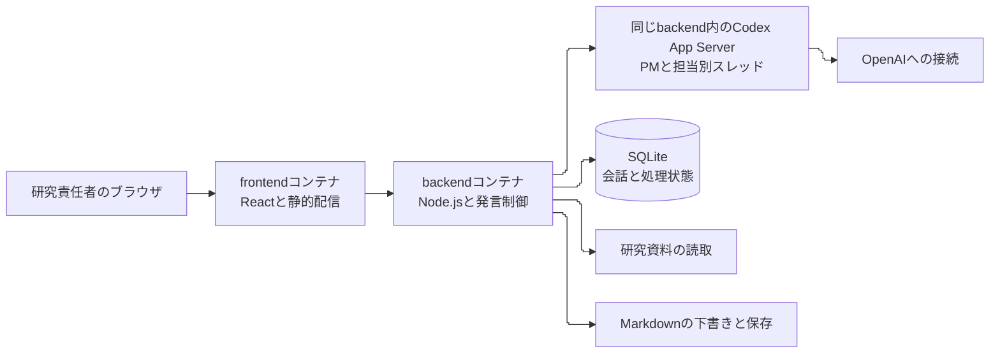

# REQ-005 研究相談グループチャットの設計案

研究責任者が、研究の経緯を共有するPMや専門担当と、ブラウザで気軽に相談できるグループチャットを提案する。frontendとbackendの2コンテナに分け、backendでCodex App Serverを動かす構成を第一候補とする。PMが話題に応じて専門担当を呼び、議論から残したい内容をMarkdownの下書きにする。

今回は「ざっと設計して」への回答であり、設計案の提示まで完了した。以下の技術選定・動作・受入条件はPMの提案で、設計の採用、アプリ実装、AI接続試験は未承認・未実施である。

対象：[REQ-005 revision 1](../requests/2026-10-25-001-REQ-005-discussion-chatbot.md)。文書版：1。発行・更新日時：2026-10-25T16:33:58+09:00。

## 1. 会話の体験

画面は左に話題の一覧、中央に会話、右に参加者と「残しておく内容」を置く。研究責任者は普段の言葉で話し、PMの返答を待つ。話題ごとに会話を再開できるようにする。

- 通常の相談ではPMが返す。途中の考えや迷いにも応じ、毎回議事録や次の課題を提示しない。
- `@researcher`、`@evaluator`などで相手を指定できる。「みんなの意見を聞きたい」ではPMが関係する担当を最大2名選び、担当の発言後に必要な整理を返す。人数上限は初期案で、設定変更可能にする。
- 専門担当は他の担当の発言にも反応できる。自動で議論を続ける回数に上限を設け、研究責任者が次の発言を入れられるようにする。
- 誰の発言か、誰が返答中かを常に示す。研究責任者は「停止」で応答を中断できる。
- 「この話を残して」でPMが要点を下書きにする。画面で内容と保存先を確認して保存する。下書きにしただけでは研究方針の承認にしない。

例えば「ジャーナルで、今の評価だけだとどこを突っ込まれそう？」と聞いた場合、PMが問いを整理し、evaluatorが評価で確認できる範囲を説明し、reviewerが不足する根拠を指摘する。毎回すべての担当を発言させる必要はない。

役割は現在の運用とそろえる。researcherは調査、architectは設計、implementerは実装相談、evaluatorは評価、reviewerは独立した批判的検討、editorは文章の相談を担う。初期画面ではPMと、今回参加している担当だけを目立たせる。PMだけで済む相談はそのまま返す。

複数のAIが同意したことを、研究上の裏付けや独立した人間の意見と扱わない。reviewerには検討対象と根拠を渡すが、他の担当の結論を支持する指示は与えない。

## 2. 最小構成

図は提案構成で、実装済みの接続を示すものではない。Codex App Serverはbackendの子プロセスとして起動するため、AI担当ごとのコンテナや別のDBコンテナは不要とする。Mermaidの実描画は未確認。指定したELK設定を維持する。

| 要素 | 提案 | 選ぶ理由 |
| --- | --- | --- |
| frontend | React + TypeScript。ビルド済み画面をNginxで配信 | 会話、担当表示、下書き確認に絞る |
| backend | Node.js + TypeScript + 小規模なHTTPサーバー | Codexのプロセス制御と画面向けイベント変換をまとめる |
| AI接続 | Codex App ServerとstdioでJSON-RPC通信 | Codexの会話・指示読込・中断機能を利用する |
| 永続化 | SQLiteファイルをDocker volumeに保存 | 個人利用の会話と処理状態を1か所で管理する |
| ブラウザ通信 | POSTで入力、SSEで発言を配信 | 入力と応答の逐次表示に必要な構成に絞る |
| 起動 | 専用ディレクトリのDocker Compose | 既存の研究実行用Dockerと依存関係を分ける |

Codex App Serverには、独自クライアント向けの会話履歴・承認・ストリーミング機能、stdio通信、スレッドの作成・再開、ターンの中断が公式に記載されている。この機能を画面と結び付ける設計である。[OpenAI Docs: Codex App Server](https://learn.chatgpt.com/docs/app-server)

代替はOpenAI Responses APIを直接呼び、backend側で役割・履歴・資料参照を実装する方式。このAPIも逐次応答を配信できる。会話専用に絞る場合は候補になるが、Codex側の指示・研究作業との接続を自分で補う範囲が増えるため、今回の第一候補にはしない。[OpenAI Docs: Streaming API responses](https://developers.openai.com/api/docs/guides/streaming-responses)

具体的なモデル名・価格・アカウントの利用可否は確定していない。採用時の環境で利用可能なモデルと認証を確認し、モデル名とCLI版を固定して記録する。現在の契約だけで動く、追加費用が不要、といった保証はしない。

## 3. 現在の研究チームとの継続性

このチャットで動いているPM・サブエージェントの会話状態を、そのままブラウザへ接続できるとは確認していない。初期案はアプリ専用のPM・担当別スレッドを作り、リポジトリの文書を共通の参照元にする。役割名が同じでも、既存の会話をすべて覚えているわけではない。

backendは開始時に、共通のAGENTS.md、プロジェクトのAGENTS.mdと運用手順、対象REQの現在欄と最新チェックポイントを確認する。参照する資料のパス・版・Git HEADを保存する。コンテナへ指示ファイルを配置するときは相対参照先とSkillも確認し、指示だけをコピーして依存先が欠ける状態を防ぐ。ホストの `~/.codex` 全体や既存セッションを一括でコンテナに渡さない。

研究内容を話す際は `paper/latest/paper_full_draft_v18.pdf` と対象の要求・報告を必要な範囲で参照する。PDFの本文抽出はbackendで行い、出典箇所を付ける。初期版ではベクトルDBを導入せず、資料選択と該当箇所の読取から始める。原稿の「患者文脈」「空間的文脈」「内的リスク」「外的リスク」「総合危険度」を使い、原稿と実装の差を分けて述べる。

担当へ渡す情報は、共通の研究要約、対象REQ・版、関連資料、現在の話題の直近発言、今回の問いに絞る。長い会話は出典となる発言IDを付けて要約する。要約にも仮説・未確認・採否を残す。既存Codexスレッドの再開機能はあるが、この環境の既存セッションへ適用できるかは接続検証後に判断する。

## 4. 発言と中断の制御

1. backendが研究責任者の発言をSQLiteへ記録し、処理IDを返す。
2. 指名があればその担当へ、通常はPMへ渡す。PMが担当を呼ぶ場合も、選択可能な役割と発言数の上限をbackendで検査する。
3. 担当の返答を話者付きで逐次配信する。次の担当には、確定した前の発言を渡す。
4. 担当の後にPMが論点を短く整理し、研究責任者へ返す。専門担当を呼ばない会話ではPMの返答だけで終える。
5. 停止要求ではCodexへ中断を伝え、未着手の担当を呼ばない。途中の返答は中断済みと表示する。

ルーム内のAI生成は初期版では1件ずつにする。生成中の新しいユーザー発言は画面にすぐ表示し、次の返答の入力として待機させる。現在の生成を止めるかどうかは停止操作で制御する。再接続で同じ生成が二重に始まらないよう、ユーザー入力の重複検出キーと処理IDを使う。

応答失敗は話者と原因の概要を示し、その担当から再試行できるようにする。アプリ再起動で完了確認できなかった処理は「中断」とし、自動再実行しない。SSEはイベントIDから再送し、DBに保存した発言を復元する。

際限のない自動議論を避けるため、発言数・出力量・時間の上限を設定する。利用量を取得できる場合は処理ごとに保存する。追加の議論は研究責任者の「もう少し議論して」で始める。

## 5. Markdownに残す流れ

会話ログと研究成果は分けて保存する。会話ログはローカルDBに置き、Git対象にしない。研究上必要な要点だけをPMが抽出し、下書き・確認・保存の段階を踏む。

| 内容 | 保存案 | 扱い |
| --- | --- | --- |
| アイデア、根拠、対立点、未確認事項 | reports/の議論メモ | 合意していない提案と明記する |
| 採用する要求・方針 | 対象REQのPM欄、承認・変更履歴 | 研究責任者の明示的な採否と対象版を対応付ける |
| 再開に必要な要点 | .codex/research-docs/checkpoints/ | Git除外。会話全文を保存しない |

研究責任者の「保存して」は文書保存の意思として扱い、設計や研究方針を採用したという承認へ読み替えない。研究上の変更を採用する場合は、変更内容・対象REQ・版を示したうえで、承認の発言を記録する。

Markdownの保存処理はbackendが担当し、AIに自由なファイル書込を許さない。日内の共通番号、発生日時と記録日時、原文保持、最新ファイルとの差分を検査する。保存直前に対象ファイルのハッシュを照合し、別の作業で変更されていれば下書きを更新する。校正が必要な文書は利用可能なSkillで検査する。

## 6. 実装の境界

想定配置は `tools/discussion-chatbot/` 以下。frontend、backend、役割定義、Composeと導入手順を置く。会話DBとアプリ専用Codex状態はvolumeに保存し、Markdownはホストへ残す。既存の研究コード・Dockerfile・依存関係は改修対象にしない。

初期版は同じPCからの個人利用を想定し、ホスト公開はfrontendの `127.0.0.1` のみにする。backendはDocker内部ネットワークだけで受け、Nginxが `/api` を転送する。LAN・インターネット公開、複数人利用、音声、外部アプリ連携、自動実験・コード修正は初期対象外とする。

研究資料は必要なファイル・ディレクトリを読取専用で渡す。Markdown用の書込先はrequests/、reports/、checkpoints/に限定し、Codexの会話プロセスには読取専用で見せる。研究資料の参照はbackend側で許可した範囲に限定し、認証情報や個人情報を含む資料を選ばない。AIの命令実行・変更要求は初期版では拒否する。アプリ専用の認証状態を使い、キーや認証データはブラウザ・Gitへ渡さない。

backendのAPI案は、ルーム作成・履歴取得、発言送信、イベント配信、処理停止、Markdown下書き作成・保存の7操作に絞る。SQLiteにはルーム、話者付き発言、実行状態、担当スレッドID、下書きと出典、承認記録を持つ。内部の推論過程は保存・表示対象にしない。

## 7. 実装へ進む場合の順序と受入条件案

| 段階 | 内容 | 確認すること |
| --- | --- | --- |
| 1. 接続検証 | コンテナ内でCodex認証、PMの1返答、停止・再開を確認 | 採用CLI版で動くか、指示ファイルが読み込まれるか |
| 2. 会話 | 2コンテナ、履歴、担当指定、PM経由の議論を実装 | 画面再読込・再起動で履歴が残り、話者が混ざらないか |
| 3. 文書化 | 下書き確認、競合検出、指定先への保存を実装 | 未承認案が合意欄へ入らず、原文・番号・時刻が保たれるか |
| 4. 試用 | 実際の研究相談で使う | 会話の負担、発言の長さ、担当を呼ぶ頻度を見直す |

受入条件案は、①Composeで2サービスを起動できる、②ブラウザでPMと担当に話せる、③指定REQと資料を参照できる、④停止・失敗・再接続を扱える、⑤合意と提案を区別したMarkdownを保存できる、⑥秘密情報・会話全文がGit対象へ混入しない、の6点。実装後にはこれらの機能確認を行う。研究相談の有用性は実際に使って確かめる事項であり、機能確認だけでは保証しない。

実装前に確認したいのは次の2点。設計を読む段階での回答は必須にしない。

- Q-01：Codex接続を第一候補にしてよいか。また、現在の会話そのものの継続が必須か、役割と研究資料を引き継いだ新しい会話でよいか。
- Q-02：初期版は同じPCからの個人利用でよいか。別端末から使う場合は公開範囲と認証の設計を追加する。

## 8. 調査・検証の範囲

調査時のGit HEADは `2c109325facba18836f30d00f1f1b1380cc0ebde`。開始時は指定要求書のみ未追跡で、今回の設計書・アプリ実装・REQ-005チェックポイントは存在しなかった。既存のDockerfileは研究実行用で、このチャット用のfrontend/backend構成は確認できなかった。

共通とプロジェクトのAGENTS.md・要求書運用、指定REQ、既存の文書配置とDocker関連ファイルを読んだ。OpenAI Docsで接続機能を確認した。今回は研究内容そのものを評価しておらず、原稿v18の本文照合・研究コードの動作試験は行っていない。

アプリの起動、認証、AIの応答、保存処理は未検証。実装や実験結果を作成したとは扱わない。日本語校正にはyomiyasuを使用し、原文と提案・採否の区別を保持する。

## 変更・確認履歴

| ID | 発生日時 | 記録日時 | 担当 | 対象版 | 内容・結果 | 根拠 |
| --- | --- | --- | --- | --- | --- | --- |
| H-01 | 2026-10-25T16:33:58+09:00 | 2026-10-25T16:33:58+09:00 | PM | 1 | 研究相談用チャットの初期設計を作成。接続と既存会話の継続は未検証と明記 | REQ-005原文と今回の直接指示 |
| V-01 | 2026-10-25T16:34:41+09:00 | 2026-10-25T16:34:41+09:00 | PM | 1 | yomiyasu静的検査は指摘なし。要求書差分の追加はPM欄と文書管理欄のみで、原文一致と相対リンク・コードフェンス・行末空白を確認。提案と承認の区別を通読確認 | 自己確認。独立査読・アプリ実行・Mermaid描画は未実施 |
| E-01 | 2026-10-25T16:31:57+09:00 | 2026-10-25T16:34:41+09:00 | PM | 1 | .codex配下へのチェックポイント保存は読取専用エラー。完成記録を/tmpに用意して権限申請 | 実行時に観測した保存失敗 |
| E-02 | 2026-10-25T16:37:30+09:00 | 2026-10-25T16:37:30+09:00 | PM | 1 | 許可後、完成チェックポイントを指定のGit除外ディレクトリへ保存した | 配置コマンド正常終了・保存内容一致を確認 |
