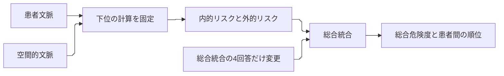

# 判断設定で順位を変えられる範囲を、今回の論文の問いにする案

案Cは、判断知識をどう表現し、出力へどう作用させるかを調べる方向です。PMとしては、その問いを**判断設定の調整で変えられる順位と、その段階の設定では変えられない順位を分ける**ことに具体化する案を提案します。これなら、「どの回答をどれだけ変えるか」を調べる最小変更量の解析が、何に役立つかを説明できます。

例えば、患者文脈を表す内的リスクと、空間的文脈を表す外的リスクを考えます。二人の患者がこの二つの値で同じになっていたら、その二つの値を総合危険度へまとめる最後の計算（総合統合）は、どの判断設定を使っても二人を区別できません。この場合、総合統合のアンケートを取り直しても差は生まれません。もし区別する必要があるなら、その手前でどの情報を残すかを点検することになります。

一方、内的リスクは患者Aが高く、外的リスクは患者Bが高いなら、両者の組合せの評価によって順位が変わり得ます。ここには「どの回答をどれだけ変えると順位が変わるか」という解析の意味があります。どこまで回答の変更を許すかによって、順位を動かせる範囲も変わります。その範囲を明示して調べる必要があります。

この区別は、「第三の目」に向けた状況評価モデルを、どこまで設定の調整で対応させられるかを考える手掛かりになります。見落とし防止の効果を実証したという意味ではありません。今回は、その手前にあるモデルの性質を調べる研究として、問いを絞る提案です。

この問いを今回の論文の中心候補として進めたいかを相談するメモです。詳細な実験条件の採否は、その後に分けて判断できます。「順位を調整する」とは、解析で仮想的に回答を動かして作用を調べることです。得たい順位に合わせて元回答を書き換える作業はしません。

本書は[REQ-006 revision 1](../requests/2026-10-25-002-REQ-006-discussion.md)に基づくPM・調査担当・設計担当の議論です。以下は提案であり、研究方針・評価指標・実験条件の採用は未決です。研究コード、原稿、原回答を変更せず、新しい実験やスタッフ調査も行っていません。

## 五つの論点への、現時点の答え

| reference第12節の論点 | PMの提案と、その理由 |
| --- | --- |
| 1. 今回の課題 | 見守りの状況と判断設定が、順位を変えられる条件・変えられない条件を明らかにする。既存の一般手法にはできない、と先に決めない |
| 2. 個別設定の価値 | 本人の再現を約束せず、複数の表明された判断設定でモデルを点検する価値を検討する |
| 3. 案Cの評価 | まず総合統合の4回答だけを動かす限定解析で、調整可能性・境界・他の患者対への影響を示す |
| 4. 手法固有の貢献 | 固定の加算との違いと、二入力の積を加えた式との同じ点を確認する。新規性は組合せ自体でなく、この見守りモデルで明らかにする関係に求める |
| 5. 作業の優先 | 大型の探索器や新規調査を先に作らず、現在のモデル・回答から一枚の診断表を作れるかを先に確かめる |

ここからは、特に論点1・3・4を詳しく説明します。数式と実装上の条件は末尾の補足へまとめました。

## 1. 課題を「どこまで設定で調整できるか」まで具体化する

referenceでは、患者文脈と空間的文脈を統合し、現場の判断知識をモデルへ反映する案が整理されています。これは研究の対象を説明していますが、「モデルを構成した後、何を明らかにするのか」はまだ広いままです。

そこで、今回の問いの候補を次のように置きます。

> 患者文脈・空間的文脈を表す値と、アンケートで表明された判断設定の組合せによって、患者間の順位はどの条件で変わるのか。逆に、どの条件では、その設定を変えても順位を変えられないのか。

「変わる条件」と「変えられない条件」を一緒に調べると、単に設定可能なモデルを示すところから、モデルをどう点検・調整するかの議論へ進めます。例えば「順位を変えたいならこの回答群が関わる」「この段階へ来た時点で区別が消えている」という違いを説明できます。

PMは、ここに今回の案Cを具体化する余地があると考えます。ただし、これが複数の評価項目を扱う意思決定の研究にない発想だと確認できたわけではありません。複数の評価項目をまとめる方法には、相互作用や、許容する設定の下で順位が変わるかを調べる先行研究があります。[Grabischら（2003）](https://arxiv.org/pdf/0804.1921)、[Grecoら（2008）](https://www.iris.unict.it/bitstream/20.500.11769/27018/1/OrdinalRegressionEjor2008.pdf)を確認しました。

したがって、論文の課題を「従来は扱えなかった」と書き始めるのは早い段階です。まずこの見守りモデルで、どの判断設定がどの状況へ作用するかを調べ、その結果と近い先行研究との違いを詰める方が、主張と根拠を対応させやすくなります。

## 2. 個別設定と条件依存は、分けて考えられる

今回の議論で整理し直したいのは、「人ごとに設定できる」と「条件の組合せで評価が変わる」の関係です。この二つは別の性質です。

| 統合の仕方 | 全員で共通の設定 | 人ごとの設定 |
| --- | --- | --- |
| 各リスクを固定の重みで足す | 構成できる | 構成できる |
| リスクの組合せによって影響が変わる | 構成できる | 構成できる |

例えば「外的リスクが高いときに、内的リスクの増加を強く反映する」という条件依存は、全員で共通のルールにも書けます。そのため、条件依存が必要であることだけから、人ごとの設定が必要だとはいえません。

それでも、複数人の回答を扱うことには検討の余地があります。ある回答群では順位が設定の小さな変更に敏感で、別の回答群では同じ場面の順位が変わりにくいかもしれません。こうした違いを調べれば、モデルの挙動がどの判断仮定に依存しているかを具体化できます。これは検証する仮説で、既に得られた結果ではありません。

この位置付けなら、個別設定を「本人を忠実に再現するための機能」だけに限定せず、表明された複数の判断設定でモデルを調べるために使えます。回答者の違いは探索する設定の根拠になりますが、その差が安定した個人差や、現場で重要な差であることまでは保証しません。

REQ-003で不採用とした「共通設定より個別設定が優れるか」という比較は、今回も採用済みの計画へ戻しません。上の表は概念の整理です。モデル構造の比較候補を検討することと、個別化の性能比較を始めることは分けます。

## 3. 総合統合だけを変える解析から始める案

現在の階層モデルには、患者文脈・空間的文脈から内的リスク・外的リスクを求め、総合危険度へ統合する段階があります。最初の解析では、患者ごとの内的リスク・外的リスクを固定し、最後の総合統合に使う4回答だけを変える案を推します。



図は限定解析の提案です。下位の計算や場面も同時に変更すると、何が順位を変えたか分かりにくくなるため、まず一つの統合段階に絞ります。Mermaidの指定設定は維持していますが、実描画は未確認です。

総合統合の各回答を1〜5の整数として扱うなら、4回答の組合せは最大625通りです。入力リスクが増すと総合危険度が下がらない、という条件を課せば候補はさらに減ります。ここでいう最小変更量は、限定した候補をすべて調べることで確認する案です。階層全体のすべての知識を同時に動かす大規模な最適化から始める必要はありません。

### 最初の成果物は、順位を調整できる範囲を示す表にする

次の表は、期待する結果の種類を説明する例です。実データの分析結果ではありません。

| 内的リスク・外的リスクの関係 | 総合統合を調べると分かること | 設計への示唆 |
| --- | --- | --- |
| Aは内的が高く、Bは外的が高い | 1〜5の単調な4回答を自由に選べる範囲なら、厳密順位として両方の順を作れる。基準回答から必要な変更を調べる | 総合統合の設定を検討する対象になる |
| AとBの二つの入力が同じ | 同じ入力へ同じ関数を適用する限り、総合4回答では区別できない | 区別が必要なら、総合統合より手前の表現を確認する |
| Aが二つの入力ともB以上 | 総合統合が単調という条件の下では、BをAより高くできない | 許容する設定や、今回の出力が表す意味を確認する |

表の可否分類自体は、一般的な単調モデルの性質から予測できる範囲が多く、新規性の主成果にはしません。限定解析の意味は、元の回答から必要な変更と、同じ変更が複数の患者対・場面へ及ぼす影響を具体化することに置きます。

最小変更量の数値だけを成果にせず、「どの回答欄をどう変えたか」「その変更が別の患者対・場面にも影響するか」を一緒に残します。一つの患者対の順を変えた結果、別の対の順まで変わる可能性があるからです。

設計担当からは、まず一つの判断設定と、既存の3場面・各4患者を対象に、計18の患者対を確認する案が出ました。条件による分類を先に決め、見つかった型から代表例を詳しく示します。三つの型が必ず見つかるとは仮定せず、変化しない例や説明しにくい例も残します。

この総合4回答の点検は、案Cを進める根拠を確かめる第一歩です。それだけで論文全体の新規性や評価規模が足りるとは判断しません。まず解析の問いと計算が対応するかを確かめ、その後に来歴を確認した他の設定・場面へ広げる順序の提案です。

### 既存のAI予行は、点検する問いを考える材料になる

REQ-004の自由回答には、同じ「視野外」と捉えた場面をモデルが連続的な角度で区別する例や、同順位に異論が残る例がありました。これは、モデルが何を同じ・違うと扱っているかを点検する手掛かりになります。[不受容理由の報告008](2026-10-18-008-REQ-004-followup-nonacceptance-reasons.md)に根拠があります。

ただし、AI役の回答を実スタッフの判断と扱いません。既存14名の原回答と、AIが補った見守りの4問も区別が必要です。総合統合の4回答自体が実回答由来でも、固定した下位入力にAI補完の影響があれば、その来歴を含む条件付きの解析として示します。

REQ-003/004で整えた、不一致の計算原因、設問の意味、場面の表現を分けて調べる仕組みは、案Cでも利用候補になります。AI予行の不一致は、どこを点検するかの手掛かりとして使い、案Cの有効性を示す結果とは分けます。

## 4. 固定の足し算との違いを示し、同型の式も比較対象に置く

「設定を変えると順位が変わる」は、固定の加算モデルでも起こります。そのため、この現象だけを提案手法固有の成果にはできません。もう少し具体的に、条件の組合せをどう計算に残すかを見ます。

総合統合への質問に、次のような仮回答を置いたとします。数値は説明用で、実際の回答データではありません。

| 質問の条件 | 外的リスクが低い | 外的リスクが高い |
| --- | --- | --- |
| 内的リスクが低い | 1 | 2 |
| 内的リスクが高い | 2 | 5 |

外的リスクが低い条件では、内的リスクの低→高に対応する回答は1→2です。外的リスクが高い条件では2→5になります。この四つを同じ数値尺度へ変換すると、内的リスクの変化が総合危険度へ及ぼす差は、外的リスクの条件でも変わります。

各リスクへ独立した点数を付けて足すだけのモデルでは、同じ内的リスクの変化に対する差は一定です。そのため、上の四つの値をすべて同時には表せません。ただし、ある一場面の順位だけなら加算モデルでも同じ順を作れる場合があります。比較する対象を、四条件の値の関係と、患者対の順位とで分ける必要があります。

ここで調査担当と設計担当から、重要な反論が出ました。**加算に、二入力を掛け合わせた項を足すと、この局所Fuzzy統合と同じ関数を書けます。** その比較で、Fuzzyだけに表現力があるとはいえません。

PMとしては、この反論を比較計画に含める方がよいと考えます。式が同じになるなら、何を質問し、回答をどこに設定し、どの入力条件・階層で順位へ作用するかに、研究上の説明を求めることになります。「答えやすい」「理解しやすい」という優位性を主張する場合は、実際に答える人を対象に、その点を評価する必要があります。

現段階の貢献候補を、病棟共有空間のこの階層モデルについて、回答から順位へ作用する条件と、設定の調整が届かない条件を明らかにすることに置きます。それが一般的な感度分析の適用を超える研究成果になるかは、実際の入力・回答の範囲で何が分かるかに依存します。

## 5. 先に一枚の診断表を作れるかを確かめ、主張の広さを決める

新規の大型モデルや、全知識を同時に動かす探索器を先に開発することは勧めません。PMの提案は、まず既存の入力値と4回答を結び付け、次の問いに答える小さな確認から始めることです。

| 最初に確かめること | その結果で判断すること |
| --- | --- |
| 内的・外的リスク、総合4回答、来歴を対応付けられるか | 定めた条件で解析できる状態か。AI補完や欠損を実回答へ混ぜず扱えるか |
| 限定解析で、維持・逆転する条件と実計算を対応付けられるか | 設定から出力を予測・説明する問いとして進められるか |
| 設定で変えられない理由も説明できるか | 回答の調整と、下位表現の点検を分ける知見が得られるか |
| 固定加算と積項付きモデルの双方へ、差と同じ点を説明できるか | 手法の貢献をどこまで主張できるか |

この確認の結果によって、次の方向を選ぶ案です。

| 方向 | 論文の中心 | 進める根拠と残る課題 |
| --- | --- | --- |
| 案1：順位が動く条件と動かない条件の解析を中心にする | 判断設定・文脈・階層構造の対応から、調整できる範囲と限界を明らかにする | 条件と実計算が対応し、実際に使う入力範囲でも意味がある場合に進める。一般的な分析の適用との差は引き続き必要 |
| 案2：知識取得から設定・点検までのモデル設計へ絞る | どの判断を取得し、何を表現でき、何を表現し切れないかを示す | 解析が局所的な性質の確認にとどまる場合の候補。主張を狭めても、新規性や投稿の見込みが自動的に上がるわけではない |

今は案1を第一候補にします。ただし、実回答の多くで条件依存が小さかったり、選んだ場面では順位が一度も逆転しなかったりしても、それだけで案C全体を否定はしません。「非加算の仕組みがこの範囲で順位に必要だった」という主張を弱め、別の条件や入力表現を調べる理由になるかを考えます。

新しい実スタッフ調査が必要かは、最終的に主張したいことに合わせて決めます。取得した知識が本人の意図をどこまで捉えるか、質問が答えやすいかを主張するなら、その評価が必要です。固定したモデルの計算上の性質を解析するだけなら、それを確かめるために新しい本人順位を先に集める必要はありません。

投稿先として挙がる[TSMC: Systemsの公式scope](https://www.ieeesmc.org/publications/transactions-on-smc-systems/)には、システムの分析・モデリングや意思決定との接点があります。今回の調査は代表的な関連資料の確認で、採録水準や新規性を判断する網羅的調査ではありません。投稿先のために先に評価を増やすより、得られる主張と証拠を具体化してから、投稿先の選択を改めて検討する案です。

次に合意したいのは、案1の「設定で順位を調整できる範囲を明らかにする」という問いが、ご自身の研究として納得できるかです。この段階で全実験条件を決める必要はありません。合意できれば、総合統合に絞った最初の確認を具体化できます。

## 技術補足：解析を成立させる条件

本文はここまでで読めます。以下は、提案を実装や評価へ移す前に確認するための補足です。

### 局所統合の式と、順位の境界

x,yを[0,1]の入力とします。高・低の適合度をそれぞれxと1−x、yと1−yとし、積で4ルールを発火させ、固定した後件代表値を正規化加重平均する条件では、局所統合を次のように書けます。

```text
F(x,y) = axy + bx(1-y) + c(1-x)y + d(1-x)(1-y)
       = d + (b-d)x + (c-d)y + (a-b-c+d)xy
```

a,b,c,dは順にHH、HL、LH、LLの代表値です。最後の係数κ=a−b−c+dが0なら、この局所式の積項は消えます。κが0でないことだけでは、その場面の患者順位が変わることは保証しません。

患者AとBの入力を固定すれば、その総合危険度差は4後件値の一次式です。差が0のところが同順位の境界になり、正負で順位が入れ替わります。ただし、厳密な逆転と同順位を区別し、数値上の同点許容差を定める必要があります。

AHPや重み付き最大を含む階層全体には、別の計算も入ります。総合統合の局所式だけで、全体の式の性質は決まりません。今回は総合統合だけを動かす範囲に限ります。

この広い許容集合では、HH/HL/LH/LLへの回答を5/5/1/1とするとF=x、5/1/5/1とするとF=yになります。二つの設定はいずれも次節に示す単調条件を満たします。したがって、xとyの大小が厳密に相反する患者対では、数学的な厳密順位として両方の順を実現できます。同点とみなす幅を導入する場合、入力差がその幅以下の対は別途確認が必要です。単一対の可否分類だけより、基準回答からの距離と、複数対・複数場面を同時に動かす制約を調べる点に限定解析の意味を置きます。結果を複雑にするために制約を後付けせず、固定する回答や保持したい関係の意味から、制約を採る理由を説明する必要があります。

### 許容する回答と、最小変更量は提案段階

総合統合を全域で単調にする条件は、a≧b、a≧c、b≧d、c≧dです。これを解析で使う許容条件とする案で、元回答を自動補正・除外する決定ではありません。元回答が条件を満たさない場合は、その事実を残し、元回答を基準とする距離と、許容集合内での逆転の意味を分けます。

最初の診断例は、元の総合4回答が単調性の条件を満たす設定に限定する案です。この限定と、条件を満たさない原回答の存在も記録します。非単調な元回答を許容集合へ直すことと、単調な基準設定から順位を変えることは別の問題です。今回、元回答の修復や採否は提案の実行範囲に含めません。

625通りという数は「4回答とも1〜5の整数、他の条件を固定」という範囲です。回答を連続化したり、TFNの幅、AHPや下位の統合を同時に変更したりすれば、別の問題になります。

変更量の候補には、変えた回答欄の数と、各回答を何段階動かしたかの総和があります。どちらを小さくしたいかによって結果は変わります。現段階では定義案であり、主要指標として採用していません。候補をすべて確認した場合に限り、その許容集合の中での最小や実現不能を主張できます。探索で見つからないことと、実現不能は別です。

5段階回答の数値変換はモデルの計算上の定義です。回答差を、本人が危険をどれだけ強く感じるかという比率へ読み替えません。説明例の4端点も、実患者の入力がすべてその端点を取るという主張ではありません。

### 固定する入力と回答の所在は、既存記録で確認できた

設計担当は、REQ-004の保存済みsnapshotにある `rule_trace.total.inputs` に内的・外的リスクの順で2値があり、元の4回答と代表値も保存されていることを確認しました。したがって、最初の試作に使う情報の所在は分かっています。今回は記録の読取までで、625候補の計算はしていません。正式な評価では、採用した最新版で統一した出力を使う必要があります。

根拠は[計算記録の生成](../master_thesis_modules/evaluation_study/additional_evaluation.py)と[総合統合の入力経路](../master_thesis_modules/risk_core/engine/risk_engine.py)、[5段階回答の代表値変換](../master_thesis_modules/risk_core/engine/personalized_config.py)です。保存記録は `outputs/REQ004_pilot_20261018T142554/analysis-v2/` 以下の各集約法・各人物の `snapshots.json` です。

## 根拠と、未確認の境界

- [検討経緯](../reference/2026-10-25-検討経緯.md)第3・5・6・9・12節を議論の起点とし、未決の仮説を採用済み扱いにしません。
- [原稿v18](../paper/latest/paper_full_draft_v18.pdf)の導入・提案手法、図2と式(2)、表2の用語と局所統合を参照しました。PDF抽出に英数字の文字化けがあるため、原稿の厳密な英文引用はしていません。式(2)・表3はPDFの4ページにあります。
- [REQ-003](../requests/2026-10-17-001-REQ-003-evaluationDesign.md)の現在欄で共通設定比較の不採用を確認し、[REQ-004](../requests/2026-10-18-001-REQ-004-additional-questionaire.md)と報告006〜008で、AI予行・実原回答・AI補完を区別しました。
- 先行研究では、相互作用・多重線形モデルと、複数の加法関数による順位の頑健性を確認しました。Grabischらの項目内価値尺度と本研究のカテゴリ内AHPを同一視しません。病棟見守り分野の網羅的な新規性確認は未実施です。

## 議論・修正・確認の記録

各担当の検討を要約して記録します。会話全文や内部の思考過程は保存していません。初稿に対する独立確認の指摘と、その後の修正・再確認を以下へ記録します。

| ID | 発生日時 | 記録日時 | 担当・種別 | 論点と結果 |
| --- | --- | --- | --- | --- |
| D-01 | 2026-10-25（依頼時刻未記録） | 2026-10-25T22:37:48+09:00 | PM→調査担当 / 依頼 | 論点1・2・4について既存MCDAとの差と個別設定の価値を照会 |
| D-02 | 2026-10-25（依頼時刻未記録） | 2026-10-25T22:37:48+09:00 | PM→設計担当 / 依頼 | 論点3・4・5について解析の成立条件と小さな評価案を照会 |
| A-01 | 2026-10-25（受信時刻未記録） | 2026-10-25T22:37:48+09:00 | 調査担当 / 初期見解 | 相互作用・多重線形・順位の頑健性は既存概念。個別設定と条件依存を分ける必要がある |
| A-02 | 2026-10-25（送信時刻未記録） | 2026-10-25T22:37:48+09:00 | PM / 反論・再照会 | 対応表を作るだけでは適用例にとどまるのではないか。Cを進めるか判断できる反証可能な確認を求めた |
| A-03 | 2026-10-25（受信時刻未記録） | 2026-10-25T22:37:48+09:00 | 調査担当 / 再検討 | 入力条件から順位の維持・逆転を予測し、同型の式との同じ点も示す案へ具体化。本人の再現や個別化の優位は主張しない |
| A-04 | 2026-10-25（受信時刻未記録） | 2026-10-25T22:37:48+09:00 | 設計担当 / 初期見解 | 総合4回答に絞れば625候補以下で限定的な厳密解析が可能。積項付き加算と同型 |
| A-05 | 2026-10-25（送信時刻未記録） | 2026-10-25T22:37:48+09:00 | PM / 反論・再照会 | 下位AI補完、単調性の前提、局所解析の価値、625の成立範囲を確認 |
| A-06 | 2026-10-25（受信時刻未記録） | 2026-10-25T22:37:48+09:00 | 設計担当 / 再検討 | 調整できる順位差と設定では区別できない順位差を分け、他の患者対への影響も記す診断表を提案 |
| H-01 | 2026-10-25T22:37:48+09:00 | 2026-10-25T22:37:48+09:00 | PM / 初稿 | 五論点を統合。研究方針の採用・新規実験は行わず、方向性を提案として保存 |
| R-01 | 2026-10-25（依頼時刻未記録） | 2026-10-25T22:46:24+09:00 | PM→独立reviewer / 依頼 | 研究の主張・根拠・数理の成立範囲と構造を確認依頼 |
| R-02 | 2026-10-25T22:41:38+09:00 | 2026-10-25T22:46:24+09:00 | reviewer / 指摘 | 広い単調F10集合では、単一対の可否はF=x/F=y等で既に決まる。可否分類だけを深い成果にしないよう指摘 |
| R-03 | 2026-10-25（修正時刻未記録） | 2026-10-25T22:46:24+09:00 | PM・設計担当 / 再議論・修正 | 指摘に同意。可否を点検基準にし、最小変更・他対/場面の同時影響へ焦点を修正。F10解析は第一段階と明示 |
| R-04 | 2026-10-25T22:42:33+09:00 | 2026-10-25T22:46:24+09:00 | reviewer / 再確認 | 前回指摘は対応済み。数学的限定・未採用の維持を確認。軽微な参照方向をPMが修正 |
| E-01 | 2026-10-25T22:38:58+09:00 | 2026-10-25T22:46:24+09:00 | editor / 読みやすさ指摘 | 初出用語・先回りする否定・文献補足の重複を指摘。冒頭例と本文/補足の分離は保持推奨 |
| E-02 | 2026-10-25（修正時刻未記録） | 2026-10-25T22:46:24+09:00 | PM / 修正 | 案C・総合統合を初出説明し、用件と仮想変更の意味を冒頭へ。重複と二重否定を整理 |
| E-03 | 2026-10-25（再確認時刻未記録） | 2026-10-25T22:46:24+09:00 | editor / 再確認 | 4指摘の反映と読みやすさの改善を確認。6軸の主観点検でも簡潔さを含む基準を満たしたと評価 |
| M-01 | 2026-10-25T22:40:44+09:00 | 2026-10-25T22:46:24+09:00 | editor / メモ形式照合 | 読者に判断してほしいこと、解析上の調整の意味、案C説明の3点を冒頭に置くよう指摘 |
| M-02 | 2026-10-25（修正時刻未記録） | 2026-10-25T22:46:24+09:00 | PM / 修正 | M-01の3点を冒頭へ追加。元回答の改変と仮想解析を区別 |
| M-03 | 2026-10-25（再確認時刻未記録） | 2026-10-25T22:46:24+09:00 | editor / 再確認 | 提案・未決・次の判断の区別を再確認し、今回範囲で追加修正指摘なし |
| V-01 | 2026-10-25T22:46:24+09:00 | 2026-10-25T22:46:24+09:00 | PM / 校正・照合 | natural-japanese fullのlint・outline・terms、読みやすさとメモ形式・研究構造の3並列確認を実施。研究実験は未実施 |

校正では、重い初出語・参照方向・長文・二重否定を修正しました。機械検査に残った語彙反復は、内的リスク・外的リスク・判断設定などの用語を統一するために維持しました。体言止めがないという候補も、説明文として自然な文末を保つために変更していません。補足の「正規化加重平均」は数式の成立条件を示す専門用語として残しました。編集者の文体評価は主観的な点検であり、研究の妥当性や新規性の測定結果ではありません。
