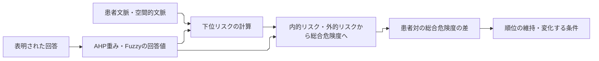

# 判断設定と文脈が順位へ作用する過程を、先行研究に照らして具体化する

## DeepResearchの要点を、まず短く説明する

DeepResearchが伝えているのは、AHP・Fuzzy・順位の感度分析には、既に研究の蓄積があるということです。今回問われるのは、**その手段を使って、何を新しく明らかにするか**です。

病棟・介護の研究も進んでいます。患者の動きに加え、スタッフの存在や距離を扱う研究があり、優先度付きの警報や患者別の設定もあります。そのため、「空間的文脈を入れた」「複数患者を監視した」「優先度を付けた」という説明だけでは、今回の貢献を十分に示せません。

ここから残る問いの候補は、例えば次のものです。

> 同じ判断設定でも、なぜ状況によって患者間の順位が変わるのか。逆に、違う回答をした人どうしでも順位が変わらないのはなぜか。その違いを、入力と計算の途中へ戻って説明できるか。

例えば、二人のスタッフが立ち上がり動作を重視する程度に違いがあっても、ある場面では順位が同じかもしれません。別の場面では、物体や見守り状況との組合せによって差が表れるかもしれません。研究として調べたいのは、この「差が表れる条件」と「差が吸収される条件」です。これは説明用の可能性で、今回のデータから既に確認した結果ではありません。

質問紙から得るのは、スタッフがその質問へ表明した判断の一部です。それを計算設定へ反映したことと、現場での本人判断を再現したことは分けます。DeepResearchは、この範囲を明確にすれば、本人との完全一致を主目的にしない研究にも意味がある、と整理しています。回答を残すことは、どの質問への回答差が、どの場面の順位差へ結び付いたかを調べる根拠になります。

DeepResearchは、この解析を研究課題として条件付きで有望と評価しています。PMも、前回の案C（判断知識の表現と作用を調べる方向）を具体化する第一候補として支持します。問いが明確になることと、新規性の充足は別です。近い応用研究と、判断・順位を扱う数理研究の双方へ、何が同じで、何を追加で明らかにするかを示す必要があります。

今回相談したいのは、この方向を論文の中心候補として具体化するかです。個別の実験条件の採否は、その後に分けて判断できます。

[提供されたDeepResearch](../reference/2026-10-26-deep-research-report.md)を要約したうえで、その助言を以下で検討します。今回は調査・議論と提案の整理までを行い、「投稿前に必須」「優先度と呼ぶべき」などの助言の採否は項目ごとに確認する扱いです。[前回報告006](2026-10-25-006-REQ-006-research-direction-discussion.md)はそのまま残し、追加の調査と議論を本書へまとめました。

## 1. 前回の提案は維持し、論文全体の説明を広げる

前回は、総合危険度へまとめる最後の計算に絞り、4回答を仮想的に変える案を示しました。これは、設定変更が何を動かすかを把握する着手点として維持します。元の回答を書き換えることや、得たい順位へ合わせ込むことはしません。

今回加わったのは、その局所的な点検を、論文全体の問いへどう結び付けるかという視点です。PMの提案は、次の範囲です。

> 患者文脈・空間的文脈と、質問紙で表明された判断設定が、患者間の総合危険度の差と順位にどう結び付くかを調べる。その関係が維持・変化する条件を、階層内の計算へ対応付けて説明する。

これなら、最小変更量は研究全体の目的というより、回答と出力の関係を調べる手段になります。「どれだけ変えると順位が変わるか」に、「なぜその回答が関わるのか」「同じ変更が別の場面へどう作用するか」を加えます。

| 前回からの扱い | 今回の整理 |
| --- | --- |
| 維持 | 本人の完全再現を主目的としない。実回答・AI補完・AI予行を区別する。総合4回答の点検は最初の確認にする |
| 補強 | 近い研究にも優先度付き警報や患者別設定があることを認め、入力・設定・出力・評価対象を具体的に比べる |
| 修正 | 「既存は検知まで、こちらは優先順位」という分け方を使わない。単一患者対の逆転可否だけを新規性にしない |
| 保留 | 出力の改名、共通設定との性能比較、Choquet等の追加実装、確率的な摂動実験、主要指標の変更 |

共通設定と個別設定の性能比較は、REQ-003で不採用とした記録を維持します。

## 2. 近い研究にも優先度と個別設定があり、比較の基準を具体化する必要がある

一次資料を確認した結果、DeepResearchが挙げる先行研究は、今回の説明に直接関わります。特にNahidらの研究では、警報の優先度と担当看護師を出し、同時の異常・通知の順序や遅延を扱っています。Danialらにも優先度を色で示す警報と、患者ごとの警報閾値の設定があります。[Nahidら（2025）](https://pmc.ncbi.nlm.nih.gov/articles/PMC12608296/)、[Danialら（2025）](https://doi.org/10.1186/s12984-025-01706-9)を参照してください。

従って、比較したいのは単に「順位を付ける機能があるか」ではありません。現在の候補は、質問への回答を判断設定として保持し、その設定と患者文脈・空間的文脈が、どの計算を通じて患者対の差へ作用するか、という説明対象です。

判断構造や、許容した設定の下で順位が保たれる性質（頑健性）にも、一般的な先行研究があります。Angilellaらは、評価項目の階層、項目間の相互作用、表明された選好、順位の頑健性を扱います。RibasとPérez-Díazには、AHP系の重みと二段階のFuzzy推論を組み合わせたリスク評価があります。これらとの重なりを認めたうえで、今回の見守り場面・回答の取得形式・解析が追加する内容を示す必要があります。[Angilellaら（2016）](https://doi.org/10.1016/j.omega.2015.10.010)、[Ribas・Pérez-Díaz（2019）](https://doi.org/10.1007/s12665-019-8526-3)。

| 比較する相手 | 今回と重なる点 | 先に明確にしたいこと |
| --- | --- | --- |
| 病棟・介護の警報研究 | 患者の行動、スタッフの存在・近接、優先度付き通知、患者別設定 | 警報の判断や担当割当と、全患者の相対スコア・順位の解析を、同じ問題として扱ってよいか |
| AHP系とFuzzyのリスク評価 | 重要度と条件別の統合、階層構造 | 質問の回答をどこへ入れ、何を表現し、どの解析結果を追加できるか |
| 階層・相互作用・頑健性を扱う意思決定手法 | 設定の違いや不確実性を含む順位の検討 | 今回の回答形式・入力・階層に必要な制約や、既存場面で新たに説明する関係が何か |

ここで確認できたのは、近い先行研究が存在し、比較すべき点が具体化したことです。「この組合せを解析した研究は世界にない」とは確認していません。資料の確認範囲は末尾へ記載します。

## 3. 総合危険度の意味を明確にし、用語の変更とは分ける

DeepResearchの「何を出力しているのかを明確にする」という指摘には賛成です。出力を何と呼ぶかは、スタッフ位置を入力に含めることだけでは決まりません。スタッフによる見守りを含めた状況の危険を、相対スコアとして表す設計も考えられるためです。

現在の原稿は、総合危険度を事故発生確率とは区別しています。またREQ-003では、順位の意味を「追加の見守りを優先すべき患者の順」として合意しています。PMは用語を維持し、現時点の説明を次のようにする案を提案します。

> 総合危険度は、患者文脈・空間的文脈と設定された判断基準に基づく相対スコアである。その順位を、追加の見守りを検討する順の候補として解釈する。

「誰を先に対応すべきか」には、使える人員や他の業務との調整も関わります。対応までの時間と、その対応によって何を改善できるかも考える必要があります。現モデルは患者ごとの総合危険度を計算して並べる構成で、これらを扱う担当割当の最適化までは行っていません。attention priorityと改名しても、その機能が加わるわけではありません。

この説明なら、何を計算しているかと、どのような見守り支援へ使いたいかを分けられます。原稿の総合危険度・内的リスク・外的リスクという用語を保って、この意味を明記する案です。

## 4. 「文脈への反応」と「判断設定への頑健性」を別々に調べる

「順位が安定していた」という結果は、それだけで良いモデルであることを示しません。順位が動かない理由が、患者間の差が大きいことなのか、入力の違いが途中で失われたことなのかを確かめる必要があります。

今回の解析では、何を固定し、何を変えたかを分ける案が有用です。

| 変えるもの | 固定するもの | 調べる問い |
| --- | --- | --- |
| 患者文脈・空間的文脈 | 同じ判断設定 | 状況のどの変化が、各患者の値・患者間の差へどう作用するか |
| 質問への回答・判断設定 | 同じ場面と患者集合 | どの回答の変更で順位が変わり、どの範囲なら維持されるか |

例えば、スタッフが動けば、複数患者との距離や方向が一緒に変わります。その場面全体の変化を扱う点検と、一つの局所統合器への入力値だけを独立に動かす点検は、別のものです。どちらも役立ちますが、同じ実場面の検証とは呼びません。

また、全患者の総合危険度が下がっても、下がり方が異なれば順位は変わります。「スタッフが近づいたから、その患者の順位が必ず下がるべき」とは決められません。総合危険度の変化と、患者間順位の変化を両方追います。

### ルール名を挙げるだけでなく、二人の差に何が加わったかを見る

現行の局所Fuzzy統合では、二入力がともに0より大きく1より小さいとき、四つのルールはすべて正の重みで関わります。「ある条件で初めて一つのルールがONになる」というより、**四つの回答を混ぜる割合が連続的に変わる**と説明する方が正確です。

患者対の順位を説明する場合も、最も強く発火したルールを挙げるだけでは不十分です。同じ回答値が、患者AとBでどれだけ異なる割合で加わったかを見ます。その差が、内的・外的リスクや上位の総合危険度の差へどうつながったかを追う案です。計算上の作用を説明するもので、人の心理や事故原因を特定する解析ではありません。

### DeepResearchの仮説は、結果を先取りしない問いへ直す

資料の「合理的に区別される」という仮説（H1）は、計算上区別できることより強い表現です。独立した妥当性の根拠がなければ、「入力や統合の違いによって、どの患者対の差が生まれるか」までに限定します。

「設定差が順位へ表れる条件を調べる」という問い（H2）は、今回の中心に据えやすい問いです。一方、「多くは安定し、少数の境界だけ敏感」という仮説（H3）の分布は、まだ測定していません。「安定性の異なる患者対があるか、その違いを入力と回答へ戻って説明できるか」と問い直す案にします。

連続な計算で同点から離れた順位なら、ごく小さな変更で順が保たれる範囲があるのは一般的な性質です。調べる意味があるのは、定義した回答変更の幅でどこまで維持されるか、どの回答に敏感か、他の患者対も同時にどう変わるかです。

## 5. 評価を一律に増やさず、裏付けたい主張ごとに選ぶ

DeepResearchは多くの評価候補を挙げています。PMは、その全項目を「投稿前の必須作業」として採用することは勧めません。主張したいことと、評価で変えるものが対応しているかを先に確認します。

| 主張候補 | 検討する確認 | そこからは結論しないこと |
| --- | --- | --- |
| 空間的文脈を入れることで計算がどう変わるか | 同じ場面・下位計算等の条件を明示し、入力の有無による作用を比較 | 患者情報のみのモデルとの差が、そのままFuzzyの効果であること |
| 条件の組合せを固定加算よりどう表すか | 同じ入力と尺度で加算との関係を比較し、四条件を同時に表せるか確認 | 異なる順位が出た方が、正しい順位であること |
| 表明された設定差が順位へどこで作用するか | 同じ患者集合へ来歴を確認した設定を適用し、患者対の差と境界を追う | 本人判断の再現や、個別化の優位 |
| 設定変更への敏感さを説明できるか | 許容する変更範囲、最小変更、複数患者対・場面への同時影響を確認 | 仮定した摂動が実際の回答誤差を表すこと |
| 計算が定めた性質を守るか | 単調性・同点・回答と適用箇所を点検 | 構造的な整合性が臨床的な妥当性を保証すること |

入力を増やす比較と、同じ入力をどう統合するかの比較は分けます。患者情報だけの加算と、空間的文脈も入れたFuzzyを比べると、入力と統合の両方が変わります。差が出ても、それだけではどちらの変更が関わったかを切り分けられません。

Kendall、Spearman、top-k一致などは、順位差を要約する候補です。使う場合は、どの二つの順位を比べたかを明記します。設定AとBのモデル順位の比較を、スタッフ本人とモデルの一致として報告しません。少数患者で同点もある場合には、患者対の入替え・同点と、総合危険度の差を直接見る案もあります。指標を何種類も並べるだけで、主張が強くなるわけではありません。

### 同型の式を残し、追加モデルは比較条件から考える

前回の「局所Fuzzyは、切片・加算・二入力の積を持つ式と同じ関数になる」という確認は維持します。この対照とは数値が一致するのが期待されます。Fuzzyだけに条件依存を表現できる、と主張しないための確認です。

追加モデルは、同じ入力と出力尺度、回答の対応をそろえて比べられるかを先に考えます。最初は明示した変更範囲で解析し、確率的な探索は必要に応じて検討する順序を提案します。実装の分岐、Choquetの尺度、探索割合の解釈は[技術補足](#技術補足)へ分けました。

## 6. 次の成果物は「先行研究との対応」と「場面・回答・順位差」をつなぐ

前回の総合4回答の点検は残します。各1〜5の整数回答で他の計算を固定すれば候補は最大625通りです。広い単調設定集合における単一対の逆転可否は、入力の大小関係から分かる範囲が多く、それ自体を新規成果にはしません。

今回、最初の成果物に加えたいのは次の対応です。

図は、論文全体で確認したい計算上の追跡対象を示す提案です。総合4回答だけの最初の点検で直接分かるのは、固定した下位入力に対する作用までです。下位の回答群を変えた影響が階層を通ってどう届くかは、別の段階で確かめます。事故や人の行動の因果図としては扱いません。指定のMermaid設定を維持していますが、実描画は未確認です。

例えば、元の回答と、仮想的に変えた回答を対にして記録します。そこへ、同じ場面の患者対の差と、別場面への影響を対応付けます。「この回答差はこの条件で順位へ届く」「別の条件では途中の値が同じになり差が届かない」と説明できるかを調べます。例の分類を事前に定め、都合のよい順位変化だけを選ばない方針は維持します。

この結果が、一般的な感度分析の適用を超える貢献になるかは未確定です。近い研究と重複しない解析上の制約・関係を具体化できない場合は、「独自の解析手法」という主張を縮め、知識取得と計算・点検の対応を示す設計研究としての位置付けも検討します。その場合も、対応付けたことを並べるだけでは十分とせず、既存設計に対して何を改善・解明したかを示す必要があります。新しい条件を結果に合わせて後付けして、見かけの独自性を作らないことも必要です。

### 今回、採用を相談したい範囲

PMの第一候補は、**質問紙で表明された判断設定と、患者文脈・空間的文脈が、患者間の総合危険度差と順位にどう結び付くかを明らかにする**方向です。前回の最小変更量は、その問いを調べる一手段とします。

次に進めるなら、まず近い先行研究との入力・設定・出力・評価対象の対応表を確かめ、既存場面の一つの設定で、回答から順位差までの追跡表を具体化する範囲を相談します。最初に相談する作業は、この対応表と一設定の追跡表までです。

まず、この問いを論文の中心候補として具体化する方向でよいか、ご意見を伺いたいです。

## 技術補足

### 入力を除く入口では、総合統合も変わる

既存実装の「患者文脈のみ」の入口は、総合危険度を内的リスクそのものにする分岐で、空間的文脈を除くと同時に総合統合も変わります。その入口と、空間的文脈を含む計算をそのまま比べた差を、空間的文脈の情報だけの効果とは解釈しません。未知の空間的文脈を0で埋めることも、低リスクという別の意味を与えるため、黙って行いません。

### Choquetの端点をそろえてから、比較する関係を決める

Choquet等を追加する場合は、同じ判断情報をそのモデルのどの設定へ写すか、入力と出力の尺度、比較する範囲を定める必要があります。現行Fuzzyでは低・低条件や高・高条件への回答値も設定できるのに対し、正規化Choquetは両端の出力を固定するので、そのままでは尺度の差まで混ざります。

まず「同じ四条件の回答を両者でどこまで共有できるか」という対応を紙上で整理する案を推します。そこから内部の補間の違いを調べるのか、全階層の代替を比べるのかを選びます。簡単な実装を一つ追加すれば十分、と今の段階で見積もることはしません。

### モンテカルロの割合を、実際の判断確率と混同しない

回答や設定をある分布で揺らし、首位となる頻度を数える解析は候補になります。得た頻度は、選んだ分布と許容範囲の下で得たものです。事故発生確率でも、スタッフが実際にその患者を選ぶ確率でもありません。

今回、回答誤差の分布は確かめていません。最初は、どの回答を何段階まで変えるかを明示した決定的な範囲で調べ、必要があれば確率的な探索を追加する順序を提案します。サンプルの大半で首位だったことを、すべての許容設定で首位であるという保証にも読み替えません。

## 根拠の扱いと今回の確認範囲

TSMC: Systemsの公式scopeは、問題の定式化、分析・モデリング、意思決定等を対象にしています。このscopeだけから、本研究に特定の指標一覧や競合モデル実装が必須と決まるわけではありません。DeepResearchの評価案は投稿規則と分け、主張との対応から選びます。採録水準や採録確率は今回判断していません。[公式scope](https://www.ieeesmc.org/publications/transactions-on-smc-systems/)を参照してください。

今回の原稿用語は[原稿v18](../paper/latest/paper_full_draft_v18.pdf)、順位の意味と比較の採否は[REQ-003](../requests/2026-10-17-001-REQ-003-evaluationDesign.md)、回答の来歴は[REQ-004](../requests/2026-10-18-001-REQ-004-additional-questionaire.md)に従いました。[前回報告006](2026-10-25-006-REQ-006-research-direction-discussion.md)の局所式・625候補・同型式の条件も維持します。

DeepResearchの引用IDは、このセッションで再検証可能な書誌情報として使っていません。主要な主張に関わる論文を、DOI・著者公開資料・公開本文から確認しました。全掲載文献を網羅的に読み直した調査ではありません。本文未取得の資料について、抄録に記載がないことから機能の不存在を断定しません。

[高瀬ら（2025）の公開本文](https://pmc.ncbi.nlm.nih.gov/articles/PMC12169716/)は、看護師の転倒リスク判断のばらつきと関連する条件を報告し、認知バイアス測定の信頼性等の限界も記載しています。判断が異なることは、どの個人設定もそのまま正しいことや、個別化すれば安全性が高まることの根拠にはなりません。今回、個別設定は、複数の表明された判断仮定を用いてモデルを調べるために扱う案です。

### 主な先行研究を、どこまで読み直したか

| 文献 | 今回の確認範囲 | 比較での留意点 |
| --- | --- | --- |
| [Nahidら2025](https://pmc.ncbi.nlm.nih.gov/articles/PMC12608296/) | PMC本文の方法・警報制御・評価。出版社へのアクセス制限を公開本文で補完 | 警報priorityと担当看護師の選択まであり、順位や割当がないとは扱わない |
| [Danialら2025](https://link.springer.com/article/10.1186/s12984-025-01706-9) | 出版社公開本文のシステム、患者別感度設定と評価 | 優先度付き警報と患者別設定を認める。スタッフ個人の質問紙設定とは区別する |
| [Ribas・Pérez-Díaz2019](https://link.springer.com/article/10.1007/s12665-019-8526-3) | 出版社の書誌・抄録。本文は未取得 | AHP系と多段Fuzzyの先例は確認。式・設問・順位分析の有無は断定しない |
| [Angilellaら2016](https://pure.port.ac.uk/ws/portalfiles/portal/3520792/GRECO_2015_cright_O_Robust_Ordinal_Regression_and_Stochastic_Multiobjective.pdf) | 著者稿の導入・階層と選好・頑健性の定式化 | 内部の階層や順位の頑健性まで重なり、今回との差は未確定 |
| [Triantaphyllou・Sánchez1997](https://www.csc.lsu.edu/trianta/Journal_PAPERS1/MCDM_SensitivityAnalysis_by_Triantaphyllou1.pdf) | 著者PDFの定義と最小変更解析 | 最小変更の概念自体を新規としない。対象モデル・変更尺度・制約は異なる |

元のDeepResearch資料の書誌・文章は変更していません。今回の原稿・実装照合は読取だけで、[総合危険度の分岐と入力](../master_thesis_modules/risk_core/engine/risk_engine.py)、[順位の生成](../master_thesis_modules/evaluation_study/additional_evaluation.py)、[Fuzzyの混合](../master_thesis_modules/risk_core/aggregators/fuzzy.py)を参照しました。

## 議論・修正・確認の記録

| ID | 発生日時 | 記録日時 | 担当・種別 | 対象版 | 論点と結果 |
| --- | --- | --- | --- | --- | --- |
| D-01 | 2026-10-26（依頼時刻未記録） | 2026-10-26T23:21:50+09:00 | PM→調査担当 / 依頼 | revision1 | 近接する応用・数理の主要文献と、DeepResearchの新規性主張の確認範囲を照会 |
| D-02 | 2026-10-26（依頼時刻未記録） | 2026-10-26T23:21:50+09:00 | PM→設計担当 / 依頼 | revision1 | 出力の意味、比較、頑健性、ルール発火と既存モデルの対応を照会 |
| A-01 | 2026-10-26（受信時刻未記録） | 2026-10-26T23:21:50+09:00 | 調査担当 / 初期見解 | revision1 | 既存にも優先度・患者別設定があり、検知と順位の二分を避ける必要がある |
| A-02 | 2026-10-26（送信時刻未記録） | 2026-10-26T23:21:50+09:00 | PM / 反論・再照会 | revision1 | 既存MCDAにも内部解析がある以上、問いが明確なことと新規性の充足を分ける。入出力・設定・説明対象の対応を先に確認する案を照会 |
| A-03 | 2026-10-26（受信時刻未記録） | 2026-10-26T23:21:50+09:00 | 設計担当 / 初期見解 | revision1 | スタッフ位置の入力だけで改名は必然でない。独立スコアの並替えと資源割当の最適化を区別 |
| A-04 | 2026-10-26（送信時刻未記録） | 2026-10-26T23:21:50+09:00 | PM / 再照会 | revision1 | 文脈への反応と設定への頑健性を分け、ルールがONになるという説明が現実装に合うか確認 |
| A-05 | 2026-10-26（受信時刻未記録） | 2026-10-26T23:21:50+09:00 | 設計担当 / 再検討 | revision1 | 四つの回答の混合割合を追う表現、患者対の差への寄与を提案。確率的割合は探索分布に依存すると限定 |
| H-01 | 2026-10-26T23:21:50+09:00 | 2026-10-26T23:21:50+09:00 | PM / 初稿 | revision1 | 原資料と前回報告を保持し、要旨・追加議論・採否候補を新規文書へ保存。研究方針の採用・実装・実験は行っていない |
| D-03 | 2026-10-26（依頼時刻未記録） | 2026-10-26T23:30:11+09:00 | PM→独立reviewer・校正2担当 / 依頼 | revision1 | 初稿を研究・構造、読みやすさ、議論メモの型から別々に確認。編集はPMへ集約 |
| R-01 | 2026-10-26T23:24:58+09:00 | 2026-10-26T23:30:11+09:00 | 独立reviewer / 指摘 | revision1 | 初稿に重大な誤りはなし。F10限定の範囲、設計研究でも必要な独自性、DRの肯定的見通しとPM判断の区別、二入力の内部条件を明記するよう指摘 |
| R-02 | 2026-10-26（受信時刻未記録） | 2026-10-26T23:30:11+09:00 | 校正2担当 / 指摘 | revision1 | 初稿は未採用の注意が重複し、技術詳細が本文を中断。案C・仮説の説明順、冒頭の判断事項と回答記録の価値も改善を提案 |
| H-02 | 2026-10-26（修正時刻未記録） | 2026-10-26T23:30:11+09:00 | PM / 修正 | revision1 | R-01/02を反映。技術補足を分離し、研究方向の判断を一つに整理。冒頭の長文と2か所の列挙を分割し、接続語の反復7か所も解消 |
| D-04 | 2026-10-26（再依頼時刻未記録） | 2026-10-26T23:30:11+09:00 | PM→上記3担当 / 再確認依頼 | revision1 | 修正版について前回指摘の反映と、残る必須修正の有無を照会 |
| V-01 | 2026-10-26T23:29:04+09:00 | 2026-10-26T23:30:11+09:00 | 独立reviewer / 再確認 | revision1 | 4指摘の反映を確認し、重大な研究解釈・事実・承認範囲の問題は検出せず。読取のみ、外部一次資料の独立再取得や実験は未実施 |
| V-02 | 2026-10-26T23:29:09+09:00 | 2026-10-26T23:30:11+09:00 | 読みやすさ担当 / 再確認 | revision1 | 必須修正なし。6軸は94・92・94・95・95・94、平均94.0。主観的な文章評価で、研究の妥当性や新規性の測定ではない |
| V-03 | 2026-10-26T23:29:16+09:00 | 2026-10-26T23:30:11+09:00 | メモ型担当 / 再確認 | revision1 | 冒頭説明・判断事項・前回から深めた点・未決の区別を確認。必須修正なし |
| H-03 | 2026-10-26T23:30:11+09:00 | 2026-10-26T23:30:11+09:00 | PM / 統合・保存 | revision1 | 再確認後、結びの重複表現のみ微修正。要求書へR-05/06の成果を反映。研究方針の採用・新規実装・実験は行っていない |

### 校正と検証の判断

natural-japaneseのフル手順で、lint・読みやすさ検査・見出しと段落冒頭の抽出・用語抽出、上記3担当の確認を実施しました。最終の数値評価は文章に関する主観評価です。

| 指摘 | 判断と結果 |
| --- | --- |
| 冒頭の104字の一文 | 二文へ分け、既存手段と新しく問う内容を区別。修正済み |
| 「ただし」で始まる7文 | 各文の役割に沿って直接記述へ変更。7か所すべて修正済み |
| 人員・時間等の列挙、回答・場面等の列挙 | 各段落で二文へ分け、関係を明記。2か所とも修正済み |
| 語彙多様性の参考警告 | 残す。同じ概念の用語を維持するため、総合危険度・回答・順位等を機械的に言い換えない |
| 要求書の原文にある長文3件 | 残す。ユーザー原文を保持するため、校正で書き換えない |
| 本文の技術詳細と注意事項の重複 | 技術補足への分離と重複整理を実施。再確認で必須修正なし |

コード版は `78378dcb194de4721d34aba0a555efdb35e5da80`。実装と既存成果の照合は読取のみです。今回、新しい研究実験や数値評価は行っていません。原資料・前回報告・ユーザー原文の保持、ローカル参照先の存在、Mermaid指定設定はPMが点検しました。実描画と新規性の充足は未確認です。
